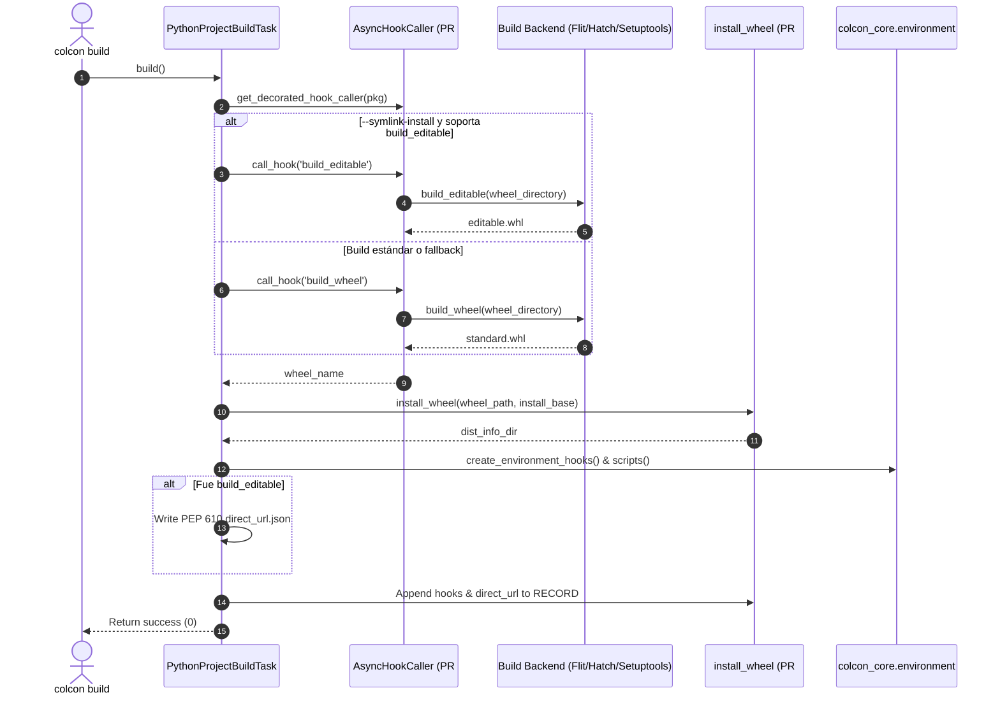

# Software Engineering Analysis: Branch `cottsay/pep621`

**Document Location**: `docs/analysis/colcon/colcon-core/branch/cottsay/pep621/swe_analysis.md`  
**Target Repository**: `colcon/colcon-core`  
**Target Branch**: `origin/cottsay/pep621`  
**Evaluated Commit**: `80acf29` (*"WIP: Add support for PEP 621 projects"*)  
**Author**: Scott K Logan (`cottsay`)  
**Status**: **Branch in Active Development (Work In Progress)**  
**Target Modules**:
- `colcon_core/package_identification/pep621.py`
- `colcon_core/package_augmentation/pep621.py`
- `colcon_core/python_project/metadata.py`
- `colcon_core/task/python_project/__init__.py`
- `colcon_core/task/python_project/build.py`
- `setup.cfg`
- `test/test_package_identification_pep621.py`
- `test/test_package_augmentation_pep621.py`
- `test/test_task_python_project_build.py`

---

## 1. Resumen Ejecutivo (Nivel Manager / Leadership)

* **Problema de Negocio / Técnico**:
  Con la incorporación del motor de ruedas (`wheel.py` en PR #741), `colcon-core` adquirió la capacidad de instalar y desinstalar archivos `.whl`. Sin embargo, el pipeline central de `colcon-core` aún carecía de la integración nativa para descubrir paquetes Python estándar definidos mediante `pyproject.toml` (PEP 621), mapear sus dependencias (`[project.dependencies]`) y ejecutar la compilación llamando a los backends de build estándar (Flit, Hatchling, Setuptools).
* **Solución Propuesta en la Rama**:
  La rama `cottsay/pep621` de Scott Logan implementa el circuito completo end-to-end:
  1. Identificación declarativa de paquetes mediante `pyproject.toml` asignando el tipo `python.project`.
  2. Aumento y resolución estática de dependencias de build, run y test.
  3. Tarea de compilación `PythonProjectBuildTask` que orquesta la invocación del hook `build_wheel` (o `build_editable`) mediante `AsyncHookCaller` y delega la instalación en `install_wheel`.
* **Impacto y ROI**:
  - Habilita soporte nativo para proyectos Python modernos sin requerir `setup.py` ni extensiones externas.
  - Previene la rotura de builds en plataformas modernas (Ubuntu 24.04+, Debian 13, Python 3.12+).
  - Unifica el ecosistema permitiendo que herramientas como Flit, Hatchling y Setuptools convivan bajo una misma abstracción.
* **Evaluación de Riesgo y Retrocompatibilidad**:
  Cero riesgo de regresión para workspaces legados. La identificación PEP 621 se configura con `PRIORITY = 90`, mientras que la identificación clásica basada en `setup.cfg`/`setup.py` opera con `PRIORITY = 100`. Si un paquete contiene `setup.py`, el pipeline clásico mantiene el control absoluto.

---

## 2. Definición de Veredicto y Criterio de Madurez

### Dictamen: **PEDIR CAMBIOS (Changes Requested / In Progress)**

* **Lista de Verificación de Criterios**:
  - [x] **Arquitectura y Diseño**: Excelente diseño modular, aprovechando limpiamente los puntos de extensión de `colcon-core`.
  - [x] **Retrocompatibilidad**: Rigurosamente protegida mediante la prioridad de extensiones (100 vs 90).
  - [x] **Identificación y Aumento**: Tests unitarios aprobados al 100% (`test_package_identification_pep621.py` y `test_package_augmentation_pep621.py`).
  - [ ] **Suite de Tests de Build Task (Bloqueante para Merge)**: `test/test_task_python_project_build.py` utiliza `@pytest.mark.asyncio`, lo que provoca error en el harness estándar de `colcon-core` (que no incluye `pytest-asyncio` en sus dependencias de test).
  - [ ] **Validación con Paquetes Reales**: Requiere comprobación end-to-end con backends reales (`flit_core`, `hatchling`).

* **Justificación del Veredicto y Cambios Mandatorios**:
  La rama implementa la arquitectura correcta y el código de producción está listo. Sin embargo, no puede abrirse un PR listo para merge hasta subsanar la falla en los tests:
  1. **Mandatorio**: Reemplazar `@pytest.mark.asyncio` en `test_task_python_project_build.py` por el helper canónico del proyecto `from .run_until_complete import run_until_complete`.
  2. **Recomendado**: Validar builds reales con un paquete mínimo de ejemplo en un workspace de prueba.

---

## 3. Glosario de Estándares y Definiciones Clave

| Estándar / Componente | Definición y Rol en la Rama |
| :--- | :--- |
| **PEP 621** | Estándar de especificación estática de metadata en `pyproject.toml` bajo `[project]`. |
| **PEP 517 / 518** | Especificación de backends de build (`[build-system.requires]`) e invocación de hooks en subproceso aislado. |
| **PEP 660** | Especificación para la compilación de ruedas editables (`build_editable`). |
| **PEP 610** | Registro del origen de instalaciones editables mediante `.dist-info/direct_url.json` (`{"dir_info": {"editable": true}}`). |
| **`python.project`** | Nuevo identificador de tipo de paquete asignado por `PEP621PackageIdentification` para desacoplarlo del tipo legacy `python`. |
| **`PythonProjectBuildTask`** | Implementación de `TaskExtensionPoint` que orquesta la compilación e instalación para paquetes `python.project`. |

---

## 4. Deep Dive de Software Engineering y Arquitectura

### 4.1 Diagrama de Secuencia del Build Task PEP 621



### 4.2 Patrones de Diseño Aplicados
1. **Extension Point Pattern (Open/Closed Principle)**:
   - Registro en `setup.cfg`:
     - `colcon_core.package_identification = pep621 = colcon_core.package_identification.pep621:PEP621PackageIdentification`
     - `colcon_core.package_augmentation = pep621 = colcon_core.package_augmentation.pep621:PEP621PackageAugmentation`
     - `colcon_core.task.build = python.project = colcon_core.task.python_project.build:PythonProjectBuildTask`
2. **Priority Ladder**:
   - `PEP621PackageIdentification.PRIORITY = 90` vs legacy `100`. Resuelve la coexistencia sin ambigüedades.
3. **Graceful Fallback**:
   - Si se solicita `--symlink-install` pero el backend no implementa `build_editable`, no se aborta el build: se advierte al usuario y se compila como wheel regular.

---

## 5. Pasos de Implementación y "Gotchas"

### Gotchas Técnicos Detectados
* **Gotcha 1 (Incompatibilidad en Test Runner)**:
  `colcon-core` estandariza todas sus pruebas asíncronas en `from .run_until_complete import run_until_complete` para evitar dependencias en `pytest-asyncio`. La rama usó `@pytest.mark.asyncio`, lo que genera fallo de importación durante la recolección de pruebas en entornos limpios.
* **Gotcha 2 (Archivos de datos en ROS bajo PEP 660)**:
  PEP 660 solo contempla la editabilidad de código Python (`.pth`). Los archivos estáticos (`launch/`, `urdf/`) son copiados directamente al wheel ZIP por el backend. Los cambios posteriores en el directorio fuente no se reflejan automáticamente en `install/share/` hasta la próxima compilación.

---

## 6. Plan de Testing y Estado de Verificación

### Estado de Tests en la Rama
```bash
# Tests de identificación y aumento (Aprobados):
pytest submodules/colcon-core/test/test_package_identification_pep621.py    # 2 PASSED
pytest submodules/colcon-core/test/test_package_augmentation_pep621.py        # 4 PASSED

# Tests de build task (Requieren corrección de runner):
pytest submodules/colcon-core/test/test_task_python_project_build.py          # 3 FAILED (por @pytest.mark.asyncio)
```

### Corrección Requerida:
```python
# En submodules/colcon-core/test/test_task_python_project_build.py
from .run_until_complete import run_until_complete

def test_build_task(tmp_path):
    ...
    result = run_until_complete(task.build())
    assert result is None
```

---

## 7. Conclusiones y Próximos Pasos

1. Crear rama de seguimiento en `submodules/kmom88-colcon-core` basada en `upstream/cottsay/pep621`.
2. Aplicar el reemplazo de `@pytest.mark.asyncio` por `run_until_complete`.
3. Validar la suite completa con el entorno virtual (`.venv`) y verificar con `flake8`.
4. Presentar el fix a Scott Logan para finalizar y mergear la rama hacia `master`.
