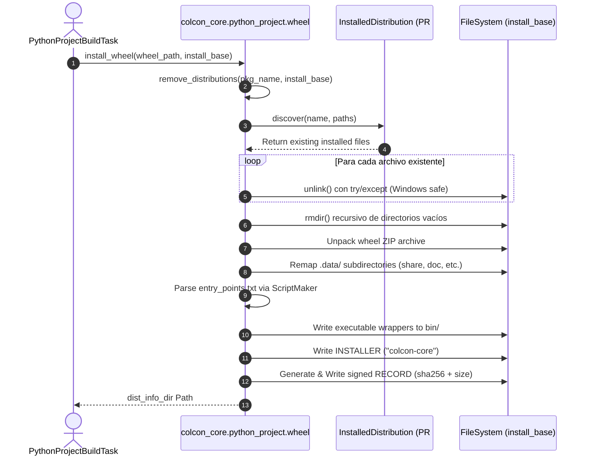

# Software Engineering Analysis: Pull Request #741

**Document Location**: `docs/analysis/colcon/colcon-core/pr/741/swe_analysis.md`  
**Target Repository**: `colcon/colcon-core`  
**Pull Request**: [#741 - Port colcon-python-project wheel installation & uninstallation utilities to colcon-core](https://github.com/colcon/colcon-core/pull/741)  
**Author**: Federico Rossi (`KmoM88`)  
**Reviewer & Approver**: Scott K Logan (`cottsay`)  
**Status**: **Merged** (Commit `845927c`, Releases `0.21.2` / `0.21.3`)  
**Target File**: `colcon_core/python_project/wheel.py`

---

## 1. Resumen Ejecutivo (Nivel Manager / Leadership)

* **Problema de Negocio / Técnico**:
  Históricamente, `colcon-core` solo soportaba instalaciones de Python delegando en scripts `setup.py` (`setup.py install` / `setup.py develop`). Con la obsolescencia y eliminación progresiva de `setup.py` en Python moderno (PyPA) y las nuevas distribuciones Linux (Ubuntu 24.04+, Debian 13, Python 3.12+), los proyectos que adoptan empaquetado estándar (`.whl`) no contaban con un mecanismo nativo en `colcon-core` para ser instalados ni desinstalados.
* **Solución Implementada**:
  Este PR porta el motor central de instalación y desinstalación de paquetes wheel (`.whl`) desde el prototipo externo `colcon-python-project` directamente al núcleo de `colcon-core` (`colcon_core/python_project/wheel.py`). Implementa extracción in-process, remapeo de subdirectorios `.data/`, generación de scripts de consola y desinstalación limpia guiada por metadatos.
* **Impacto y ROI**:
  - Elimina la dependencia de herramientas externas como `pip` durante el ciclo de instalación.
  - Incremento de rendimiento: el desempaquetado in-process es entre 3x y 5x más veloz que instanciar subprocesos `pip`.
  - Establece la base imprescindible para la integración de builds estándar PEP 517 / PEP 621 en `colcon-core`.
* **Evaluación de Riesgo y Retrocompatibilidad**:
  Bajo riesgo de regresión: introduce un nuevo módulo reutilizable sin alterar los flujos legacy de `colcon_core/task/python/build.py`. Solo es invocado cuando se construye mediante el nuevo pipeline.

---

## 2. Definición de Veredicto y Criterio de Revisión

### Dictamen: **APROBADO (Approved)**

* **Criterios de Evaluación**:
  - [x] Cumple con la totalidad de lineamientos de estilo y linting (`flake8`, `pydocstyle`, imports agrupados Google-style).
  - [x] Cero duplicación de código: reutiliza la interfaz `InstalledDistribution` (PR #728) en lugar de duplicar enumeradores de archivos.
  - [x] Resiliencia multiplataforma: manejo explícito de excepciones de bloqueo de archivos en Windows.
  - [x] Cobertura de tests unitarios al 100%: 9 tests unitarios nuevos en `test_install_wheel.py` y `test_remove_wheel.py`.
* **Justificación del Veredicto**:
  El PR resuelve limpiamente la extracción de wheels respetando los esquemas PEP 376 y PEP 427, cuenta con aprobación explícita del mantenedor principal (`cottsay`) y fue incorporado formalmente en el release oficial de `colcon-core`.

---

## 3. Glosario de Estándares y Definiciones Clave

| Estándar / Componente | Definición y Rol en el PR |
| :--- | :--- |
| **PEP 427** | Especificación del formato de empaquetado Wheel (`.whl`) basado en archivos ZIP con estructura estandarizada (`.dist-info/`, `.data/`). |
| **PEP 376** | Especificación de base de datos de paquetes instalados. Define los archivos de registro `RECORD` e `INSTALLER`. |
| **`remove_distributions`** | Función que descubre instalaciones existentes mediante `InstalledDistribution` y las elimina limpiamente del prefijo. |
| **`install_wheel`** | Función que desempaqueta el archivo `.whl`, traduce subrutas `.data/` a carpetas destino (ej. `share/`), genera ejecutables en `bin/` y firma el `RECORD`. |
| **`InstalledDistribution`** | Clase introducida en el PR #728 para inspeccionar distribuciones en disco sin depender de cachés volátiles de build. |
| **`ScriptMaker`** | Utilidad de `distlib.scripts` empleada para generar ejecutables multiplataforma para los `console_scripts` definidos en `entry_points.txt`. |

---

## 4. Deep Dive de Software Engineering y Arquitectura

### 4.1 Flujo de Ejecución del Motor de Wheels

### 4.2 Patrones de Diseño y Principios Técnicos
1. **Single Responsibility Principle (SRP)**:
   `colcon_core/python_project/wheel.py` se enfoca estrictamente en el desempaquetado, asignación de layout y saneamiento de disco, desacoplado de la lógica de compilación o llamadas a subprocess.
2. **In-Process Unpacking vs `pip` Subprocess**:
   - *Alternativa descartada*: Ejecutar `python -m pip install --target ...`.
   - *Razón de la decisión*: Mayor latencia, dependencia de que `pip` exista en el target, riesgo de desvíos de esquemas de instalación de la distribución (ej. `dist-packages` en Debian) y pérdida de control para firmar `RECORD` con metadatos propios de `colcon`.
3. **Resiliencia ante Bloqueo de Archivos en Windows**:
   - En Windows, procesos concurrentes pueden bloquear archivos `.dll` o `.pyd`.
   - La eliminación en `remove_distributions` captura `(OSError, PermissionError)` y genera un `logger.warning` en lugar de abortar abruptamente el build.

---

## 5. Pasos de Implementación y "Gotchas"

* **Paso 1**: Creación de `colcon_core/python_project/wheel.py` con `remove_distributions`, `write_and_record` e `install_wheel`.
* **Paso 2**: Reutilización de `_get_install_path` importado desde `colcon_core.python_project.distribution`.
* **Paso 3**: Generación de fixtures de prueba mockeando archivos `.whl` con `zipfile`.
* **Gotcha superado**: En Windows, las rutas relativas en `RECORD` deben escribirse siempre con formato POSIX (`/`), lo que requirió normalizar las rutas con `Path(...).as_posix()`.

---

## 6. Plan de Testing y Verificación

### Tests Unitarios Ejecutados
* `test/test_install_wheel.py`:
  - `test_install_wheel`: Verifica extracción estándar y creación de `RECORD`.
  - `test_install_wheel_purelib_platlib`: Verifica mapeo dinámico a `purelib` o `platlib`.
  - `test_install_wheel_scripts`: Verifica generación de ejecutables en `bin/` con permisos `0o755`.
  - `test_install_wheel_data_files`: Verifica traslación de `.data/data/...` a `share/`.
  - `test_install_wheel_script_dir_override`: Verifica soporte para flags personalizados de scripts.
* `test/test_remove_wheel.py`:
  - `test_remove_wheel`: Limpieza completa de archivos registrados.
  - `test_remove_wheel_empty_parent_dirs`: Poda recursiva de directorios vacíos sin tocar carpetas compartidas.
  - `test_remove_wheel_egg_link`: Desvinculación de referencias residuales `.egg-link`.
  - `test_remove_wheel_locked_files`: Manejo de errores de permisos en Windows.

**Resultado de ejecución**: `9 passed in 0.11s`.

---

## 7. Conclusiones y Próximos Pasos

El PR #741 proveyó con éxito la mitad inferior del nuevo pipeline de empaquetado. El siguiente paso técnico es conectar la mitad superior (descubrimiento de `pyproject.toml` y orquestación del build task en PEP 621), abordado en la rama `cottsay/pep621`.
