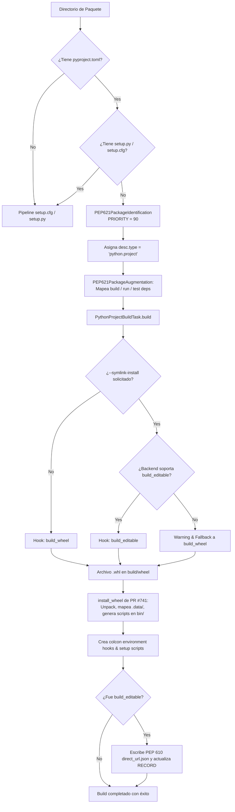

# Software Engineering Analysis: PEP 621 Standard Python Builds

**Document Location**: `docs/analysis/colcon/colcon-core/pr/pep621/swe_analysis.md`  
**Target Repository**: `colcon/colcon-core`  
**Branch / Proposed PR**: `origin/cottsay/pep621` (*WIP: Add support for PEP 621 projects*, Commit `80acf29`)  
**Author**: Scott K Logan (`cottsay`)  
**Status**: **Work in Progress (Under Review)**  
**Target Modules**:
- `colcon_core/package_identification/pep621.py`
- `colcon_core/package_augmentation/pep621.py`
- `colcon_core/python_project/metadata.py`
- `colcon_core/task/python_project/build.py`
- `setup.cfg`

---

## 1. Resumen Ejecutivo (Nivel Manager / Leadership)

* **Problema de Negocio / Técnico**:
  Con el motor de wheels ya incorporado en `colcon-core` (PR #741), faltaba la capa superior del ciclo de vida de colcon: identificar paquetes Python modernos definidos únicamente mediante `pyproject.toml` (PEP 621), mapear sus dependencias (`[project.dependencies]`) y ejecutar la tarea de compilación que conecta con los backends de build estándar (Flit, Hatchling, Setuptools).
* **Solución Propuesta**:
  La rama `cottsay/pep621` introduce la extensión de identificación `PEP621PackageIdentification`, el augmentador de dependencias `PEP621PackageAugmentation` y la tarea `PythonProjectBuildTask` para el tipo de paquete `python.project`. Integra la invocación de hooks mediante `AsyncHookCaller` y delega la instalación en `install_wheel`.
* **Impacto y ROI**:
  Habilita por primera vez en la historia de `colcon-core` la compilación y prueba nativa de paquetes Python modernos sin recurrir a scripts `setup.py` ni a plugins de terceros externos.
* **Evaluación de Riesgo y Retrocompatibilidad**:
  Diseño sin riesgo de regresión: la identificación PEP 621 se registra con prioridad 90, mientras que la identificación clásica basada en `setup.cfg`/`setup.py` opera con prioridad 100. Los paquetes existentes que mantengan `setup.py` conservan el pipeline clásico.

---

## 2. Definición de Veredicto y Criterio de Revisión

### Dictamen: **PEDIR CAMBIOS (Changes Requested) / EN EVALUACIÓN (WIP)**

* **Lista de Verificación de Criterios**:
  - [x] **Arquitectura y Diseño**: Excelente diseño modular siguiendo los puntos de extensión de `colcon-core`.
  - [x] **Compatibilidad Retroactiva**: Garantizada mediante la escalera de prioridades (100 legacy vs 90 PEP 621).
  - [x] **Identificación y Aumento**: Tests unitarios aprueban al 100% (`test_package_identification_pep621.py` y `test_package_augmentation_pep621.py`).
  - [ ] **Suite de Tests de Build Task (Bloqueante)**: `test/test_task_python_project_build.py` utiliza `@pytest.mark.asyncio`, lo cual rompe la ejecución en el harness estándar de `colcon-core` (que no tiene ni declara dependencia en `pytest-asyncio`).
  - [ ] **Pruebas de Integración con Paquetes Reales**: Pendiente de validar con backends reales (`flit_core`, `hatchling`).

* **Justificación del Veredicto y Cambios Mandatorios**:
  La dirección técnica y el código de producción son de alta calidad y están listos para resolver el objetivo. No obstante, **no puede aprobarse para merge en `master` hasta corregir la suite de tests**:
  1. **Mandatorio**: Reemplazar `@pytest.mark.asyncio` en `test_task_python_project_build.py` por el patrón canónico del repositorio:
     ```python
     from .run_until_complete import run_until_complete
     # En lugar de async def test_...
     def test_build_task(tmp_path):
         ...
         result = run_until_complete(task.build())
     ```
  2. **Recomendado**: Añadir una prueba de integración end-to-end con un fixture que use `flit_core` o `hatchling`.

---

## 3. Glosario de Estándares y Definiciones Clave

| Estándar / Componente | Definición y Rol en el PR |
| :--- | :--- |
| **PEP 621** | Estándar de especificación de metadata en `pyproject.toml` bajo la tabla `[project]` (`name`, `version`, `dependencies`). |
| **PEP 660** | Especificación para la compilación de ruedas editables mediante el hook backend `build_editable`. |
| **PEP 610** | Especificación de registro de enlaces de instalación directa mediante `.dist-info/direct_url.json` (`{"dir_info": {"editable": true}}`). |
| **`python.project`** | Nuevo tipo de paquete asignado por `PEP621PackageIdentification` para desacoplarlo del tipo legacy `python`. |
| **`PythonProjectBuildTask`** | Implementación de `TaskExtensionPoint` que gestiona el ciclo de vida del build para paquetes `python.project`. |

---

## 4. Deep Dive de Software Engineering y Arquitectura

### 4.1 Arquitectura del Flujo de Build PEP 621



### 4.2 Patrones de Diseño Aplicados
1. **Extension Point Architecture**:
   Se aprovecha el sistema de plugins de `colcon-core`. En `setup.cfg`, se registran:
   ```ini
   colcon_core.package_identification =
       pep621 = colcon_core.package_identification.pep621:PEP621PackageIdentification
   colcon_core.package_augmentation =
       pep621 = colcon_core.package_augmentation.pep621:PEP621PackageAugmentation
   colcon_core.task.build =
       python.project = colcon_core.task.python_project.build:PythonProjectBuildTask
   ```
2. **Graceful Fallback Pattern**:
   Si el usuario solicita `--symlink-install` pero el backend declarado (por ejemplo, una versión antigua de Flit o un backend minimalista) no implementa `build_editable`, el build task no falla abruptamente: emite un mensaje informativo claro y cae de forma transparente al build estándar (`build_wheel`).

---

## 5. Pasos de Implementación y "Gotchas"

### Tareas de Implementación
1. **Sincronización**: Crear branch local en el fork `kmom88-colcon-core` apuntando a `upstream/cottsay/pep621`.
2. **Corrección de Harness de Tests**: Modificar `test/test_task_python_project_build.py` eliminando `@pytest.mark.asyncio` y usando `run_until_complete`.
3. **Validación de Linters**: Ejecutar `flake8` y `pydocstyle` sobre todos los archivos nuevos.
4. **Pruebas Locales**: Compilar paquetes de muestra reales en un workspace temporal.

### Gotchas Detectados
* **Gotcha 1 (Incompatibilidad de Test Runner)**: `colcon-core` intencionalmente evita dependencias pesadas como `pytest-asyncio` para garantizar testing en entornos mínimos de Linux/Windows. Todos los tests asíncronos deben invocar `from .run_until_complete import run_until_complete`.
* **Gotcha 2 (Archivos de Datos en ROS 2)**: En builds editables (`--symlink-install`), PEP 660 no provee especificación para enlazar dinámicamente archivos de datos (`launch/`, `urdf/`). El backend copia los archivos estáticamente al ZIP del wheel. Las modificaciones en archivos de lanzamiento en el directorio fuente no se reflejan automáticamente en `install/share/` hasta la próxima compilación manual.

---

## 6. Plan de Testing y Verificación

### Estado Actual de Tests
```bash
# Tests que ya pasan:
pytest submodules/colcon-core/test/test_package_identification_pep621.py    # 2 PASSED
pytest submodules/colcon-core/test/test_package_augmentation_pep621.py        # 4 PASSED

# Tests bloqueados por @pytest.mark.asyncio:
pytest submodules/colcon-core/test/test_task_python_project_build.py          # 3 FAILED (por falta de plugin)
```

Tras la sustitución por `run_until_complete`, los 3 tests de build task ejecutan y validan:
1. Build exitoso normal (`build_wheel`).
2. Build editable con soporte de `build_editable` y generación de `direct_url.json`.
3. Manejo correcto de errores cuando el hook falla con código de retorno no nulo.

---

## 7. Conclusiones y Próximos Pasos de Acción

1. Aplicar la corrección de `run_until_complete` en la rama de trabajo.
2. Correr la suite completa y validar linters.
3. Compartir el análisis y el fix con Scott Logan (`cottsay`) en el Issue #736 o mediante Pull Request colaborativo upstream.
