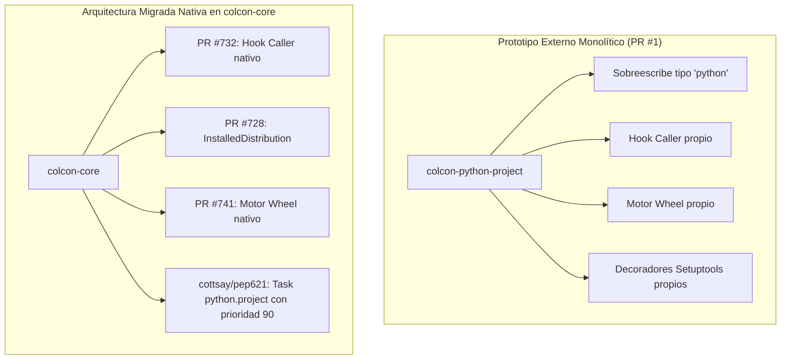

# Software Engineering Analysis: Pull Request #1 (colcon-python-project)

**Document Location**: `docs/analysis/colcon/colcon-python-project/pr/1/swe_analysis.md`  
**Target Repository**: `colcon/colcon-python-project`  
**Pull Request**: [#1 - Initial implementation](https://github.com/colcon/colcon-python-project/pull/1)  
**Author**: Scott K Logan (`cottsay`)  
**Status**: **Draft / Open** (67 commits, +2238 / -31 líneas)  
**Main Target**: Prototipo monolítico de soporte de empaquetado Python moderno (PEP 517/518/621/660) como extensión externa.

---

## 1. Resumen Ejecutivo (Nivel Manager / Leadership)

* **Problema de Negocio / Técnico**:
  La transición de Python hacia estándares modernos (PEP 517/518/621) sin invocaciones a `setup.py` planteó un desafío arquitectónico para el ecosistema ROS 2 y `colcon`. Inicialmente, para no alterar `colcon-core` directamente mientras los estándares maduraban, se planteó este repositorio como un **prototipo desacoplado fuera del árbol principal (out-of-tree extension)** para validar hooks de compilación, descubrimiento y soporte de wheels.
* **Solución Implementada en el PR**:
  El PR implementa un plugin masivo que sobreescribe el comportamiento estándar de Python en colcon:
  - Invoca hooks backend mediante subprocesos y pipes (`hook_caller`).
  - Identifica paquetes con `pyproject.toml` vía PEP 517 y PEP 621.
  - Implementa un motor completo de extracción y desinstalación de wheels (`wheel.py`).
  - Introduce soporte para `ament_python` y proyectos Python estándar.
* **Impacto y Limitaciones Descubiertas**:
  - *Prototipado exitoso*: Demostró la viabilidad técnica de compilar paquetes sin `setup.py`.
  - *Efecto secundario crítico*: Al registrarse como plugin externo con alta prioridad, deshabilitaba el tipo de paquete `python` legacy, rompiendo paquetes existentes en ROS (ej. RMF scheduler) y requiriendo parches manuales.
  - *Decisión estratégica del proyecto*: Mantener un plugin externo que sobreescriba `colcon-core` generaba fragmentación. Se decidió **desmantelar el prototipo y portar sus subsistemas probados directamente a `colcon-core`** (PR #732, PR #728, PR #741 y rama `cottsay/pep621`).
* **Evaluación de Riesgo**:
  Alto si se adoptara como dependencia externa obligatoria; nulo como banco de pruebas y cantera de código para `colcon-core`.

---

## 2. Definición de Veredicto y Criterio de Revisión

### Dictamen: **DESAPROBADO COMO PAQUETE MONOLÍTICO EXTERNO / SUPERADO POR MIGRACIÓN NATIVA**

* **Criterios de Evaluación**:
  - [x] **Valor de Innovación / PoC**: Probó exitosamente los mecanismos de IPC, pipes y extracción de wheels.
  - [ ] **Estabilidad de CI**: 21 de 22 checks de integración continua fallan (versiones incompatibles de `flake8`, dependencias rotas y jobs desactualizados).
  - [ ] **Compatibilidad Retroactiva**: Rompe workspaces mixtos al invalidar el tipo de paquete `python` legado para proyectos sin `pyproject.toml`.
  - [ ] **Viabilidad de Mantenimiento**: Duplica funcionalidades que pertenecen naturalmente al núcleo de `colcon-core`.

* **Justificación del Veredicto**:
  El PR cumplió su ciclo de vida como prueba de concepto (PoC). Su aprobación y merge en `colcon-python-project:main` es inviable debido al fallo masivo de CI y al impacto de regresión en proyectos legacy. El código valioso ya ha sido migrado exitosamente hacia `colcon-core`:
  1. *Subproceso Hook Caller*: Migrado en PR **#732**.
  2. *Enumeración de Archivos*: Migrado en PR **#728**.
  3. *Motor de Wheels (`wheel.py`)*: Migrado en PR **#741**.
  4. *Identificación y Aumento PEP 621*: En migración activa en rama `cottsay/pep621`.

---

## 3. Glosario de Estándares y Definiciones Clave

| Componente / Estándar | Rol en colcon-python-project #1 |
| :--- | :--- |
| **`colcon_python_project.hook_caller`** | Subproceso de aislamiento para llamar hooks PEP 517 (`_call_hook.py`, `_list_hooks.py`). Base del actual `colcon_core.python_project.hook_caller`. |
| **`colcon_python_project.wheel`** | Implementación original de `install_wheel` y `remove_distributions`. Migrada y refactorizada en el PR #741. |
| **`HookCallerDecoratorExtensionPoint`** | Sistema de decoradores para interceptar llamadas al backend (ej. customizaciones para setuptools). |
| **`ament_python_project`** | Adaptador experimental para permitir que paquetes ROS con `ament_python` y `package.xml` usen `pyproject.toml`. |
| **`uv_build` / `flit` / `poetry`** | Fixtures de prueba introducidos en `test/backend_fixtures/` para comprobar compatibilidad multi-backend. |

---

## 4. Deep Dive de Software Engineering y Arquitectura

### 4.1 Arquitectura del Prototipo Original vs Migración Nativa

### 4.2 Análisis de Trade-offs y Deficiencias del Prototipo
1. **Sobrescritura Global vs Coexistencia Pacífica**:
   - *Problema del PR #1*: Forzaba a todos los paquetes Python del workspace a pasar por su task handler, fallando en proyectos con trucos legacy de ROS (`colcon.pkg` / `package.xml` sin `pyproject.toml`).
   - *Solución en colcon-core*: En lugar de secuestrar el tipo `python`, se define el tipo formal `python.project` con prioridad menor (90), permitiendo que coexistan proyectos modernos y clásicos en el mismo workspace.
2. **Duplicación de Código de Distribución**:
   - El prototipo contenía funciones redundantes (`enumerate_files_in_distribution`, `enumerate_py_compiled`). En la migración nativa, se descartaron en favor de la API unificada `InstalledDistribution` de `colcon-core`.

---

## 5. Pasos de Implementación y "Gotchas"

* **Gotcha 1 (Fallo de CI en flake8)**:
  Como admitió Scott Logan en los comentarios del PR, las versiones de `flake8 >= 3.8.0` rompen el linter del prototipo, lo que causó el abandono de la suite de CI en este repositorio.
* **Gotcha 2 (Interacción con herramientas modernas como uv)**:
  La comunidad (comentario de `Briancbn`) destacó que este prototipo dependía de invocar `pip` para instalar los hooks, cuando herramientas modernas como `uv` proporcionan interfaces más rápidas.

---

## 6. Plan de Testing y Estado de Verificación

* **Estado de CI en GitHub Actions / ROS CI**:
  21 de 22 pipelines en rojo (`Linux Image`, `Linux-aarch64`, `Windows`, `RHEL8/9`).
* **Suites de prueba en `test/`**:
  - `test_hooks.py`: Prueba de llamadas IPC a hooks.
  - `test_pipeline.py`: Prueba end-to-end con fixtures de Flit, Poetry, Legacy y Setuptools.
  *Nota*: Estos tests sirvieron de base conceptual para los tests añadidos en `colcon-core` (`test_install_wheel.py` y `test_task_python_project_build.py`).

---

## 7. Conclusiones y Próximos Pasos

1. **Destino del PR #1**: No debe ser mergeado en `colcon-python-project`. El repositorio `colcon-python-project` quedará archivado o deprecado una vez que `colcon-core` finalice la incorporación de la rama `cottsay/pep621`.
2. **Acción Inmediata Recomendada**:
   Concentrar todos los esfuerzos de desarrollo, pruebas y revisión en la rama upstream `cottsay/pep621` dentro de `colcon-core`, donde reside el código de producción activo.
