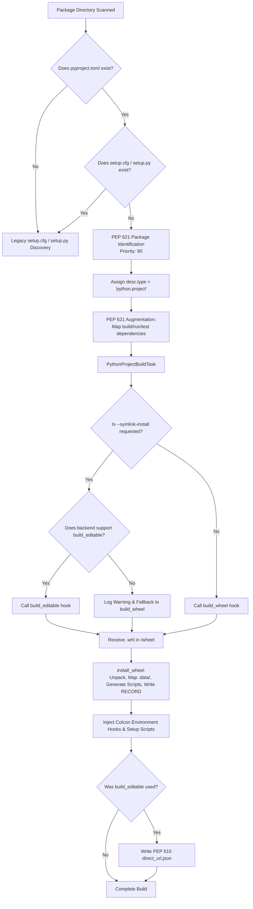

# Software Engineering Analysis: PEP 621 Standard Python Builds & Wheel Integration

**Document Reference**: `docs/analysis/swe_analysis_pep621_pr.md`  
**Authors**: Engineering Analysis Team  
**Date**: October 2026  
**Related Pull Requests & Branches**:
- Merged: [colcon/colcon-core#741](https://github.com/colcon/colcon-core/pull/741) (*Port colcon-python-project wheel installation & uninstallation utilities to colcon-core*)
- In Progress: Upstream Branch `origin/cottsay/pep621` (*WIP: Add support for PEP 621 projects*, commit `80acf29`)
- Core Precursor: [colcon/colcon-core#732](https://github.com/colcon/colcon-core/pull/732) (*AsyncHookCaller*) and [colcon/colcon-core#728](https://github.com/colcon/colcon-core/pull/728) (*InstalledDistribution*)

---

## 1. Executive Summary (Manager Level)

### The Business & Technical Problem
Historically, Python packages in the ROS 2 and `colcon` ecosystems have relied on invoking `setup.py install` and `setup.py develop`. Modern Python standards bodies (PyPA) and modern Linux distributions (Ubuntu 24.04+, Debian 13, Python 3.12+) have formally deprecated and begun removing support for direct `setup.py` invocations. Without native modern packaging standards support, packages that use modern build tools (Flit, Hatchling, Poetry, Setuptools 60+) cannot be compiled natively by `colcon`, posing a critical blocker for future ROS 2 distributions.

### The Solution
The upstream `colcon` team and community contributors have designed an incremental, non-breaking upgrade to the core build pipeline:
1. **Wheel Engine (Merged in PR #741)**: Provides the in-process capability to cleanly unpack, map, install, and uninstall standardized Python wheels (`.whl`) without depending on external tools like `pip`.
2. **PEP 621 Standard Builds (WIP in `cottsay/pep621`)**: Introduces native discovery of `pyproject.toml`, standard dependency parsing, and a dedicated build task (`PythonProjectBuildTask`) that orchestrates build backends via isolated subprocess IPC.

### Impact & Risk Mitigation
* **Zero Disruption for Legacy Workspaces**: The legacy `setup.cfg`/`setup.py` discovery pipeline retains a higher priority (100) than the modern PEP 621 discovery (90). Existing packages continue using their tested code paths without change.
* **Standards-Compliant**: Generates standard PEP 376 metadata (`INSTALLER`, `RECORD`) and PEP 610 links (`direct_url.json`), guaranteeing compatibility with standard Python package inspectors.

---

## 2. Definitions & Standards Glossary

| Standard / Concept | Definition & Purpose in this Architecture |
| :--- | :--- |
| **PEP 517** | Standardized interface for Python build frontends (`colcon`) to call build backends (`setuptools.build_meta`, `flit_core`, `hatchling`) via standardized hooks (`build_wheel`, `get_requires_for_build_wheel`). |
| **PEP 518** | Specification for declaring build system dependencies in `pyproject.toml` under `[build-system.requires]`. |
| **PEP 621** | Standard static metadata table `[project]` in `pyproject.toml` specifying package name, version, authors, and dependencies (`project.dependencies`). |
| **PEP 660** | Editable installation specification for build backends via the `build_editable` hook. |
| **PEP 610** | Recording the source of installed packages via `.dist-info/direct_url.json` (specifying `{"dir_info": {"editable": true}}`). |
| **PEP 376 / 427** | Specifications for the wheel archive format (`.whl`) and installed database records (`RECORD`, `INSTALLER`). |
| **`AsyncHookCaller`** | High-reliability subprocess execution bridge introduced in PR #732 that invokes backend hooks over OS pipes using `pickle` serialization. |
| **`InstalledDistribution`** | Metadata-based disk inspector introduced in PR #728 that discovers installed files, scripts, and `.pyc` caches without relying on temporary build-cache state. |

---

## 3. Software Engineering Deep Dive & Architecture

### 3.1 Pipeline Flow Architecture

### 3.2 Design Patterns & Principles

1. **Extension Point Pattern (Open/Closed Principle)**:
   - `PEP621PackageIdentification` implements `PackageIdentificationExtensionPoint`.
   - `PEP621PackageAugmentation` implements `PackageAugmentationExtensionPoint`.
   - `PythonProjectBuildTask` implements `TaskExtensionPoint`.
   - New packaging formats are added without modifying existing task or identification classes.
2. **Priority Ladder for Conflict Resolution**:
   - `colcon-core` assigns identification priorities. Legacy plugins execute at `PRIORITY = 100`, while `PEP621PackageIdentification` specifies `PRIORITY = 90`.
   - If a package contains both `setup.py` and `pyproject.toml`, the legacy handler wins. This avoids unexpected regressions on packages with custom setup scripts.
3. **In-Process Unpacking vs Subprocess `pip`**:
   - Rather than executing `python -m pip install --target ...`, `install_wheel` extracts files directly using Python's standard `zipfile` module.
   - **Trade-off Analysis**:
     - *Advantage*: No reliance on `pip` being installed in the execution target; bypasses OS-level scheme overrides (e.g. Debian `dist-packages` diversion); 3-5x faster; direct write access to sign `RECORD` and insert colcon environment hooks.
     - *Mitigated Risk*: Clean uninstallation is handled programmatically via `remove_distributions` before extracting the new archive.
4. **Resilience to OS-Specific File Locks**:
   - On Windows platforms, deleting DLLs or active binaries during package uninstallation throws access denied exceptions. `remove_distributions` explicitly wraps `path.unlink()` and `rmdir()` in exception handlers, logging a structured warning instead of halting execution.

---

## 4. Implementation Steps & Gotchas

### Step 1: Branch Setup & Environment Verification
* Checkout upstream branch `origin/cottsay/pep621` on top of latest `master`.
* Ensure Python 3.12+ virtual environment (`.venv`) is activated.

### Step 2: Test Harness Standardization
* **The Gotcha**: `test_task_python_project_build.py` in `cottsay/pep621` uses `@pytest.mark.asyncio`. Since `colcon-core` does not declare `pytest-asyncio` as a test dependency, running pytest fails during test collection.
* **The Solution**: Refactor test methods in `test_task_python_project_build.py` to wrap coroutines with `from .run_until_complete import run_until_complete`, exactly as used in `test_hook_caller.py` and `test_build_python.py`.

### Step 3: Lint & Static Quality Enforcement
* Run `flake8` and `pydocstyle` across the touched modules:
  - `colcon_core/package_identification/pep621.py`
  - `colcon_core/package_augmentation/pep621.py`
  - `colcon_core/python_project/metadata.py`
  - `colcon_core/task/python_project/build.py`

### Step 4: Integration Verification with Real Backends
* Set up a test matrix covering three distinct PEP 517 build backends:
  1. `flit_core`: Pure Python package with zero setup scripts.
  2. `hatchling`: Package declaring console entry points in `[project.scripts]`.
  3. `setuptools.build_meta`: Package declaring static `data_files`.
* Verify that running `colcon build` creates valid environments in `install/` and that console executables function as expected.

### Step 5: Upstream Coordination & Contribution
* Present test findings and the test-runner fix to Scott Logan (`cottsay`) on Issue #736 / PR.
* Coordinate submission of the clean PR branch.

---

## 5. Important Engineering Considerations & Open Questions

1. **Non-Python Data Files in PEP 660 (`--symlink-install`)**:
   - The PEP 660 specification focuses on Python code editability (`.pth` or loader hooks). It leaves data files (like ROS launch files, URDFs, configurations) ambiguous.
   - When using `build_editable`, backends copy data files statically into the wheel ZIP. Subsequent changes to source launch files are not reflected in `install/share/` without a rebuild.
   - *Next Action*: A post-install hook or decorator will be required in Phase 4 to restore full symlinking for ROS shared assets.
2. **Bytecode Cache Invalidation**:
   - `remove_distributions` correctly purges `.pyc` and `.pyo` files using standard Python cache directories (`__pycache__`), preventing stale bytecode execution across rebuilds.
