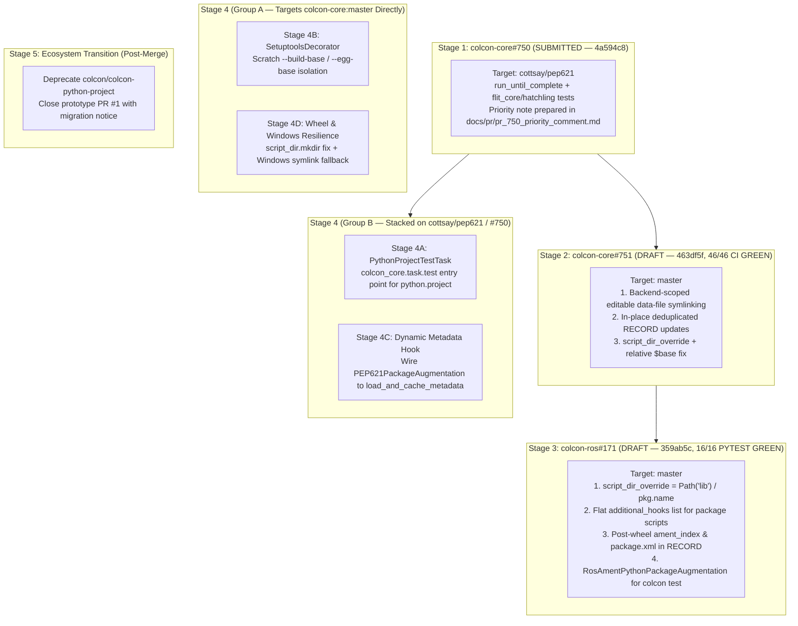

# Architectural Pitfalls & Remediation Plan: Native Python Standards in colcon & ROS 2

This document provides the technical audit of the Python packaging standards (PEP 517, 518, 621, 660) implementation across `colcon-core` and `colcon-ros`, records the remediations completed in Stages 1–3, and defines the remaining single-concern follow-up pull requests for Stages 4–5.

---

## 1. Executive Summary & Audit Findings

Building on the merged upstream foundations (`AsyncHookCaller` in PR #732, `InstalledDistribution` in PR #728, and `install_wheel` / `remove_distributions` in PR #741), trace analysis and integration testing across `colcon-core#750`, `colcon-core#751`, and `colcon-ros#171` identified **10 architectural pitfalls and edge-case gaps**:

| # | Severity | Category | Pitfall Description | Status & Stage |
| :- | :--- | :--- | :--- | :--- |
| **1** | **Critical** | ROS 2 CLI | `ros2 run` cannot find executables built from `pyproject.toml` (`bin/` vs `lib/<pkg>/`) | **Resolved** in Stage 2 (`colcon-core#751`, `463df5f`) & Stage 3 (`colcon-ros#171`, `359ab5c`) |
| **2** | **Critical** | Test Suite | `colcon test` skips testing for modern `pyproject.toml` packages (`ros.ament_python` & `python.project`) | **Resolved for ROS 2 (`ros.ament_python`)** in Stage 3 (`359ab5c`); **Scheduled for pure `python.project`** in Stage 4A |
| **3** | **Critical** | Packaging | Data-files parity breakage between standard build and `--symlink-install` + duplicate `RECORD` entries | **Resolved** in Stage 2 (`colcon-core#751`, `463df5f`) & mock package `03` (`e07c6d2`) |
| **4** | **High** | Identification | Priority tie (`PRIORITY = 90`) between `colcon-python-setup-py` and `PEP621PackageIdentification` | **Documented** in `docs/pr/pr_750_priority_comment.md` (deferred pending maintainer review of `#750`) |
| **5** | **High** | Environment | Non-isolated PEP 517 builds & `rosdep` blind spot for `[build-system].requires` (incl. `wheel` on `setuptools < 70.1`) | **Documented** in Stage 2/3 PRs, Gist, and dual-manifest user guides |
| **6** | **High** | Metadata | Dual-manifest synchronization (`package.xml` vs `pyproject.toml`) + post-wheel `ament_index` / `package.xml` `RECORD` tracking | **Resolved & Documented** in Stage 3 (`colcon-ros#171`, `359ab5c`) |
| **7** | **Medium** | Extensibility | Dynamic metadata (`dynamic = ["version", "dependencies"]`) ignored by static TOML parsing in `PEP621PackageAugmentation` | **Scheduled** for Stage 4C (`colcon-core`, stacked on `cottsay/pep621`) |
| **8** | **Medium** | Workspace | `setuptools.build_meta` leaves `.egg-info/` and `build/` artifacts in the package source tree | **Scheduled** for Stage 4B (`colcon-core`, targets `master` directly) |
| **9** | **Medium** | Windows | Unhandled `OSError` when `os.symlink` lacks `SeCreateSymbolicLinkPrivilege` on Windows | **Scheduled** for Stage 4D (`colcon-core`, targets `master` directly) |
| **10** | **Medium** | Wheel Rebuild | Cached `ScriptMaker` (`@lru_cache` on `_get_script_maker`) fails with `FileNotFoundError` after `remove_distributions` deletes an empty `script_dir` in the same Python process | **Uncovered in Stage 3**; **Scheduled** for Stage 4D (`colcon-core`, targets `master` directly) |

---

## 2. In-Depth Pitfall Breakdown & Technical Root Causes

### Pitfall 1: Breaking `ros2 run` (`bin/` vs `lib/<package>/`) — [RESOLVED]
* **Mechanism**: In ROS 2, `ros2 run <pkg> <executable>` queries `ros2pkg.api.get_executable_paths(package_name=...)`, searching `<install_prefix>/lib/<package>/`.
* **Root Cause**: `install_wheel` defaults to `<install_base>/bin` (`Scripts` on Windows). Pure `pyproject.toml` packages lack `setup.cfg` `[install] install_scripts`, and `PythonProjectBuildTask.build()` previously did not expose `script_dir_override` (plus its `$base` expansion doubled relative `install_base` paths).
* **Resolution**:
  * Stage 2 (`colcon-core#751`, `463df5f`): Added `script_dir_override=None` to `PythonProjectBuildTask.build()` and initialized `_override = Path()` when expanding `$base`.
  * Stage 3 (`colcon-ros#171`, `359ab5c`): `AmentPythonBuildTask` forwards `script_dir_override=Path('lib') / self.context.pkg.name` to `PythonProjectBuildTask.build()` and unwraps `additional_hooks=additional_hooks` so both `.dsv` and shell `ament_prefix_path` hooks register cleanly.

### Pitfall 2: `colcon test` Skipped for Modern Packages — [ROS 2 RESOLVED / `python.project` STAGE 4A]
* **Mechanism**: `colcon test` dispatches `colcon_core.task.test` extensions by `pkg.type`.
* **Root Cause**:
  * **In `colcon-ros` (`ros.ament_python`)**: `RosAmentPythonPackageAugmentation` previously returned early when `setup.py` was absent, leaving `get_python_setup_options` unset so `PytestPythonTestingStep.match()` could not detect `pytest`. **Resolved in Stage 3 (`359ab5c`)** by populating `get_python_setup_options` from `pyproject.toml` (`[project.dependencies]`, `[project.optional-dependencies]`, and PEP 735 `[dependency-groups]`, merged with `setup.cfg` `[options]` if present).
  * **In `colcon-core` (`python.project`)**: `setup.cfg` does not yet register a `python.project` entry point under `colcon_core.task.test`. **Scheduled for Stage 4A**.

### Pitfall 3: Backend Fragmentation & Data-Files Asymmetry — [RESOLVED]
* **Mechanism**: PEP 621 leaves arbitrary data-file packaging to backend-specific tables, which pack non-code assets into `<dist>.data/data/...`.
* **Root Cause**: Unscoped parsing of `setup.cfg` during `--symlink-install` caused `flit_core` packages to symlink files in editable mode that were silently omitted in release builds, while appending duplicate lines to `.dist-info/RECORD`.
* **Resolution**: Stage 2 (`colcon-core#751`, `463df5f`) scoped `_get_data_files_mapping(pkg, backend_name)` strictly to `setuptools.build_meta*` (with glob expansion across `setup.cfg` and `[tool.setuptools.data-files]`) and `hatchling.*` (single-file and directory `[tool.hatch.build.targets.wheel.shared-data]`), deduplicated `.dist-info/RECORD` updates in place via `record_map`, and migrated mock package `03_modern_editable_data_files` to `hatchling` `shared-data`.

### Pitfall 4: Priority Collision in Package Identification — [PREPARED / DEFERRED]
* **Mechanism**: `order_extensions_by_priority` sorts by `(-PRIORITY, entry_point_name)`.
* **Root Cause**: Both `PEP621PackageIdentification` (`cottsay/pep621`) and `colcon-python-setup-py` set `PRIORITY = 90`, and `'pep621'` sorts alphabetically ahead of `'python_setup_py'`, claiming hybrid `setup.py` + `pyproject.toml` packages as `python.project`.
* **Remediation**: Lowering `PEP621PackageIdentification.PRIORITY` to `80` preserves `setup.cfg (100) > setup.py (90) > pep621 (80)`. Documented in `docs/pr/pr_750_priority_comment.md` for maintainer discussion on `colcon/colcon-core#750` without expanding `#750`'s test-focused diff.

### Pitfall 5: Non-Isolated Builds & `rosdep` Blind Spot — [DOCUMENTED]
* **Mechanism**: `colcon` invokes PEP 517 hooks in the active workspace environment without pip-style ephemeral virtual environments, while `rosdep` reads only `package.xml`. Furthermore, `setuptools < 70.1` imports the external `wheel` package (`wheel.bdist_wheel`) during `build_wheel` and `build_editable`.
* **Resolution**: Documented across PR descriptions and guides that ROS 2 `pyproject.toml` packages must declare `<build_depend>` entries in `package.xml` for their PEP 518 backend (`python3-flit-core`, `python3-hatchling`, or `python3-setuptools` plus `python3-wheel` on Ubuntu 22.04/24.04). Guarded optional-wheel setuptools integration tests in `colcon-core#751` (`463df5f`), verified across 46/46 CI jobs.

### Pitfall 6: Dual-Manifest Sync & Rebuild Idempotency for `ament_index` / `package.xml` — [RESOLVED]
* **Mechanism**: `install_wheel` calls `remove_distributions()` at the start of every build, deleting all paths listed in the prior `.dist-info/RECORD` and pruning empty directories.
* **Root Cause**: Creating `share/ament_index/resource_index/packages/<pkg>` and `share/<pkg>/package.xml` *before* `PythonProjectBuildTask.build()` either left them untracked in `RECORD` (leaking orphan files on uninstall) or caused `remove_distributions()` to delete them on rebuild #2.
* **Resolution**: Stage 3 (`colcon-ros#171`, `359ab5c`) installs `ament_index` and `package.xml` *after* `PythonProjectBuildTask.build()` succeeds (without clobbering wheel-provided files) and records them in `.dist-info/RECORD`.

### Pitfall 7: Dynamic Metadata Ignored (`dynamic = ["version", "dependencies"]`) — [STAGE 4C]
* **Root Cause**: `PEP621PackageAugmentation` inspects static `pyproject.toml` tables and is not yet wired to `colcon_core/python_project/metadata.py` (`load_and_cache_metadata` / `prepare_metadata_for_build_wheel`).
* **Planned Fix (Stage 4C)**: Invoke `load_and_cache_metadata` when `project.dynamic` contains `version`, `dependencies`, or `optional-dependencies`.

### Pitfall 8: Setuptools In-Source Tree Pollution (`.egg-info/`) — [STAGE 4B]
* **Root Cause**: `setuptools.build_meta` creates `<pkg>.egg-info/` in the source directory unless `--build-base` / `--egg-base` scratch directories are injected via a `HookCallerDecoratorExtensionPoint` (`SetuptoolsDecorator`).
* **Planned Fix (Stage 4B)**: Port `SetuptoolsDecorator` into `colcon-core` targeting `colcon-core:master` directly (since `HookCallerDecoratorExtensionPoint` is already merged on `master` via PR #732).

### Pitfall 9: Windows Symlink Privileges on Non-Admin Accounts — [STAGE 4D]
* **Root Cause**: `os.symlink()` on Windows raises `OSError` (`winerror 1314`) when Developer Mode / `SeCreateSymbolicLinkPrivilege` is unavailable.
* **Planned Fix (Stage 4D)**: Catch symlink privilege `OSError` on Windows, log a clear warning, and fall back to copying the file so `--symlink-install` degrades gracefully.

### Pitfall 10: Cached `ScriptMaker` Failure After `remove_distributions` Directory Pruning — [STAGE 4D]
* **Mechanism**: Uncovered while running repeated in-process rebuilds in Stage 3 (`test_ament_python_build_pep621`).
* **Root Cause**: `colcon_core/python_project/wheel.py` decorates `_get_script_maker(script_dir)` with `@lru_cache(maxsize=32)`. Inside `distlib`, `ScriptMaker._fileop` (`FileOperator`) caches created directory paths in `self._created` and skips `os.makedirs` if a path is already in `self._created`. When a second build in the same Python process calls `remove_distributions()`, `remove_distributions()` unlinks old scripts and `rmdir()`s the empty `script_dir`; `install_wheel()` then reuses the cached `ScriptMaker`, skips directory creation, and raises `FileNotFoundError`.
* **Planned Fix (Stage 4D)**: Ensure `script_dir.mkdir(parents=True, exist_ok=True)` in `install_wheel()` (or avoid caching stateful `FileOperator` instances across calls) on `colcon-core:master`.

---

## 3. Staged Remediation & Upstream PR Status

### Completed Stages (Stages 1–3)

1. **Stage 1 (`colcon/colcon-core#750`, Commit `4a594c8`) — COMPLETED & SUBMITTED**:
   - Kept PR #750 strictly focused on `run_until_complete` async test alignment and multi-backend (`flit_core`, `hatchling`) integration tests against `cottsay/pep621`.
   - Prepared optional review note on `PRIORITY = 80` in `docs/pr/pr_750_priority_comment.md` (held back per review strategy until maintainer feedback on `#750`).
2. **Stage 2 (`colcon/colcon-core#751`, Commit `463df5f`) — COMPLETED & VERIFIED (46/46 CI GREEN)**:
   - Implemented `script_dir_override`, fixed relative `install_base` `$base` resolution, scoped `_get_data_files_mapping` to `setuptools.build_meta*` (with globs) and `hatchling.*` (`shared-data`), deduplicated `.dist-info/RECORD` updates, isolated entry-point caches in tests, and verified 46/46 GitHub Actions checks green (`256 passed, 5 skipped` locally).
   - Updated PR #751 title/description and synced the upstream Gist.
3. **Stage 3 (`colcon/colcon-ros#171`, Commit `359ab5c`, & Base Repo `e07c6d2`) — COMPLETED & VERIFIED (16/16 PYTEST GREEN)**:
   - Updated `AmentPythonBuildTask` (`script_dir_override=Path('lib') / pkg.name`, flat `additional_hooks`, post-wheel `ament_index` and `package.xml` installation recorded in `.dist-info/RECORD`) and `RosAmentPythonPackageAugmentation` (`pyproject.toml` PEP 621 / PEP 735 test dependency discovery for `colcon test`).
   - Fixed `flake8` and `scspell3k` checks, added backend-independent unit tests plus `flit_core` integration tests (`16 passed` under `pytest --cov --cov-branch`), updated PR #171 description, and updated mock packages `03` and `04` (`4/4` scenarios passing in `scripts/test_mock_packages.py`).

### Planned Next Stages (Stages 4–5)

#### Stage 4 — Group A: Independent Single-Concern PRs Targeting `colcon/colcon-core:master`
These enhancements build solely on primitives already merged on `colcon-core:master` (`#728`, `#732`, `#741`) and can be opened/merged independently of `#750` and `#751`:
* **Stage 4B (`feature/setuptools-decorator`)**:
  - Implement `SetuptoolsDecorator` (`HookCallerDecoratorExtensionPoint`) redirecting `build_wheel` / `build_editable` scratch `--build-base` and `--egg-base` directories into `<build_base>` / temporary directories so `setuptools.build_meta` never pollutes the git source tree with `.egg-info/`.
* **Stage 4D (`feature/wheel-script-dir-and-windows-symlink`)**:
  - Ensure `script_dir.mkdir(parents=True, exist_ok=True)` in `colcon_core/python_project/wheel.py` before invoking cached `ScriptMaker.make_multiple()` so repeated in-process builds after `remove_distributions()` never raise `FileNotFoundError`.
  - Add graceful Windows fallback in `colcon_core.task.install()` when `os.symlink()` fails due to missing `SeCreateSymbolicLinkPrivilege`.

#### Stage 4 — Group B: Follow-up Single-Concern PRs Stacked on `cottsay/pep621` (`#750`)
These enhancements extend the `python.project` extensions introduced in `cottsay/pep621`:
* **Stage 4A (`feature/python-project-test-task`)**:
  - Register `python.project` under `colcon_core.task.test` (and wire `get_python_setup_options` in `PEP621PackageAugmentation`) so pure non-ROS `python.project` packages execute `pytest` via `colcon test`.
* **Stage 4C (`feature/pep621-dynamic-metadata`)**:
  - Connect `PEP621PackageAugmentation` to `colcon_core.python_project.metadata.load_and_cache_metadata()` when `project.dynamic` declares dynamic `version`, `dependencies`, or `optional-dependencies`.

#### Stage 5: Ecosystem Transition & Deprecation (`colcon/colcon-python-project`)
* Once Stages 1–3 land upstream, add a deprecation notice to `colcon/colcon-python-project` pointing users to native `colcon-core` / `colcon-ros` support and close prototype PR #1.

---

## 4. Implementation Roadmap Matrix

| Task ID | Action Item | Target Repo & Branch | Stage | Status |
| :--- | :--- | :--- | :--- | :--- |
| **TASK-1** | Keep PR #750 minimal; prepare `PRIORITY = 80` review note (`docs/pr/pr_750_priority_comment.md`) | `colcon/colcon-core#750` (`4a594c8`) | Stage 1 | **Done** (PR open; comment deferred) |
| **TASK-2** | Add `script_dir_override` & fix relative `$base` resolution in `PythonProjectBuildTask.build()` | `KmoM88/colcon-core:feature/pep660-editable-data-files` | Stage 2 (`#751`) | **Done** (`463df5f`, 46/46 CI green) |
| **TASK-3** | Backend-scoped editable data-file symlinking, deduplicated `RECORD`, cache-isolated tests | `KmoM88/colcon-core:feature/pep660-editable-data-files` | Stage 2 (`#751`) | **Done** (`463df5f`, 46/46 CI green) |
| **TASK-4** | Update `colcon-ros#171`: `lib/<pkg>` script override, flat hooks, post-wheel `RECORD` tracking, `colcon test` augmentation | `KmoM88/colcon-ros:feature/ros-ament-python-project` | Stage 3 (`#171`) | **Done** (`359ab5c`, 16/16 pytest green) |
| **TASK-5** | Update mock packages (`03`, `04`), `scripts/test_mock_packages.py`, PR descriptions & Gist | `KmoM88/colcon-roadmap:main` | Stage 3 | **Done** (`e07c6d2`, 4/4 scenarios green) |
| **TASK-5B** | Dockerized ROS 2 Jazzy PoC (`poc/`) across active `ros2/*` packages (`demos`, `examples`, `teleop_twist_keyboard`) | `KmoM88/colcon-roadmap:main` (`poc/`) | Final PoC | **Done** (All 3 backends & 6 stages verified in Docker) |
| **TASK-6** | Port `SetuptoolsDecorator` scratch `--build-base` / `--egg-base` isolation | `KmoM88/colcon-core:feature/setuptools-decorator` (targets `master`) | Stage 4B | **Planned** (Ready — independent of `#750`) |
| **TASK-7** | Fix `wheel.py` `script_dir.mkdir` with cached `ScriptMaker` + Windows symlink copy fallback | `KmoM88/colcon-core:feature/wheel-script-dir-and-windows-symlink` (targets `master`) | Stage 4D | **Planned** (Ready — independent of `#750`) |
| **TASK-8** | Register `python.project` `colcon test` task & test options augmentation | `KmoM88/colcon-core:feature/python-project-test-task` (stacked on `#750`) | Stage 4A | **Planned** (After `#750` review/merge) |
| **TASK-9** | Wire `PEP621PackageAugmentation` to `load_and_cache_metadata` for `project.dynamic` | `KmoM88/colcon-core:feature/pep621-dynamic-metadata` (stacked on `#750`) | Stage 4C | **Planned** (After `#750` review/merge) |
| **TASK-10** | Deprecate `colcon/colcon-python-project` & close prototype PR #1 | `colcon/colcon-python-project` | Stage 5 | **Planned** (Post-merge) |
