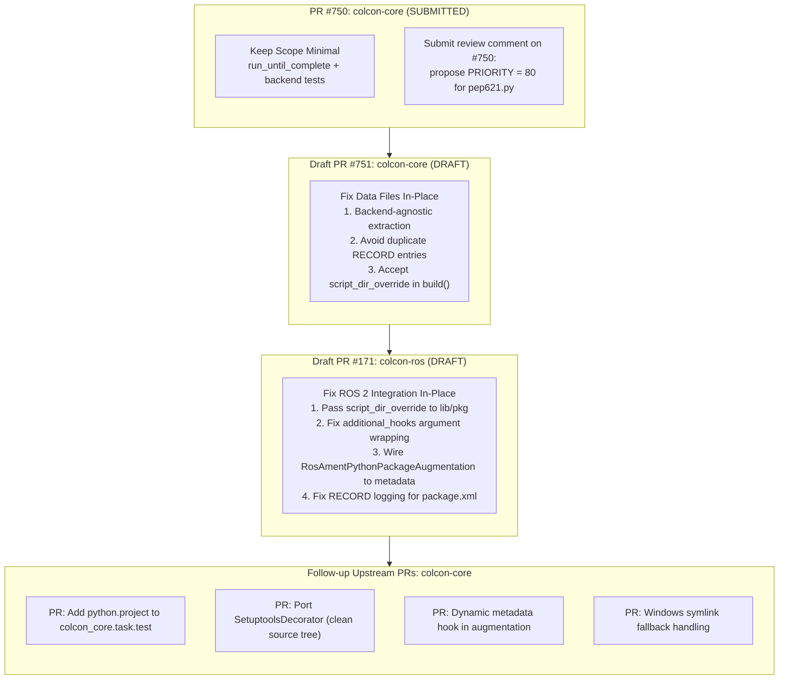

# Architectural Pitfalls & Remediation Plan: Native Python Standards in colcon & ROS 2

This document provides a comprehensive technical audit of the current Python packaging standards (PEP 517, 518, 621, 660) implementation across `colcon-core` and `colcon-ros`. It defines concrete remediation designs and a phased pull request (PR) staging strategy tailored to upstream maintainer practices.

---

## 1. Executive Summary & Audit Findings

While foundational milestones have been merged upstream (`AsyncHookCaller` in PR #732, `InstalledDistribution` in PR #728, and `install_wheel`/`remove_distributions` in PR #741), rigorous trace analysis of the open and draft PRs (`colcon-core#750`, `colcon-core#751`, `colcon-ros#171`) reveals **9 critical architectural pitfalls and edge-case gaps**:

| # | Severity | Category | Pitfall Description | Root Cause / Affected Files |
| :- | :--- | :--- | :--- | :--- |
| **1** | 🚨 **Critical** | ROS 2 CLI | `ros2 run` cannot find executables built from `pyproject.toml` | Scripts installed into `bin/` instead of `lib/<pkg>/`; `AmentPythonBuildTask` does not pass `script_dir_override`. |
| **2** | 🚨 **Critical** | Test Suite | `colcon test` completely skips testing for modern packages | No `colcon_core.task.test` registered for `python.project`; `RosAmentPythonPackageAugmentation` skips metadata setup when `setup.py` is absent. |
| **3** | 🚨 **Critical** | Packaging | Data files parity breakage between standard build & `--symlink-install` | PR #751 hardcodes backend parsers only during `--symlink-install`; releases with `flit_core` omit data files entirely; duplicate `RECORD` lines. |
| **4** | ⚠️ **High** | Identification | Priority race between `colcon-python-setup-py` and `PEP621PackageIdentification` | Both extensions set `PRIORITY = 90`, making identification non-deterministic when both `setup.py` and `pyproject.toml` exist. |
| **5** | ⚠️ **High** | Environment | Missing build isolation & `rosdep` blind spot for `build-system.requires` | Colcon does not isolate build environments; `rosdep` only parses `package.xml`, ignoring `[build-system].requires`. |
| **6** | ⚠️ **High** | Metadata | Double-manifest sync hazard (`package.xml` vs `pyproject.toml`) | Runtime tools (`importlib.metadata`) inspect `.dist-info/METADATA`, while colcon builds topological order from `package.xml`. |
| **7** | 🔍 **Medium** | Extensibility | Dynamic metadata ignorance (`dynamic = ["version", "dependencies"]`) | `PEP621PackageAugmentation` reads static TOML; ignores existing `colcon_core/python_project/metadata.py` hook caller. |
| **8** | 🔍 **Medium** | Workspace | Setuptools in-source tree pollution (`.egg-info/`) | Missing `SetuptoolsDecorator` from `colcon-python-project`; building leaves untracked build artifacts in git source tree. |
| **9** | 🔍 **Medium** | Windows | Unhandled privilege errors on Windows symlink installs | `colcon_core.task.install()` crashes if `os.symlink` fails due to lack of `SeCreateSymbolicLinkPrivilege`. |

---

## 2. In-Depth Pitfall Breakdown & Technical Root Causes

### Pitfall 1: Breaking `ros2 run` (`bin/` vs `lib/<package>/`)
* **Mechanism**: In ROS 2, `ros2 run <pkg> <executable>` queries `ros2pkg.api.get_executable_paths(package_name=...)`, which searches `<install_prefix>/lib/<package>/`.
* **Root Cause**:
  * In `colcon_core/python_project/wheel.py`, `install_wheel` defaults to placing scripts in `<install_base>/bin` (or `Scripts` on Windows).
  * `colcon_core/task/python_project/build.py` checks for `script-dir` in `setup.cfg`. In a pure modern package without `setup.cfg`, `script_dir_override` evaluates to `None`.
  * In `colcon-ros` PR #171 (`colcon_ros/task/ament_python/build.py`), `AmentPythonBuildTask` delegates to `PythonProjectBuildTask` without supplying `script_dir_override`.
  * Additionally, `PythonProjectBuildTask.build(*, additional_hooks=None)` currently does not accept `script_dir_override` as an argument.
* **Impact**: CLI commands (`ros2 run`, `ros2 launch`) fail with `Package '<pkg>' doesn't have the executable '<node>'`. Mock scenario 4 masked this by calling the binary file directly via python.

### Pitfall 2: `colcon test` Skipped for Modern Packages
* **Mechanism**: `colcon test` resolves task extensions from `colcon_core.task.test` matching `pkg.type`.
* **Root Cause**:
  * **In `colcon-core`**: `setup.cfg` has no entry point for `python.project` under `colcon_core.task.test`. Running `colcon test --packages-select <pep621_pkg>` logs `WARNING: No task extension to 'test' a 'python.project' package` and terminates cleanly without executing tests.
  * **In `colcon-ros`**: `AmentPythonTestTask` delegates to `PythonTestTask`, which calls `has_test_dependency(setup_py_data, 'pytest')`. For a pure `pyproject.toml` package, `RosAmentPythonPackageAugmentation` exits early because `setup.py` does not exist, leaving `setup_py_data = {}`. `pytest` matching returns `False`, logging `WARNING: No Python Testing Step extension matched`.
* **Impact**: Modernized ROS 2 packages cannot run unit or integration tests under colcon.

### Pitfall 3: Backend Fragmentation & Data Files Asymmetry (PR #751)
* **Mechanism**: PEP 621 deliberately excluded `data_files` from `[project]`. Standard Python backends package non-code assets into the `.data/` directory of the wheel archive (`<dist>.data/data/share/...`).
* **Root Cause**:
  * `colcon-core` Draft PR #751 introduces `_get_data_files_mapping()`, which manually parses `setup.cfg`, `tool.setuptools.data-files`, and `tool.hatch.build.targets.wheel.shared-data`.
  * This mapping is only executed when `--symlink-install` is active.
  * In a release build (`colcon build`), `install_wheel` extracts the `.data/` folder from the wheel. For backends like `flit_core` that do not support arbitrary data files, data files are never packed into the wheel.
  * As a result, mock package `03_modern_editable_data_files` works under `--symlink-install` (because colcon parses `setup.cfg` directly), but completely fails to install launch/config files during a standard release build.
  * For backends that do support shared data (Hatchling, Setuptools), `install_wheel` installs them and records them in `RECORD`, and then `_get_data_files_mapping` appends duplicate entries into `RECORD`.
* **Impact**: Violates PEP 517 backend agnosticism; creates inconsistent behavior between dev and production builds.

### Pitfall 4: Priority Collision in Package Identification
* **Mechanism**: Colcon executes identification extensions in order of priority.
* **Root Cause**:
  * `colcon_core/package_identification/pep621.py`: `PRIORITY = 90`.
  * `colcon_python_setup_py/package_identification/python_setup_py.py`: `PRIORITY = 90`.
  * Comment in `pep621.py` explicitly states: `# the priority needs to be lower than the extensions identifying packages using setup.py and/or setup.cfg files`.
* **Impact**: For hybrid repositories with both `setup.py` (legacy fallback) and `pyproject.toml`, resolution order is non-deterministic, varying across operating systems or Python environments based on entry-point dictionary iteration.

### Pitfall 5: Build Isolation & Missing `rosdep` Integration
* **Mechanism**: Colcon relies on the host environment (or active venv) to contain build backends (`flit_core`, `hatchling`, `setuptools`).
* **Root Cause**: `colcon` does not perform pip-style build isolation (`pip` builds in ephemeral virtual environments). `rosdep` resolves `<build_depend>` tags from `package.xml`. It does not parse `pyproject.toml` `[build-system].requires`.
* **Impact**: If developers declare build backends exclusively in `pyproject.toml`, automated CI/CD runners (ROS buildfarm, industrial CI) will fail with missing module errors.

### Pitfall 6: Metadata Duplication & Dual-Manifest Synchronization
* **Mechanism**: ROS 2 packages require `package.xml` for workspace dependencies and metadata; Python standard wheels require `[project]` in `pyproject.toml` to populate `.dist-info/METADATA`.
* **Root Cause**: Two divergent sources of truth exist in the same package repository.
* **Impact**: Mismatches lead to runtime failure in `importlib.metadata` / `pip check` if omitted from `pyproject.toml`, or build ordering failures in colcon topological sort if omitted from `package.xml`.

### Pitfall 7: Dynamic Metadata Ignored (`dynamic = ["version", "dependencies"]`)
* **Mechanism**: PEP 621 allows delegating metadata fields to dynamic hooks (e.g. `setuptools_scm`, `hatch-vcs`).
* **Root Cause**: `PEP621PackageAugmentation` only performs static dictionary queries on `spec['project']`. However, `colcon_core/python_project/metadata.py` (`load_and_cache_metadata`) already exists and implements the PEP 517 `prepare_metadata_for_build_wheel` hook, but is not connected to `PEP621PackageAugmentation`.
* **Impact**: Colcon cannot sequence dependencies or report versions for dynamic packages.

### Pitfall 8: Setuptools In-Source Tree Pollution
* **Mechanism**: Running `build_wheel` or `build_editable` with `setuptools.build_meta` generates `<pkg>.egg-info/` and `build/` directories directly in the source tree.
* **Root Cause**: The original prototype `colcon-python-project` implemented `SetuptoolsDecorator` with `_ScratchBuildBase` and `_ScratchEggBase` to redirect output to scratch paths via `config_settings`. This decorator was not ported to `colcon-core`.
* **Impact**: Running builds pollutes source workspaces and git status.

### Pitfall 9: Windows Symlink Privileges on Non-Admin Accounts
* **Mechanism**: `colcon_core.task.install()` creates symlinks via `os.symlink()` when `symlink_install=True`.
* **Root Cause**: On Windows, `os.symlink()` raises `OSError` (Privilege not held) unless Developer Mode is activated or running as Administrator.
* **Impact**: Editable builds with data-file symlinking fail unconditionally on unprivileged Windows systems.

---

## 3. Remediation & Upstream PR Staging Strategy

Upstream maintainer Scott Logan (`cottsay`) favors decomposing large features into single-concern, highly auditable PRs (e.g. #728, #732, #741). We adopt a **Hybrid PR Staging Strategy** based on the status of each PR:



### Stage 1: Preserve PR #750 Stability & Address Priority
* **Repository**: `colcon/colcon-core`
* **Target Branch**: `cottsay/pep621`
* **Head Branch**: `KmoM88/colcon-core:feature/pep621-upstream-pr`
* **Action**:
  1. Do not bloat PR #750 with testing tasks or decorators. Keep it strictly focused on test runner harmonization and multi-backend integration tests.
  2. Post an upstream comment on PR #750 proposing to adjust `PEP621PackageIdentification.PRIORITY = 80` (lower than `colcon-python-setup-py`'s 90) to strictly honor the existing docstring comment:
     ```python
     # the priority needs to be lower than the extensions identifying packages
     # using setup.py and/or setup.cfg files.
     PRIORITY = 80
     ```

### Stage 2: Refactor Draft PR #751 (`colcon-core` Data Files & Script Override)
* **Repository**: `colcon/colcon-core`
* **Target Branch**: `master` (or stacked on `cottsay/pep621`)
* **Head Branch**: `KmoM88/colcon-core:feature/pep660-editable-data-files`
* **Action**:
  1. **Expose `script_dir_override` in `PythonProjectBuildTask.build`**:
     ```python
     async def build(self, *, additional_hooks=None, script_dir_override=None):
     ```
     Allowing calling tasks (such as `colcon-ros`) to explicitly define script locations without forcing a `setup.cfg`.
  2. **Refactor Data Files Handling**:
     * Eliminate proprietary parsing of `setup.cfg` when building pure PEP 621 packages.
     * Enforce backend-agnostic behavior: during standard builds, rely on the wheel's standard `.data/` directory; during editable installs (`--symlink-install`), symlink data files defined by backend specifications and register each once without duplicating `RECORD`.
     * Update mock package `03_modern_editable_data_files` to use standard `hatchling` shared-data configuration.

### Stage 3: Refactor Draft PR #171 (`colcon-ros` ROS 2 Modernization)
* **Repository**: `colcon/colcon-ros`
* **Target Branch**: `master`
* **Head Branch**: `KmoM88/colcon-ros:feature/ros-ament-python-project`
* **Action**:
  1. **Fix `ros2 run` Script Destination**:
     In `AmentPythonBuildTask`:
     ```python
     script_dir = Path(args.install_base) / 'lib' / self.context.pkg.name
     return await extension.build(
         additional_hooks=additional_hooks,
         script_dir_override=script_dir)
     ```
  2. **Fix `additional_hooks` Argument Passing**:
     Change `additional_hooks=[additional_hooks]` to `additional_hooks=additional_hooks` to prevent nested list crashes.
  3. **Fix Package Augmentation & Testing in `colcon-ros`**:
     In `RosAmentPythonPackageAugmentation`, if `setup.py` is absent but `pyproject.toml` is present, read options via `load_and_cache_metadata(desc)` or parse `pyproject.toml` test dependencies so `AmentPythonTestTask` discovers `pytest`.
  4. **Record Package Manifest**:
     Ensure `package.xml` and the `ament_index` marker file installed by `colcon-ros` are appended to `.dist-info/RECORD` so `remove_distributions` uninstalls them cleanly.

### Stage 4: Follow-up Additive PRs in `colcon-core`
* **Repository**: `colcon/colcon-core`
1. **PR 4A: `python.project` Test Task**:
   * Register `python.project = colcon_core.task.python_project.test:PythonProjectTestTask` in `setup.cfg`.
   * Enable `PytestPythonTestingStep` to discover tests from `[project.optional-dependencies].test` or standard test directories when `setup_py_data` is empty.
2. **PR 4B: Setuptools Source Tree Isolation**:
   * Port `SetuptoolsDecorator` from `colcon-python-project` to prevent `.egg-info/` generation in source trees.
3. **PR 4C: Dynamic Metadata Support**:
   * Connect `PEP621PackageAugmentation` with `colcon_core.python_project.metadata.load_and_cache_metadata()` when `dynamic` fields are declared in `pyproject.toml`.
4. **PR 4D: Windows Symlink Graceful Fallback**:
   * Catch `OSError` in `install()` on Windows when symlink privileges are missing and fall back to file copy with an informative warning.

---

## 4. Documentation & Ecosystem Alignment

1. **Dual-Manifest Guidance**:
   * Document in the user guides that for ROS 2 `ament_python` packages:
     * `package.xml` is the authoritative manifest for `rosdep` and workspace topological sorting.
     * `pyproject.toml` is the authoritative manifest for the Python build backend and runtime wheel metadata.
     * Backends (e.g. `python3-flit-core`, `python3-hatchling`) must be listed as `<build_depend>` in `package.xml` to ensure `rosdep install` resolves them in CI.
2. **Mock Package Suite Updates**:
   * Update `examples/mock_packages/04_ros2_ament_pyproject` test assertion to verify binary execution from `lib/ros_pyproject_pkg/sample-node` (matching `ros2 run` behavior).
   * Update `examples/mock_packages/03_modern_editable_data_files` to demonstrate clean shared-data packaging with `hatchling`.

---

## 5. Implementation Roadmap Matrix

| Task ID | Action Item | Target Repo & Branch | Staging Type | Prerequisite |
| :--- | :--- | :--- | :--- | :--- |
| **TASK-1** | Post upstream comment on PR #750 proposing `PRIORITY = 80` | `colcon/colcon-core#750` | Review Comment | PR #750 open |
| **TASK-2** | Support `script_dir_override` in `PythonProjectBuildTask.build()` | `kmom88-colcon-core:feature/pep660-editable-data-files` | In-place (PR #751) | TASK-1 |
| **TASK-3** | Update `colcon-ros` PR #171: `script_dir_override = lib/<pkg>`, fix `additional_hooks`, wire metadata | `colcon-ros:feature/ros-ament-python-project` | In-place (PR #171) | TASK-2 |
| **TASK-4** | Refactor editable data files & remove duplicate `RECORD` lines | `kmom88-colcon-core:feature/pep660-editable-data-files` | In-place (PR #751) | TASK-2 |
| **TASK-5** | Update mock packages (03 and 04) and `scripts/test_mock_packages.py` | `colcon-roadmap:main` | Base Repo | TASK-3, TASK-4 |
| **TASK-6** | Implement `PythonProjectTestTask` for `colcon test` | `colcon-core:feature/python-project-test` | New PR | PR #750 merged |
| **TASK-7** | Port `SetuptoolsDecorator` scratch directory isolation | `colcon-core:feature/setuptools-decorator` | New PR | PR #750 merged |
