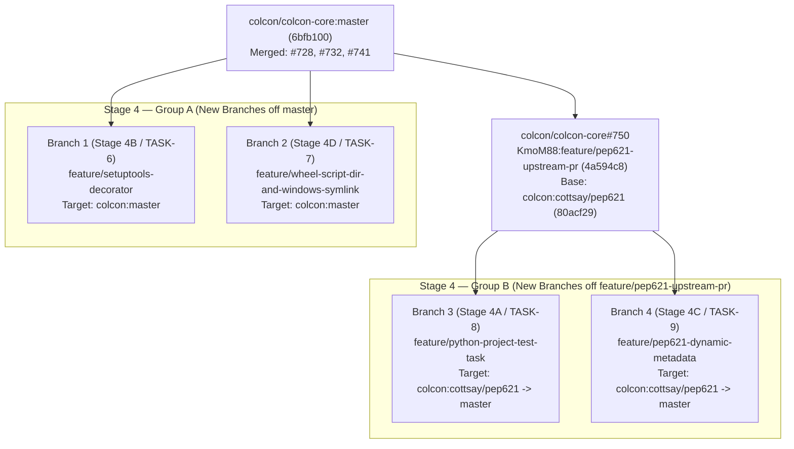

# Stage 4 Branch Implementation Plan: Group A (`master`) & Group B (`cottsay/pep621`)

This document defines the branch-by-branch engineering plan for **Stage 4** in `submodules/kmom88-colcon-core` (`KmoM88/colcon-core`), splitting the four remaining `colcon-core` follow-ups into small, single-concern branches aligned with upstream `colcon` review conventions.

---

## 1. Branch Topology & Upstream Target Matrix

Stage 4 is divided into two groups based on upstream commit ancestry:

* **Group A (Independent — Branches off `colcon/colcon-core:master` @ `6bfb100`)**: Builds strictly on primitives already merged on `master` (PR #728 `InstalledDistribution`, PR #732 `AsyncHookCaller` & `HookCallerDecoratorExtensionPoint`, PR #741 `wheel.py`, and `colcon_core/task/__init__.py`). Both branches can be implemented, tested, and opened against `colcon/colcon-core:master` immediately without waiting for `#750` or `#751`.
* **Group B (Stacked — Branches off `KmoM88/colcon-core:feature/pep621-upstream-pr` @ `4a594c8`)**: Extends the `python.project` task type, `PEP621PackageAugmentation`, and `colcon_core/python_project/metadata.py` introduced on `colcon/colcon-core:cottsay/pep621` (`80acf29`) and validated in [colcon/colcon-core#750](https://github.com/colcon/colcon-core/pull/750). Each Group B branch stacks cleanly on `feature/pep621-upstream-pr` (`4a594c8`) and rebases directly onto `colcon/colcon-core:master` once `#750` lands.



| Group | Stage / Task | New Branch Name (`KmoM88/colcon-core`) | Fork Base Branch & Commit | Upstream PR Target | Pitfall(s) Addressed |
| :--- | :--- | :--- | :--- | :--- | :--- |
| **Group A** | **Stage 4B** (`TASK-6`) | `feature/setuptools-decorator` | `origin/master` (`6bfb100`) | `colcon/colcon-core:master` | Pitfall 8 (`setuptools` `.egg-info/` & `build/` source pollution) + PR #732 missing extension-point group entry |
| **Group A** | **Stage 4D** (`TASK-7`) | `feature/wheel-script-dir-and-windows-symlink` *(optional split noted below)* | `origin/master` (`6bfb100`) | `colcon/colcon-core:master` | Pitfall 10 (cached `ScriptMaker` rebuild `FileNotFoundError`) & Pitfall 9 (Windows unprivileged `os.symlink` crash) |
| **Group B** | **Stage 4A** (`TASK-8`) | `feature/python-project-test-task` | `origin/feature/pep621-upstream-pr` (`4a594c8`) | `colcon/colcon-core:cottsay/pep621` (then `master`) | Pitfall 2 (`colcon test` execution & PEP 621 / PEP 735 test options for pure `python.project`) |
| **Group B** | **Stage 4C** (`TASK-9`) | `feature/pep621-dynamic-metadata` | `origin/feature/pep621-upstream-pr` (`4a594c8`) | `colcon/colcon-core:cottsay/pep621` (then `master`) | Pitfall 7 (`project.dynamic` resolution via `load_and_cache_metadata` & PEP 517 optional-hook fallback) |

---

## 2. Stage 4 — Group A: New Branches off `colcon/colcon-core:master`

### A.1 Branch 1 (`Stage 4B` / `TASK-6`): `feature/setuptools-decorator`

* **Branch Creation**:
  ```bash
  git -C submodules/kmom88-colcon-core checkout -b feature/setuptools-decorator origin/master
  ```
* **Base & Target**: `origin/master` (`6bfb100`) -> `colcon/colcon-core:master`.

#### Problem Statement & Codebase Findings
1. **Source Tree Pollution (`Pitfall 8`)**: When `AsyncHookCaller` runs `setuptools.build_meta` or `setuptools.build_meta:__legacy__` with `cwd=project_path`, `bdist_wheel` (`build_wheel`) and `egg_info` (`get_requires_for_build_*`) default to creating `<pkg>.egg-info/` and `build/` inside the package source directory, dirtying `git status`.
2. **Missing Extension-Point Group Registration from PR #732**: `colcon_core/python_project/hook_caller_decorator/__init__.py` (merged in PR #732) calls `instantiate_extensions(__name__)` (`colcon_core.python_project.hook_caller_decorator`), but `setup.cfg` on `master` omitted `colcon_core.python_project.hook_caller_decorator` under `[options.entry_points] colcon_core.extension_point`. Because `colcon_core.extension_point.get_all_extension_points()` filters strictly against groups registered in `colcon_core.extension_point`, registering that group in `setup.cfg` is required for `entry_points.txt`-backed hook caller decorators to load outside `ExtensionPointContext` mocks.
3. **`setuptools.build_meta` Hook-Specific `config_settings` Translation**:
   - In `setuptools >= 64`, `build_wheel` forwards `--build-option` via `_ConfigSettingsTranslator._arbitrary_args` (`bdist_wheel --dist-dir <tmp> build --build-base=<tmp> egg_info --egg-base=<tmp>`).
   - `prepare_metadata_for_build_wheel` and `build_editable` already pass `dist_info --output-dir <temp>` in `setuptools >= 64` (keeping metadata out of the source directory without `--build-option`).
   - `get_requires_for_build_wheel` and `get_requires_for_build_editable` (`_get_build_requires`) only read `_global_args` (`--global-option`), ignoring `--build-option`, and run `egg_info` on disk when no `setup_requires` exception short-circuits `run_setup()`. Redirecting `egg_info --egg-base=<tmp>` via `--global-option` (with deprecation warning suppression) for `get_requires_for_build_*` and via `--build-option` (`setuptools >= 64`) / `--global-option` (`setuptools < 64`) for `build_wheel` guarantees zero source-tree artifacts across every PEP 517/660 hook.

#### Planned File Changes
1. **`colcon_core/python_project/hook_caller_decorator/setuptools.py` [NEW]**:
   - Port and harden `SetuptoolsHookCallerDecoratorExtension(HookCallerDecoratorExtensionPoint)` and `SetuptoolsDecorator(GenericDecorator)` from `colcon_python_project/hook_caller_decorator/setuptools.py`:
     - Match `hook_caller.backend_name in ('setuptools.build_meta', 'setuptools.build_meta:__legacy__')`; return `hook_caller` unchanged for all other backends.
     - Append `setuptools.command.editable_wheel` `InformationOnly` suppression to `hook_caller.env['PYTHONWARNINGS']` while filtering empty tokens (`[w for w in ... if w]`) so no leading comma is produced when `PYTHONWARNINGS` was unset.
     - Copy `config_settings = dict(kwargs.pop('config_settings', None) or {})` before injecting temporary `_ScratchBuildBase` / `_ScratchEggBase` directories so caller dictionaries are never mutated and `config_settings=None` is handled safely.
     - Cover standard and editable hook lifecycles (`build_wheel`, `get_requires_for_build_wheel`, `prepare_metadata_for_build_wheel`, `get_requires_for_build_editable`) using temporary directories cleaned up automatically on exit.
2. **`setup.cfg` [MODIFY]**:
   - Under `colcon_core.extension_point`:
     ```ini
     colcon_core.python_project.hook_caller_decorator = colcon_core.python_project.hook_caller_decorator:HookCallerDecoratorExtensionPoint
     ```
   - Add section `colcon_core.python_project.hook_caller_decorator`:
     ```ini
     colcon_core.python_project.hook_caller_decorator =
         setuptools = colcon_core.python_project.hook_caller_decorator.setuptools:SetuptoolsHookCallerDecoratorExtension
     ```
3. **`test/test_hook_caller_decorator_setuptools.py` [NEW]**:
   - Unit tests: non-setuptools passthrough (`flit_core.buildapi`), `PYTHONWARNINGS` formatting (unset vs existing value), `config_settings=None` and caller dict immutability, temporary directory cleanup after hook success and hook failure, and extension-point registration discovery via `get_extension_points('colcon_core.python_project.hook_caller_decorator')` with `clear_entry_point_cache()` isolation.
   - Subprocess integration test: invoke `get_decorated_hook_caller(desc)` against a real `setuptools.build_meta` fixture across `get_requires_for_build_wheel`, `prepare_metadata_for_build_wheel`, `build_wheel`, `get_requires_for_build_editable`, and `build_editable` (guarded for `wheel` on `setuptools < 70.1`), asserting `list(proj_dir.glob('*.egg-info')) == []` and `not (proj_dir / 'build').exists()`.

---

### A.2 Branch 2 (`Stage 4D` / `TASK-7`): `feature/wheel-script-dir-and-windows-symlink`

* **Branch Creation**:
  ```bash
  git -C submodules/kmom88-colcon-core checkout -b feature/wheel-script-dir-and-windows-symlink origin/master
  ```
* **Base & Target**: `origin/master` (`6bfb100`) -> `colcon/colcon-core:master`.
* **Optional Further Split**: Because the `wheel.py` change and the `task/__init__.py` change touch disjoint modules on `master`, this branch can also be split into two 15-line PRs (`feature/wheel-script-dir-mkdir` and `feature/windows-symlink-fallback`) if upstream maintainers prefer strictly separate PRs per subsystem.

#### Problem Statement & Codebase Findings
1. **Cached `ScriptMaker` Rebuild `FileNotFoundError` (`Pitfall 10`)**:
   - In `colcon_core/python_project/wheel.py`, `_get_script_maker(script_dir)` is decorated with `@lru_cache(maxsize=32)`.
   - Inside `distlib.scripts.ScriptMaker`, `self._fileop` (`distlib.util.FileOperator`) caches created directory paths in `self._fileop._created` and skips `os.makedirs` on subsequent calls for paths already in `_created`.
   - When `remove_distributions(install_base, pkg_name)` runs prior to a second build in the same Python process, it unlinks the old script wrappers and prunes the now-empty `script_dir` (`bin/`, `Scripts/`, or `lib/<pkg>/`). When `install_wheel()` subsequently calls `sm.make_multiple(specs)` on the cached `ScriptMaker`, `FileOperator.ensure_dir()` sees `script_dir` in `self._created`, skips `os.makedirs`, and raises `FileNotFoundError`.
2. **Windows Unprivileged `os.symlink` Crash (`Pitfall 9`)**:
   - In `colcon_core/task/__init__.py` (line 333), `install()` invokes `os.symlink(src, dst)` directly when `symlink_install` is active.
   - On Windows accounts without Developer Mode or `SeCreateSymbolicLinkPrivilege`, `os.symlink()` raises `OSError` with `winerror == 1314` (`ERROR_PRIVILEGE_NOT_HELD`), aborting `--symlink-install` builds instead of falling back to a file copy.

#### Planned File Changes
1. **`colcon_core/python_project/wheel.py` [MODIFY]**:
   - Ensure `script_dir.mkdir(parents=True, exist_ok=True)` is executed right before `sm = _get_script_maker(script_dir)` / `sm.make_multiple(specs)` whenever `specs` is non-empty so `script_dir` is guaranteed to exist on disk regardless of `@lru_cache` reuse after `remove_distributions()`.
2. **`colcon_core/task/__init__.py` [MODIFY]**:
   - In `install()`, catch `OSError as e` around `os.symlink(src, dst)`: when `sys.platform == 'win32'` and `getattr(e, 'winerror', None) == 1314`, log a clear warning via `logger.warning(...)` and fall back to `shutil.copy2(src, dst)`; re-raise all other `OSError` exceptions so real I/O or broken-path errors are never hidden.
3. **`test/test_install_wheel.py` & `test/test_task.py` [MODIFY]**:
   - In `test/test_install_wheel.py`: add `test_install_wheel_rebuild_after_remove_distributions_cached_script_maker`, running `install_wheel` -> `remove_distributions` (asserting `not script_dir.exists()`) -> `install_wheel` in one process **without** calling `_get_script_maker.cache_clear()`, verifying scripts are recreated cleanly.
   - In `test/test_task.py`: add `test_install_windows_symlink_privilege_fallback` mocking `sys.platform = 'win32'` and `os.symlink` raising an `OSError` with `winerror = 1314` (asserting warning logged and destination copied), plus a companion assertion that non-`1314` `OSError` propagates.

---

## 3. Stage 4 — Group B: New Branches Stacked on `feature/pep621-upstream-pr` (`#750`)

### B.1 Branch 3 (`Stage 4A` / `TASK-8`): `feature/python-project-test-task`

* **Branch Creation**:
  ```bash
  git -C submodules/kmom88-colcon-core checkout -b feature/python-project-test-task origin/feature/pep621-upstream-pr
  ```
* **Base & Target**: `origin/feature/pep621-upstream-pr` (`4a594c8`, based on `colcon:cottsay/pep621` `80acf29`) -> `colcon/colcon-core:cottsay/pep621` (rebasing onto `colcon/colcon-core:master` once `#750` merges).

#### Problem Statement & Codebase Findings
1. **Missing `colcon_core.task.test` Registration (`Pitfall 2`)**: On `cottsay/pep621`, `setup.cfg` registers `python.project` under `colcon_core.task.build` (`PythonProjectBuildTask`), but not under `colcon_core.task.test`. Running `colcon test` on a pure non-ROS PEP 621 `python.project` package therefore skips test execution completely.
2. **Duplicate CLI Argument Registration Trap**: `PythonTestTask.add_arguments()` calls `add_python_testing_step_arguments(parser)`, registering `--python-testing`, `--pytest-args`, and `--pytest-with-coverage`. Because `python = colcon_core.task.python.test:PythonTestTask` is already active in `colcon_core.task.test`, `PythonProjectTestTask(PythonTestTask)` **must** override `add_arguments(self, *, parser): pass` (matching `colcon_python_project/task/python/project/test.py`) to avoid `argparse.ArgumentError: conflicting option string: --python-testing`.
3. **Static `get_python_setup_options` & PEP 735 `[dependency-groups]` Coverage**: `PythonTestTask.test()` calls `get_setup_data(self.context.pkg, env)` (`pkg.metadata['get_python_setup_options'](env)`) and passes the result to `PytestPythonTestingStep.match()`, which checks `has_test_dependency(setup_py_data, 'pytest')` (and `pytest-cov`). On `cottsay/pep621`, `PEP621PackageAugmentation` populates `desc.dependencies['test']` from `[project.optional-dependencies].test`, but never sets `desc.metadata['get_python_setup_options']` for static `pyproject.toml` files and does not inspect `[project.optional-dependencies]` keys `tests`/`testing` or PEP 735 `[dependency-groups]` (`test`, `tests`, `testing`, including `{include-group = "..."}` includes).

#### Planned File Changes
1. **`colcon_core/task/python_project/test.py` [NEW]**:
   - Define `PythonProjectTestTask(PythonTestTask)` verifying `TaskExtensionPoint.EXTENSION_POINT_VERSION` (`^1.0`), overriding `add_arguments(self, *, parser): pass`, and inheriting `PythonTestTask.test()` (`colcon_core.python_testing` step dispatch, working directory resolution, and `TestFailure` event emission).
2. **`colcon_core/package_augmentation/pep621.py` [MODIFY]**:
   - Extract test dependencies from both `[project.optional-dependencies]` (`test`, `tests`, `testing`) and PEP 735 `[dependency-groups]` (`test`, `tests`, `testing`, with cycle-safe `{include-group = "..."}` resolution), adding all discovered descriptors to `desc.dependencies['test']`.
   - Populate `desc.metadata.setdefault('get_python_setup_options', ...)` returning `{'install_requires': install_reqs, 'extras_require': {'test': test_reqs}}` so `PythonProjectTestTask` / `PytestPythonTestingStep` matches `pytest` and `pytest-cov` without spawning a PEP 517 subprocess for static manifests.
3. **`setup.cfg` [MODIFY]**:
   - Under `colcon_core.task.test`:
     ```ini
     python.project = colcon_core.task.python_project.test:PythonProjectTestTask
     ```
4. **`test/test_task_python_project_test.py` [NEW], `test/test_package_augmentation_pep621.py` [MODIFY], & `test/test_integration_pep621.py` [MODIFY]**:
   - Unit tests verifying `PythonTestTask.add_arguments` + `PythonProjectTestTask.add_arguments` coexist on a single `ArgumentParser` without option conflicts, and verifying `PythonProjectTestTask.test()` dispatches to matching `PythonTestingStepExtensionPoint` plugins.
   - Augmentation unit tests covering `get_python_setup_options` output for `[project.optional-dependencies]` (`test`/`tests`/`testing`) and PEP 735 `[dependency-groups]` (including nested `include-group` tables and cycle protection).
   - End-to-end integration test in `test/test_integration_pep621.py` building a pure PEP 621 `flit_core` package with a `tests/test_sample.py` suite and executing `PythonProjectTestTask.test()`, asserting exit code `0` and JUnit `pytest.xml` generation.

---

### B.2 Branch 4 (`Stage 4C` / `TASK-9`): `feature/pep621-dynamic-metadata`

* **Branch Creation**:
  ```bash
  git -C submodules/kmom88-colcon-core checkout -b feature/pep621-dynamic-metadata origin/feature/pep621-upstream-pr
  ```
* **Base & Target**: `origin/feature/pep621-upstream-pr` (`4a594c8`, based on `colcon:cottsay/pep621` `80acf29`) -> `colcon/colcon-core:cottsay/pep621` (rebasing onto `colcon/colcon-core:master` once `#750` merges).

#### Problem Statement & Codebase Findings
1. **Unwired `metadata.py` Helper (`Pitfall 7`)**: `colcon_core/python_project/metadata.py` (`load_metadata`, `load_and_cache_metadata`, and `options_from_metadata`) already exists on `cottsay/pep621`, but `PEP621PackageAugmentation` currently reads only static TOML fields from `pyproject.toml`. Packages declaring `dynamic = ["version"]` (e.g., `setuptools_scm`, `hatch-vcs`) or dynamic `dependencies` / `optional-dependencies` / `maintainers` / `authors` leave `desc.metadata['version']` or `desc.dependencies` incomplete during workspace discovery.
2. **PEP 517 Optional `prepare_metadata_for_build_wheel` Fallback**: In `colcon_core/python_project/metadata.py`, `load_metadata(desc)` unconditionally calls `hook_caller.call_hook('prepare_metadata_for_build_wheel', ...)`. Per PEP 517, `prepare_metadata_for_build_wheel` is an optional backend hook; if `'prepare_metadata_for_build_wheel'` is not in `await hook_caller.list_hooks()`, `load_metadata(desc)` must fall back to `build_wheel(wheel_directory=md_dir)` and read `.dist-info/METADATA` from the built wheel archive.
3. **Zero-Overhead Guard & Missing-Backend Resilience**: `load_and_cache_metadata(desc)` spawns a backend subprocess, so it must **only** run when `set(project.get('dynamic') or ())` intersects `{'version', 'dependencies', 'optional-dependencies', 'maintainers', 'authors'}`. Additionally, if a user runs `colcon list` or `colcon graph` before installing `[build-system].requires`, backend invocation failure (`CalledProcessError`) must emit a `logger.warning(...)` and preserve static `[build-system].requires` augmentation rather than crashing workspace discovery.

#### Planned File Changes
1. **`colcon_core/python_project/metadata.py` [MODIFY]**:
   - In `load_metadata(desc)`, check `'prepare_metadata_for_build_wheel' in await hook_caller.list_hooks()`. When absent, fall back to `wheel_name = await hook_caller.call_hook('build_wheel', wheel_directory=md_dir)`, unpack `.dist-info/` into `md_dir`, and return `Distribution.at(dist_info_path).metadata`.
2. **`colcon_core/package_augmentation/pep621.py` [MODIFY]**:
   - Check `dynamic_fields = set(project.get('dynamic') or ())`.
   - When `dynamic_fields & {'version', 'dependencies', 'optional-dependencies', 'maintainers', 'authors'}` is non-empty, run `load_and_cache_metadata(desc)` on a dedicated `new_event_loop()` (always closing the loop in a `finally:` block):
     - If `'version' in dynamic_fields` and `metadata.get('Version')`: set `desc.metadata['version'] = metadata['Version']`.
     - If `'dependencies' in dynamic_fields` or `'optional-dependencies' in dynamic_fields`: extract `options = options_from_metadata(metadata)` and update `desc.dependencies['run']` (`install_requires`) and `desc.dependencies['test']` (`extras_require.get('test')`).
     - If `'maintainers' in dynamic_fields` or `'authors' in dynamic_fields`: parse `Maintainer-email` / `Author-email` headers into `desc.metadata['maintainers']` without duplicates.
   - Catch `Exception as e` around dynamic hook execution and log a descriptive warning (`logger.warning(...)`) so `colcon list` degrades gracefully when build backends are not yet installed.
3. **`test/test_python_project_metadata.py` [NEW] & `test/test_package_augmentation_pep621.py` [MODIFY]**:
   - Unit tests for `load_metadata` (both `prepare_metadata_for_build_wheel` path and PEP 517 `build_wheel` fallback path when `prepare_metadata_for_build_wheel` is absent from `list_hooks()`), `load_and_cache_metadata` caching, and `options_from_metadata` marker parsing (`extra == 'test'`, `'tests'`, `'testing'`).
   - Augmentation unit tests asserting static `pyproject.toml` packages **never** call `load_and_cache_metadata`, verifying dynamic `version` / `dependencies` / `optional-dependencies` / `maintainers` backfill when declared in `project.dynamic`, and verifying graceful warning degradation on `CalledProcessError`.
   - Integration test against a real `setuptools.build_meta` package declaring `dynamic = ["version", "dependencies"]` (configured via `setup.cfg` / dynamic attributes), confirming `PEP621PackageAugmentation` populates the resolved version and runtime/test dependencies.

#### Rebase Coordination Between Group B Branches (`4A` and `4C`)
Both `feature/python-project-test-task` (`4A`) and `feature/pep621-dynamic-metadata` (`4C`) touch `colcon_core/package_augmentation/pep621.py`:
* `4A` adds static PEP 735 `[dependency-groups]` extraction and sets `desc.metadata.setdefault('get_python_setup_options', ...)`.
* `4C` adds the `if dynamic_fields & _DYNAMIC_AUGMENTATION_FIELDS:` block invoking `load_and_cache_metadata(desc)` (which updates `desc.metadata['get_python_setup_options']` with dynamic `Requires-Dist` requirements). When rebased together after the first merges, `get_python_setup_options` merges dynamic `options_from_metadata(metadata)` with any static PEP 735 `[dependency-groups]` test requirements so dynamic-version packages using PEP 735 `[dependency-groups]` retain `pytest` discovery under `colcon test`.

---

## 4. Execution & Verification Checklist per Branch

Every Stage 4 branch in `submodules/kmom88-colcon-core` follows the same verification gate before opening a draft PR:

1. **Targeted Unit & Integration Tests**:
   ```bash
   cd submodules/kmom88-colcon-core && .venv/bin/pytest -v <new_and_modified_test_files>
   ```
2. **Full `colcon-core` Suite & Linters (`flake8`, `scspell3k`, copyright, entry-point cache isolation)**:
   ```bash
   cd submodules/kmom88-colcon-core && .venv/bin/pytest
   ```
3. **Commit Hygiene**:
   - Single-concern commit history signed off (`git commit -s`) as `Federico Rossi <rossif@google.com>`.
   - Zero `@` mentions in commit messages or PR descriptions.
4. **End-to-End Regression Check (Base Repo Mock Suite & Dockerized ROS 2 Jazzy PoC)**:
   ```bash
   submodules/colcon-ros/.venv/bin/python3 scripts/test_mock_packages.py
   ./poc/run_poc.sh --target all
   ```
