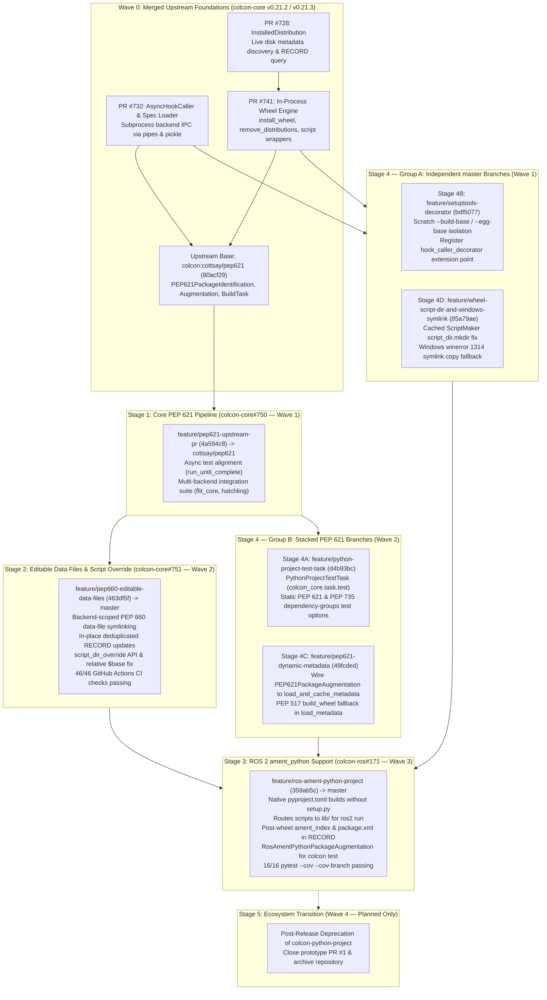

# Modern Python Packaging (PEP 517/518/621/660) in colcon: Architecture Summary & Staged Adoption Plan

This document provides the architectural summary and staged adoption plan for native modern Python packaging standards (PEP 517, PEP 518, PEP 621, PEP 660, and PEP 735) across [`colcon-core`](https://github.com/colcon/colcon-core) and [`colcon-ros`](https://github.com/colcon/colcon-ros), detailing the merged foundations, active pull requests, single-concern follow-up branches, verification results, and upstream release sequence.

---

## 1. Executive Summary & Staged Adoption Architecture

Direct invocations of `setup.py install` and `setup.py develop` have been deprecated across the Python packaging ecosystem in favor of declarative `pyproject.toml` specifications (`[build-system]` and `[project]`) executed via standard PEP 517/660 build hooks.

Rather than maintaining an out-of-tree override extension (`colcon-python-project`), native support is decomposed into five incremental stages across `colcon-core` and `colcon-ros` so that existing `setup.py` / `setup.cfg` workspaces remain 100% backward compatible while pure `pyproject.toml` packages are built, editable-installed, and tested natively:

---

## 2. Historic Context & Merged Upstream Foundations (`colcon-core`)

Early prototyping in [colcon/colcon-python-project#1](https://github.com/colcon/colcon-python-project/pull/1) validated PEP 517 subprocess hook invocation and in-process wheel extraction, but overriding the legacy `python` package type from an external package broke mixed workspaces containing classic `setup.py` packages. Per [colcon/colcon-core#736](https://github.com/colcon/colcon-core/issues/736), the architecture was redesigned around a dedicated `python.project` package type and merged incrementally into `colcon-core` (`v0.21.2` / `v0.21.3`):

| Component / PR | Status | Delivered Capabilities |
| :--- | :--- | :--- |
| **[colcon-core#732](https://github.com/colcon/colcon-core/pull/732)** | **Merged** (`v0.21.2`+) | **`AsyncHookCaller`**: Subprocess backend IPC via OS pipes and pickle serialization, `HookCallerDecoratorExtensionPoint`, and cached `pyproject.toml` spec loader (`load_and_cache_spec`). |
| **[colcon-core#728](https://github.com/colcon/colcon-core/pull/728)** | **Merged** (`v0.21.2`+) | **`InstalledDistribution`**: Filesystem discovery of installed Python distributions, entry points, `.dist-info` metadata, and `.pyc` bytecode artifacts. |
| **[colcon-core#741](https://github.com/colcon/colcon-core/pull/741)** | **Merged** (`845927c`, `v0.21.2` / `v0.21.3`) | **Wheel Engine (`wheel.py`)**: - `install_wheel`: In-process `.whl` extraction, `.data/` directory mapping (e.g. `share/`), console script wrapper generation via `distlib.scripts.ScriptMaker`, and PEP 376 `INSTALLER` / `RECORD` generation. - `remove_distributions`: Metadata-driven cleanup of prior installations and empty parent directories before rebuilds. |
| **[colcon:cottsay/pep621](https://github.com/colcon/colcon-core/tree/cottsay/pep621)** | **Upstream Base Branch** (`80acf29`) | Introduces `PEP621PackageIdentification` (`python.project`), `PEP621PackageAugmentation`, `PythonProjectBuildTask`, `metadata.py`, and the `pep621_builds` feature flag. |

---

## 3. Stage 1: Core PEP 621 Native Pipeline (`colcon/colcon-core#750`)

* **Pull Request**: [colcon/colcon-core#750](https://github.com/colcon/colcon-core/pull/750) (Open — Release Wave 1)
* **Target Base**: `colcon/colcon-core:cottsay/pep621` (`80acf29`)
* **Head Branch**: [`KmoM88/colcon-core:feature/pep621-upstream-pr`](https://github.com/KmoM88/colcon-core/tree/feature/pep621-upstream-pr) (Commit `4a594c8`)
* **Comparison**: [Compare on GitHub](https://github.com/colcon/colcon-core/compare/cottsay/pep621...KmoM88:colcon-core:feature/pep621-upstream-pr)

### Implementation Decisions & Solution
1. **Identification (`PEP621PackageIdentification`)**:
   - Inspects `pyproject.toml` for `[project].name` via `load_and_cache_spec` and assigns package type `python.project`.
   - Note on identification priority: `PEP621PackageIdentification` and `colcon-python-setup-py` both declare `PRIORITY = 90`; lowering `PEP621PackageIdentification.PRIORITY` to `80` (so `setup.cfg [100] > setup.py [90] > pep621 [80]`) is prepared as a 1-line policy adjustment if maintainers prefer `setup.py` precedence on hybrid packages.
2. **Metadata Augmentation (`PEP621PackageAugmentation`)**:
   - Maps `build-system.requires` to `build` dependencies, `project.dependencies` to `run` dependencies, and `project.optional-dependencies.test` to `test` dependencies, alongside `version` and `maintainers`/`authors`.
3. **Build Task (`PythonProjectBuildTask`)**:
   - Invokes `build_wheel` (or `build_editable` under `--symlink-install` when supported by the backend) via `AsyncHookCaller`.
   - Extracts the resulting wheel into `install_base` via `install_wheel`, generates colcon environment hooks and scripts, writes PEP 610 `direct_url.json` for editable builds, and records generated artifacts in `.dist-info/RECORD`.
4. **Test Runner Alignment & Multi-Backend Integration Suite**:
   - Replaced `pytest.mark.asyncio` in `test/test_task_python_project_build.py` with `colcon-core`'s `run_until_complete` helper so unit tests run in bootstrap environments without `pytest-asyncio`.
   - Added `test/test_integration_pep621.py` exercising real `flit_core` and `hatchling` builds: minimal PEP 621 wheel installation, `[project.scripts]` executable wrappers in `bin/`, idempotent rebuilds via `remove_distributions`, and PEP 660 `--symlink-install` editable builds.
   - Passed `flake8`, `scspell3k`, and copyright linters with zero warnings.

---

## 4. Stage 2: Backend-Scoped Editable Data Files & Script Override (`colcon/colcon-core#751`)

* **Pull Request**: [colcon/colcon-core#751](https://github.com/colcon/colcon-core/pull/751) (Draft — Release Wave 2)
* **Target Base**: `colcon/colcon-core:master`
* **Head Branch**: [`KmoM88/colcon-core:feature/pep660-editable-data-files`](https://github.com/KmoM88/colcon-core/tree/feature/pep660-editable-data-files) (Commit `463df5f`)
* **Comparison**: [Compare on GitHub](https://github.com/colcon/colcon-core/compare/master...KmoM88:colcon-core:feature/pep660-editable-data-files)
* **Verification**: **46/46 GitHub Actions CI checks passing** (Ubuntu, macOS, Windows across Python 3.8–3.14, `stdeb`, `codecov/patch`, `codecov/project`); `256 passed, 5 skipped` locally.

### Implementation Decisions & Solution
1. **Downstream `script_dir_override` API & Relative `$base` Fix**:
   - Extended `PythonProjectBuildTask.build(self, *, additional_hooks=None, script_dir_override=None)` so downstream tasks (`colcon-ros`) can route console scripts to custom relative directories (`lib/<pkg_name>`) when `setup.cfg` does not define an override.
   - Fixed `$base` path resolution in `setup.cfg` `[install]` / `[develop]` script directory parsing to expand relative to `Path()`, preventing path doubling when `args.install_base` is relative.
2. **Backend-Scoped `--symlink-install` Data-File Parity**:
   - Scoped `_get_data_files_mapping(pkg, backend_name)` strictly to the active PEP 517 backend so standard builds and `--symlink-install` builds maintain 100% parity:
     - `setuptools.build_meta*`: resolves `setup.cfg` (`[options.data_files]`) and `pyproject.toml` (`[tool.setuptools.data-files]`) with wildcard/glob expansion (`*`, `?`, `[`).
     - `hatchling.*`: resolves `[tool.hatch.build.targets.wheel.shared-data]` for both individual file mappings and recursive directory mappings.
     - Backends without external data-file configuration (such as `flit_core`) return an empty mapping rather than reading unrelated configuration files.
3. **In-Place `.dist-info/RECORD` Deduplication**:
   - Keyed `.dist-info/RECORD` updates by relative path (`record_map`) so replacing static wheel `.data/` copies with symbolic links updates existing `RECORD` entries in place without duplicate lines or stale digests.
4. **Unit & Multi-Backend Integration Coverage**:
   - Added backend-independent unit tests (`test_get_data_files_mapping_by_backend`, `test_build_task_script_override_and_record_update`) and real-backend integration tests (`test_integration_symlink_install_data_files`, `test_integration_setuptools_data_files_and_script_override`) with entry-point cache isolation and `setuptools < 70.1` `wheel` guards.

---

## 5. Stage 3: ROS 2 `ament_python` Native `pyproject.toml` Support (`colcon/colcon-ros#171`)

* **Pull Request**: [colcon/colcon-ros#171](https://github.com/colcon/colcon-ros/pull/171) (Draft — Release Wave 3)
* **Target Base**: `colcon/colcon-ros:master`
* **Head Branch**: [`KmoM88/colcon-ros:feature/ros-ament-python-project`](https://github.com/KmoM88/colcon-ros/tree/feature/ros-ament-python-project) (Commit `359ab5c`)
* **Comparison**: [Compare on GitHub](https://github.com/colcon/colcon-ros/compare/master...KmoM88:colcon-ros:feature/ros-ament-python-project)
* **Verification**: **16/16 `pytest --cov --cov-branch` tests passing** (`test_flake8`, `test_spell_check`, `test_copyright_license`, backend-independent unit tests, and end-to-end `flit_core` integration test).

### Implementation Decisions & Solution
1. **Build Delegation & `ros2 run` Executable Layout (`colcon_ros/task/ament_python/build.py`)**:
   - Preserves existing `PythonBuildTask` execution whenever `setup.py` is present; delegates `<build_type>ament_python</build_type>` packages containing `pyproject.toml` without `setup.py` to `PythonProjectBuildTask`.
   - Passes `script_dir_override=Path('lib') / self.context.pkg.name` so `[project.scripts]` executables install into `<install_base>/lib/<pkg_name>/` where `ros2 run` discovers them, without requiring a `setup.cfg`.
   - Passes `additional_hooks=additional_hooks` as a flat hook list so `create_environment_scripts` registers both `.dsv` and shell (`.sh` / `.bat` / `.ps1`) `ament_prefix_path` hooks in package environment scripts.
2. **Idempotent ROS Index & Manifest Installation with `RECORD` Tracking**:
   - Creates `share/ament_index/resource_index/packages/<pkg_name>` and installs `share/<pkg_name>/package.xml` *after* `PythonProjectBuildTask.build()` completes (avoiding deletion by `remove_distributions` during rebuilds and preserving any wheel-provided marker or manifest), then records added relative paths in `.dist-info/RECORD`.
3. **`colcon test` Metadata Augmentation (`colcon_ros/package_augmentation/ros_ament_python.py`)**:
   - Populates `desc.metadata['get_python_setup_options']` from `pyproject.toml` (`[project.dependencies]`, `[project.optional-dependencies]`, and PEP 735 `[dependency-groups]` test groups, merged with `setup.cfg` `[options]` when present) when `setup.py` is absent, enabling `AmentPythonTestTask` / `PytestPythonTestingStep` to match `pytest`.
4. **Dual-Manifest Build Dependency Convention (`package.xml` + `pyproject.toml`)**:
   - Because `colcon` invokes PEP 517 hooks without pip-style isolated virtual environments, ROS 2 `ament_python` packages using `pyproject.toml` declare their PEP 518 build backend as `<build_depend>` in `package.xml` (for example `python3-flit-core`, `python3-hatchling`, or `python3-setuptools` plus `python3-wheel` on distributions with `setuptools < 70.1` such as Ubuntu 22.04/24.04) so `rosdep install` provisions them in CI and buildfarm environments.

---

## 6. Stage 4: Single-Concern `colcon-core` Follow-Up Branches (Group A & Group B)

To keep upstream pull requests focused on single architectural concerns, the four remaining `colcon-core` enhancements are structured into two branch groups in `KmoM88/colcon-core` and validated together across the full 44-job GitHub Actions matrix in fork validation PR [KmoM88/colcon-core#5](https://github.com/KmoM88/colcon-core/pull/5) (run [40802478808](https://github.com/KmoM88/colcon-core/actions/runs/40802478808), `272 passed, 5 skipped` locally):

### Group A — Independent Branches off `colcon-core:master` (`6bfb100` — Release Wave 1)
1. **Stage 4B: `SetuptoolsDecorator` Scratch Build & Egg-Info Isolation ([`feature/setuptools-decorator`](https://github.com/KmoM88/colcon-core/tree/feature/setuptools-decorator), Commit `bdf5077`, [Compare](https://github.com/KmoM88/colcon-core/compare/master...feature/setuptools-decorator))**:
   - Implements `SetuptoolsHookCallerDecoratorExtension` (`colcon_core/python_project/hook_caller_decorator/setuptools.py`) redirecting `build --build-base` and `egg_info --egg-base` into temporary directories (`--build-option` on `setuptools >= 64`, `--global-option` on `setuptools < 64` and `get_requires_for_build_*`) so `setuptools.build_meta` and `setuptools.build_meta:__legacy__` builds leave zero `.egg-info/` or `build/` directories in the package source tree.
   - Registers `colcon_core.python_project.hook_caller_decorator` under `colcon_core.extension_point` in `setup.cfg` so entry-point-backed hook caller decorators are discovered by `get_all_extension_points()`.
   - Verification: `243 passed, 5 skipped` locally; 44/44 fork GitHub Actions jobs green.
2. **Stage 4D: Cached `ScriptMaker` Rebuild Fix & Windows Symlink Privilege Fallback ([`feature/wheel-script-dir-and-windows-symlink`](https://github.com/KmoM88/colcon-core/tree/feature/wheel-script-dir-and-windows-symlink), Commit `85a79ae`, [Compare](https://github.com/KmoM88/colcon-core/compare/master...feature/wheel-script-dir-and-windows-symlink))**:
   - Ensures `script_dir.mkdir(parents=True, exist_ok=True)` in `colcon_core/python_project/wheel.py` when `specs` is non-empty before invoking `functools.lru_cache`-backed `_get_script_maker(script_dir)`, preventing `FileNotFoundError` on repeated in-process builds after `remove_distributions()` prunes an empty `script_dir`.
   - Catches `OSError` with `winerror == 1314` (`ERROR_PRIVILEGE_NOT_HELD`) around `os.symlink()` on Windows in `colcon_core.task.install()`, logs a warning, and falls back to `shutil.copy`.
   - Verification: `240 passed, 5 skipped` locally; 44/44 fork GitHub Actions jobs green.

### Group B — Stacked Branches off `feature/pep621-upstream-pr` (`4a594c8` / `#750` — Release Wave 2)
3. **Stage 4A: Pure `python.project` Test Task & PEP 735 Dependency-Groups Support ([`feature/python-project-test-task`](https://github.com/KmoM88/colcon-core/tree/feature/python-project-test-task), Commit `d4b93bc`, [Compare](https://github.com/KmoM88/colcon-core/compare/feature/pep621-upstream-pr...feature/python-project-test-task))**:
   - Adds `PythonProjectTestTask(PythonTestTask)` (`colcon_core/task/python_project/test.py`, overriding `add_arguments` to avoid duplicate `--python-testing` registration) and registers `python.project` under `colcon_core.task.test` in `setup.cfg`.
   - Populates `get_python_setup_options` in `PEP621PackageAugmentation` from `[project.dependencies]`, `[project.optional-dependencies]` (`test`, `tests`, `testing`), and cycle-safe PEP 735 `[dependency-groups]` (`include-group` resolution), enabling `colcon test` (`PytestPythonTestingStep`) on pure non-ROS `python.project` packages.
   - Verification: `256 passed, 5 skipped` locally; 44/44 fork GitHub Actions jobs green.
4. **Stage 4C: Dynamic PEP 621 Metadata Resolution & PEP 517 `build_wheel` Fallback ([`feature/pep621-dynamic-metadata`](https://github.com/KmoM88/colcon-core/tree/feature/pep621-dynamic-metadata), Commit `49fcded`, [Compare](https://github.com/KmoM88/colcon-core/compare/feature/pep621-upstream-pr...feature/pep621-dynamic-metadata))**:
   - Connects `PEP621PackageAugmentation` to `load_and_cache_metadata` when `project.dynamic` declares `version`, `dependencies`, `optional-dependencies`, `maintainers`, or `authors`, incurring zero subprocess overhead for static `pyproject.toml` manifests and degrading gracefully with a warning when build backends are absent during discovery.
   - Adds a PEP 517 `build_wheel` `.dist-info/METADATA` fallback in `colcon_core/python_project/metadata.py` (`load_metadata`) when a backend omits the optional `prepare_metadata_for_build_wheel` hook.
   - Verification: `257 passed, 5 skipped` locally; 44/44 fork GitHub Actions jobs green.

---

## 7. Stage 5: Prototype Deprecation & Archival Plan (`colcon/colcon-python-project` — Planned Only)

* **Status**: **Planned Only — Post-Release Gate (No Implementation Executed)**
* **Scope**: Once Stages 1–4 are merged and released in `colcon-core` and `colcon-ros`:
  1. Add a deprecation notice to `colcon/colcon-python-project` directing users to native `colcon-core` and `colcon-ros` support and noting the minimum required release versions.
  2. Close prototype PR [colcon/colcon-python-project#1](https://github.com/colcon/colcon-python-project/pull/1) and update [colcon/colcon-core#736](https://github.com/colcon/colcon-core/issues/736) with links to the merged pull requests.
  3. Archive `colcon/colcon-python-project` as read-only on GitHub.

---

## 8. Upstream Release Waves & Deliverable Matrix

### 8.1 Ordered Release Wave Plan

| Release Wave | Target Repository | Included PRs & Branches | Sequencing & Release Gate |
| :--- | :--- | :--- | :--- |
| **Wave 0** *(Completed)* | `colcon-core` `v0.21.2` / `v0.21.3` | `#728`, `#732`, `#741` (`845927c`) | **Released upstream**. Establishes `InstalledDistribution`, `AsyncHookCaller`, `install_wheel`, and `remove_distributions`. |
| **Wave 1** *(Active / Independent)* | `colcon-core` (`cottsay/pep621` & `master`) | 1. [colcon/colcon-core#750](https://github.com/colcon/colcon-core/pull/750) (`4a594c8` -> `cottsay/pep621`, then merge `cottsay/pep621` -> `master`) 2. Stage 4B `feature/setuptools-decorator` (`bdf5077` -> `master`) 3. Stage 4D `feature/wheel-script-dir-and-windows-symlink` (`85a79ae` -> `master`) | All three items are independent of one another and can land on `colcon-core:master` in parallel. |
| **Wave 2** *(Core Minor Release)* | `colcon-core` (e.g. `v0.22.0`) | 1. Rebase & undraft [colcon/colcon-core#751](https://github.com/colcon/colcon-core/pull/751) (`463df5f` -> `master`) 2. Stage 4A `feature/python-project-test-task` (`d4b93bc` -> `master`) 3. Stage 4C `feature/pep621-dynamic-metadata` (`49fcded` -> `master`) | Cut a `colcon-core` minor release exposing `PythonProjectBuildTask(..., script_dir_override=...)` and `PythonProjectTestTask`. |
| **Wave 3** *(ROS 2 Minor Release)* | `colcon-ros` | 1. Update `colcon-ros/setup.cfg` minimum `colcon-core` dependency to the Wave 2 release 2. Undraft & merge [colcon/colcon-ros#171](https://github.com/colcon/colcon-ros/pull/171) (`359ab5c` -> `colcon-ros:master`) | Cut a `colcon-ros` release enabling pure `pyproject.toml` `ament_python` builds, `ros2 run` layout, and `colcon test` integration. |
| **Wave 4** *(Planned Only)* | `colcon-python-project` | Stage 5 deprecation notice, PR #1 closure & archival | Executed only after Wave 2 and Wave 3 releases are published. |

### 8.2 Complete Summary of PRs & Branches

| Stage / Deliverable | Repository | Branch & Commit | Target Base | Status & Verification |
| :--- | :--- | :--- | :--- | :--- |
| **[colcon-core#732](https://github.com/colcon/colcon-core/pull/732)** | `colcon-core` | `master` | `master` | **Merged** (`v0.21.2`+) — `AsyncHookCaller` & `pyproject.toml` spec loader |
| **[colcon-core#728](https://github.com/colcon/colcon-core/pull/728)** | `colcon-core` | `master` | `master` | **Merged** (`v0.21.2`+) — `InstalledDistribution` metadata & file discovery |
| **[colcon-core#741](https://github.com/colcon/colcon-core/pull/741)** | `colcon-core` | `master` (`845927c`) | `master` | **Merged** (`v0.21.2`+) — `install_wheel` & `remove_distributions` |
| **Stage 1: [colcon-core#750](https://github.com/colcon/colcon-core/pull/750)** | `colcon-core` | [`feature/pep621-upstream-pr`](https://github.com/KmoM88/colcon-core/tree/feature/pep621-upstream-pr) (`4a594c8`) | `cottsay/pep621` | **Open PR** — Core PEP 621 tests, `run_until_complete` alignment, multi-backend integration suite |
| **Stage 2: [colcon-core#751](https://github.com/colcon/colcon-core/pull/751)** | `colcon-core` | [`feature/pep660-editable-data-files`](https://github.com/KmoM88/colcon-core/tree/feature/pep660-editable-data-files) (`463df5f`) | `master` | **Draft PR** — **46/46 GitHub Actions CI green** (`256 passed, 5 skipped` locally) |
| **Stage 3: [colcon-ros#171](https://github.com/colcon/colcon-ros/pull/171)** | `colcon-ros` | [`feature/ros-ament-python-project`](https://github.com/KmoM88/colcon-ros/tree/feature/ros-ament-python-project) (`359ab5c`) | `master` | **Draft PR** — **16/16 `pytest --cov --cov-branch` green** |
| **Stage 4B (Group A)** | `KmoM88/colcon-core` | [`feature/setuptools-decorator`](https://github.com/KmoM88/colcon-core/tree/feature/setuptools-decorator) (`bdf5077`) | `master` (`6bfb100`) | **Fork Branch Verified** — `SetuptoolsDecorator` scratch isolation + decorator group registration (`243 passed, 5 skipped`; 44/44 fork CI green) |
| **Stage 4D (Group A)** | `KmoM88/colcon-core` | [`feature/wheel-script-dir-and-windows-symlink`](https://github.com/KmoM88/colcon-core/tree/feature/wheel-script-dir-and-windows-symlink) (`85a79ae`) | `master` (`6bfb100`) | **Fork Branch Verified** — `wheel.py` cached `ScriptMaker` `script_dir.mkdir` + Windows `winerror 1314` copy fallback (`240 passed, 5 skipped`; 44/44 fork CI green) |
| **Stage 4A (Group B)** | `KmoM88/colcon-core` | [`feature/python-project-test-task`](https://github.com/KmoM88/colcon-core/tree/feature/python-project-test-task) (`d4b93bc`) | `feature/pep621-upstream-pr` (`4a594c8`) | **Fork Branch Verified** — `PythonProjectTestTask` + static PEP 621 / PEP 735 `colcon test` options (`256 passed, 5 skipped`; 44/44 fork CI green) |
| **Stage 4C (Group B)** | `KmoM88/colcon-core` | [`feature/pep621-dynamic-metadata`](https://github.com/KmoM88/colcon-core/tree/feature/pep621-dynamic-metadata) (`49fcded`) | `feature/pep621-upstream-pr` (`4a594c8`) | **Fork Branch Verified** — Dynamic PEP 621 metadata via `load_and_cache_metadata` + PEP 517 `build_wheel` fallback (`257 passed, 5 skipped`; 44/44 fork CI green) |
| **Combined Stage 4 CI ([PR #5](https://github.com/KmoM88/colcon-core/pull/5))** | `KmoM88/colcon-core` | [`ci/stage4-all-validation`](https://github.com/KmoM88/colcon-core/tree/ci/stage4-all-validation) (`32dd42a`) | `KmoM88:master` | **Fork CI Validation PR** — **44/44 GitHub Actions matrix jobs green** ([Run 40802478808](https://github.com/KmoM88/colcon-core/actions/runs/40802478808), `272 passed, 5 skipped` locally) |
| **Stage 5 Deprecation** | `colcon-python-project` | Post-release | `main` | **Planned Only (No Implementation)** — Deprecation notice, close [PR #1](https://github.com/colcon/colcon-python-project/pull/1) & archive after Wave 2 + Wave 3 releases |

---

* **Published Gist**: [https://gist.github.com/KmoM88/0357abff37b5a32ab801cac7d399d4ed](https://gist.github.com/KmoM88/0357abff37b5a32ab801cac7d399d4ed)
*Prepared by Federico Rossi ([KmoM88](https://github.com/KmoM88))*
