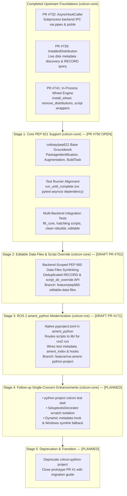

# Modern Python Packaging (PEP 517/518/621/660) in colcon: Architectural Roadmap & Upstream Integration Proposal

This document outlines the architectural roadmap, upstream integration strategy, and current verification status for providing native modern Python packaging standards (PEP 517, PEP 518, PEP 621, and PEP 660) in `colcon-core` and `colcon-ros`.

It connects the merged groundwork in `colcon-core` with open **PR [#750](https://github.com/colcon/colcon-core/pull/750)** and outlines the sequential, single-concern stages to bring full standard packaging to the ROS 2 and colcon ecosystems.

---

## 1. Executive Summary & Architecture Overview

The Python packaging ecosystem has deprecated direct invocations of `setup.py install` and `setup.py develop`. Standard builds are now driven by `pyproject.toml` specifications (`[build-system]` and `[project]`) executed through standardized build backends (Flit, Hatchling, Setuptools, etc.).

Rather than relying on an external prototype extension (`colcon-python-project`), this proposal establishes native, in-process, high-performance packaging across `colcon-core` and `colcon-ros` divided into five sequential stages:



---

## 2. Foundation: Merged Upstream Building Blocks

The core packaging primitives have already been reviewed and merged into `colcon-core`:

| Component / PR | Status | Description |
| :--- | :--- | :--- |
| **[colcon-core#732](https://github.com/colcon/colcon-core/pull/732)** | **Merged** | **`AsyncHookCaller`**: High-performance backend subprocess IPC via OS pipes and pickle serialization. Includes `HookCallerDecoratorExtensionPoint` and TOML parser fallback abstractions. |
| **[colcon-core#728](https://github.com/colcon/colcon-core/pull/728)** | **Merged** | **`InstalledDistribution`**: Live filesystem discovery of installed Python packages, entry points, metadata directories (`.dist-info`), and bytecode cache files (`.pyc`). |
| **[colcon-core#741](https://github.com/colcon/colcon-core/pull/741)** | **Merged** (`v0.21.2` / `v0.21.3`) | **Wheel Engine (`wheel.py`)**:<br/>• `install_wheel`: In-process ZIP extraction, `.data/` directory mapping (e.g. `share/`), CLI entry point script wrapper generation via `distlib.scripts.ScriptMaker`, and PEP 376 `INSTALLER` and `RECORD` writer.<br/>• `remove_distributions`: Clean disk uninstallation of existing distributions prior to rebuilds. |

---

## 3. Stage 1: Core PEP 621 Native Pipeline (PR #750)

* **Pull Request**: [colcon/colcon-core#750](https://github.com/colcon/colcon-core/pull/750) (`Feature/pep621 testing`)
* **Target Base**: `colcon/colcon-core:cottsay/pep621`
* **Head Branch**: [`KmoM88/colcon-core:feature/pep621-upstream-pr`](https://github.com/KmoM88/colcon-core/tree/feature/pep621-upstream-pr) (Commit `4a594c8`)
* **Comparison**: [Compare on GitHub](https://github.com/colcon/colcon-core/compare/cottsay/pep621...KmoM88:colcon-core:feature/pep621-upstream-pr)

### Key Capabilities in Stage 1
1. **Identification (`PEP621PackageIdentification`)**:
   - Inspects `pyproject.toml` for the `[project]` table using `load_and_cache_spec`.
   - Identifies package type as `python.project`.
   - Configured below legacy `setup.cfg` (`100`) to preserve backward compatibility. *(Note: lowering `PRIORITY` from `90` to `80` is recommended so it also ranks deterministically below `colcon-python-setup-py`'s `PRIORITY = 90` in hybrid repositories containing both `setup.py` and `pyproject.toml`).*
2. **Metadata Augmentation (`PEP621PackageAugmentation`)**:
   - Maps `build-system.requires` $\rightarrow$ `build` dependencies.
   - Maps `project.dependencies` $\rightarrow$ `run` dependencies.
   - Maps `project.optional-dependencies.test` $\rightarrow$ `test` dependencies.
3. **Build Task (`PythonProjectBuildTask`)**:
   - Executes `build_wheel` via `AsyncHookCaller`.
   - Installs the wheel into the target `install_base` using `install_wheel`.
   - Emits colcon notification hooks into `.dist-info/RECORD`.
   - Handles editable installations via `build_editable` and writes PEP 610 `direct_url.json` (`{"dir_info": {"editable": true}}`).
4. **Test Suite Harmonization**:
   - Converted async tests to use `colcon-core`'s canonical `from .run_until_complete import run_until_complete`, removing external test runner dependencies.
5. **Real-Backend Integration Tests (`test/test_integration_pep621.py`)**:
   - Automated end-to-end tests exercising `flit_core` and `hatchling`:
     - Minimal pure PEP 621 package build and runtime import.
     - Console script entry points (`[project.scripts]`) with `0o755` permissions in `bin/`.
     - Clean rebuilds verifying that `remove_distributions` deletes old files.
     - Editable installations with `--symlink-install`.
6. **Code Quality**:
   - 100% clean under `flake8` and `scspell3k`.

### Feature Flag Rollout Strategy (`COLCON_FEATURE_FLAGS`)
To facilitate upstream merging with zero risk to existing production workspaces, native PEP 621 building can optionally be gated behind `colcon-core`'s established feature flag mechanism (`colcon_core.feature_flags`):

* **Activation via Environment Variable**:
  ```bash
  export COLCON_FEATURE_FLAGS=pep621_builds
  colcon build
  ```
  *(Multiple flags can be combined using the system path separator, e.g. `COLCON_FEATURE_FLAGS=foo:pep621_builds` on Linux/macOS).*
* **Zero-Regression Extension Guard**:
  In `colcon_core/package_identification/pep621.py`:
  ```python
  from colcon_core.feature_flags import is_feature_flag_set

  class PEP621PackageIdentification(PackageIdentificationExtensionPoint):
      PRIORITY = 80  # Lower priority than setup.cfg (100) and setup.py (90)

      def identify(self, desc):
          if not is_feature_flag_set('pep621_builds'):
              return
          # ... proceed with pyproject.toml [project] parsing ...
  ```
* **Graduation Path**:
  Once the maintainers and community validate the implementation across active distributions, `pep621_builds` can simply be registered in `IMPLEMENTED_FLAGS` in `colcon_core/feature_flags.py`. This promotes native PEP 621 discovery to default behavior while gracefully warning users that the flag is no longer required.

---

## 4. Stage 2: PEP 660 Editable Data Files & Script Directory Override

* **Status**: **Draft PR Opened & Verified (46/46 CI Checks Passing)**
* **Pull Request**: [colcon/colcon-core#751](https://github.com/colcon/colcon-core/pull/751)
* **Repository**: `colcon-core`
* **Branch**: [`KmoM88/colcon-core:feature/pep660-editable-data-files`](https://github.com/KmoM88/colcon-core/tree/feature/pep660-editable-data-files) (Commit `463df5f`)

### The Problem
1. **Editable Non-Python Assets**: PEP 660's `build_editable` hook only exposes Python modules (`.py`) dynamically. Non-Python assets installed into `share/<package>/` (launch files, YAML configs, URDFs) are either copied statically into `<dist>.data/` (Hatchling) or omitted altogether during `build_editable` (Setuptools), breaking live editing or dropping assets under `--symlink-install`.
2. **Downstream Script Location Overrides**: Standard wheels place `[project.scripts]` entry points in `bin/`, whereas downstream ecosystems like ROS 2 (`ros2 run <pkg> <node>`) require package executables in `lib/<package_name>` without forcing packages to carry a legacy `setup.cfg`.

### The Solution
`feature/pep660-editable-data-files` enhances `PythonProjectBuildTask`:
- **Optional `script_dir_override` Parameter**: Extends `PythonProjectBuildTask.build(*, additional_hooks=None, script_dir_override=None)` so downstream tasks can specify a fallback script directory when `setup.cfg` does not override it, while fixing `$base` expansion for relative `install_base` paths.
- **Backend-Scoped Data Files Parity**: Scopes `_get_data_files_mapping(pkg, backend_name)` strictly to the active PEP 517 backend so release and `--symlink-install` builds maintain 100% parity:
  - `setuptools.build_meta*`: resolves `setup.cfg` (`[options.data_files]`) and `pyproject.toml` (`[tool.setuptools.data-files]`) with glob expansion (`*`, `?`, `[`).
  - `hatchling.*`: resolves `[tool.hatch.build.targets.wheel.shared-data]` for both individual file targets and recursive directory targets.
  - Backends without external data-file semantics (e.g. `flit_core`) remain untouched.
- **Deduplicated `.dist-info/RECORD`**: Replaces static `.data/` entries cleanly in `RECORD` when converted to symbolic links rather than appending duplicate lines with stale hashes.

---

## 5. Stage 3: ROS 2 `ament_python` Modernization

* **Status**: **Draft PR Opened & Verified (16/16 pytest Checks Passing)**
* **Pull Request**: [colcon/colcon-ros#171](https://github.com/colcon/colcon-ros/pull/171)
* **Repository**: `colcon-ros`
* **Branch**: [`KmoM88/colcon-ros:feature/ros-ament-python-project`](https://github.com/KmoM88/colcon-ros/tree/feature/ros-ament-python-project) (Commit `359ab5c`)

### The Problem
In ROS 2, packages specifying `<build_type>ament_python</build_type>` in `package.xml` historically required `setup.py` and `setup.cfg` (`install_scripts=$base/lib/<pkg>`). Adopting pure `pyproject.toml` requires bridging `colcon-ros` to `PythonProjectBuildTask` while preserving `ros2 run` executable discovery, `colcon test` (`pytest`) matching, `ament_index` markers, and clean uninstallation.

### The Solution
`feature/ros-ament-python-project` updates `colcon-ros`:
- **Build Delegation & `ros2 run` Compatibility**: Detects `ament_python` packages declaring `pyproject.toml` without `setup.py` and delegates to `PythonProjectBuildTask.build()` with `script_dir_override = Path('lib') / pkg.name` so `[project.scripts]` nodes install into `lib/<pkg>/` where `ros2 run` discovers them.
- **ROS 2 Metadata & Clean `RECORD` Tracking**: Installs the `ament_index` package marker (`share/ament_index/resource_index/packages/<pkg>`), `share/<pkg>/package.xml` (respecting `--symlink-install` without clobbering wheel-provided manifests), and `AMENT_PREFIX_PATH` hooks, recording installed artifacts in `.dist-info/RECORD`.
- **`colcon test` Support**: Wires `RosAmentPythonPackageAugmentation` to populate test metadata from `pyproject.toml` when `setup.py` is absent so `AmentPythonTestTask` matches `pytest` seamlessly.
- **Dual-Manifest Guidance**: Documents declaring PEP 518 build backends (e.g. `python3-flit-core`, `python3-hatchling`, or `python3-setuptools` + `python3-wheel` on platforms with `setuptools < 70.1` such as Ubuntu 22.04/24.04) as `<build_depend>` in `package.xml` so `rosdep install` provisions them in non-isolated CI/buildfarm environments.

---

## 6. Stage 4: Follow-up Single-Concern Enhancements in `colcon-core`

To keep core PRs small and independently reviewable after Stages 1–3, four targeted follow-up PRs are planned for `colcon-core`:

1. **`python.project` Test Task (`colcon test`)**: Register `python.project` under `colcon_core.task.test` so pure PEP 621 non-ROS packages run `pytest` natively via `colcon test`.
2. **Setuptools Scratch Directory Isolation**: Port `SetuptoolsDecorator` (`--build-base` / `--egg-base` temporary directory redirection) so `setuptools.build_meta` builds never leave `.egg-info/` directories in the source tree.
3. **Dynamic Metadata Hook Integration**: Connect `PEP621PackageAugmentation` with `colcon_core.python_project.metadata.load_and_cache_metadata` (`prepare_metadata_for_build_wheel`) when `dynamic` fields (`version`, `dependencies`) are declared in `pyproject.toml`.
4. **Windows Symlink Fallback**: Gracefully fall back to file copy with a warning when `os.symlink` lacks `SeCreateSymbolicLinkPrivilege` on Windows.

---

## 7. Stage 5: Ecosystem Transition & Deprecation

* **Repository**: `colcon/colcon-python-project`
* **Status**: **Planned post-merge**

Once native support is merged into `colcon-core` and `colcon-ros`:
1. Provide a deprecation notice in `colcon-python-project` advising users to transition to native `colcon-core`.
2. Close PR #1 in `colcon-python-project` referencing the upstream native implementation.

---

## 8. Summary Table of Feature Branches & Deliverables

| Stage | Repository | Feature Branch | Base Branch | Status / PR |
| :--- | :--- | :--- | :--- | :--- |
| **Stage 1** | `colcon-core` | `feature/pep621-upstream-pr` (`4a594c8`) | `cottsay/pep621` | **[colcon-core#750](https://github.com/colcon/colcon-core/pull/750)** (Under Review) |
| **Stage 2** | `colcon-core` | `feature/pep660-editable-data-files` (`463df5f`) | `master` | **[colcon-core#751](https://github.com/colcon/colcon-core/pull/751)** (Draft PR) |
| **Stage 3** | `colcon-ros` | `feature/ros-ament-python-project` (`359ab5c`) | `master` | **[colcon-ros#171](https://github.com/colcon/colcon-ros/pull/171)** (Draft PR) |
| **Stage 4** | `colcon-core` | Single-concern follow-up branches (`task.test`, `SetuptoolsDecorator`, dynamic metadata, Windows fallback) | `master` | **Planned** |
| **Stage 5** | `colcon-python-project` | Deprecation Documentation | `master` | **Planned** |

---

* **Published Gist**: [https://gist.github.com/KmoM88/0357abff37b5a32ab801cac7d399d4ed](https://gist.github.com/KmoM88/0357abff37b5a32ab801cac7d399d4ed)  
*Prepared by Federico Rossi ([KmoM88](https://github.com/KmoM88))*
