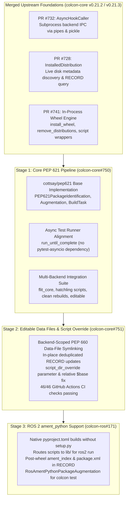

# Modern Python Packaging (PEP 517/518/621/660) in colcon: Implemented Architecture & Verification Results

This document summarizes the implemented architecture, delivered pull requests, and verification results for native modern Python packaging standards (PEP 517, PEP 518, PEP 621, and PEP 660) across `colcon-core` and `colcon-ros`.

---

## 1. Executive Summary & Delivered Architecture

Direct invocations of `setup.py install` and `setup.py develop` have been deprecated across the Python packaging ecosystem in favor of `pyproject.toml` specifications (`[build-system]` and `[project]`) executed via standard PEP 517/660 build hooks.

Building on the merged wheel and hook-caller foundations in `colcon-core`, native support is delivered across three focused pull requests covering `colcon-core` (`#750`, `#751`) and `colcon-ros` (`#171`):

---

## 2. Merged Upstream Foundations (`colcon-core`)

The core packaging primitives are merged in `colcon-core` (`master`, released in `v0.21.2` / `v0.21.3`):

| Component / PR | Status | Delivered Capabilities |
| :--- | :--- | :--- |
| **[colcon-core#732](https://github.com/colcon/colcon-core/pull/732)** | **Merged** | **`AsyncHookCaller`**: Subprocess backend IPC via OS pipes and pickle serialization, `HookCallerDecoratorExtensionPoint`, and `pyproject.toml` spec loader (`load_and_cache_spec`). |
| **[colcon-core#728](https://github.com/colcon/colcon-core/pull/728)** | **Merged** | **`InstalledDistribution`**: Filesystem discovery of installed Python distributions, entry points, `.dist-info` metadata, and `.pyc` bytecode artifacts. |
| **[colcon-core#741](https://github.com/colcon/colcon-core/pull/741)** | **Merged** (`v0.21.2` / `v0.21.3`) | **Wheel Engine (`wheel.py`)**: - `install_wheel`: In-process `.whl` extraction, `.data/` directory mapping (e.g. `share/`), console script wrapper generation via `distlib.scripts.ScriptMaker`, and PEP 376 `INSTALLER` / `RECORD` generation. - `remove_distributions`: Metadata-driven cleanup of prior installations and empty parent directories before rebuilds. |

---

## 3. Stage 1: Core PEP 621 Native Pipeline (`colcon/colcon-core#750`)

* **Pull Request**: [colcon/colcon-core#750](https://github.com/colcon/colcon-core/pull/750)
* **Target Base**: `colcon/colcon-core:cottsay/pep621`
* **Head Branch**: [`KmoM88/colcon-core:feature/pep621-upstream-pr`](https://github.com/KmoM88/colcon-core/tree/feature/pep621-upstream-pr) (Commit `4a594c8`)
* **Comparison**: [Compare on GitHub](https://github.com/colcon/colcon-core/compare/cottsay/pep621...KmoM88:colcon-core:feature/pep621-upstream-pr)

### Delivered Capabilities
1. **Identification (`PEP621PackageIdentification`)**:
   - Inspects `pyproject.toml` for `[project].name` via `load_and_cache_spec` and assigns package type `python.project`.
2. **Metadata Augmentation (`PEP621PackageAugmentation`)**:
   - Maps `build-system.requires` to `build` dependencies, `project.dependencies` to `run` dependencies, and `project.optional-dependencies.test` to `test` dependencies, alongside `version` and `maintainers`/`authors`.
3. **Build Task (`PythonProjectBuildTask`)**:
   - Invokes `build_wheel` (or `build_editable` under `--symlink-install` when supported by the backend) via `AsyncHookCaller`.
   - Extracts the resulting wheel into `install_base` via `install_wheel`, generates colcon environment hooks and scripts, writes PEP 610 `direct_url.json` for editable builds, and records generated artifacts in `.dist-info/RECORD`.
4. **Test Runner Alignment & Multi-Backend Integration Suite**:
   - Aligned `test/test_task_python_project_build.py` with `colcon-core`'s `run_until_complete` helper so unit tests run without `pytest-asyncio`.
   - Added `test/test_integration_pep621.py` exercising real `flit_core` and `hatchling` builds: minimal PEP 621 wheel installation, `[project.scripts]` executable wrappers in `bin/`, idempotent rebuilds via `remove_distributions`, and PEP 660 `--symlink-install` editable builds.
   - Passed `flake8`, `scspell3k`, and copyright linters with zero warnings.

---

## 4. Stage 2: Backend-Scoped Editable Data Files & Script Override (`colcon/colcon-core#751`)

* **Pull Request**: [colcon/colcon-core#751](https://github.com/colcon/colcon-core/pull/751) (Draft)
* **Target Base**: `colcon/colcon-core:master`
* **Head Branch**: [`KmoM88/colcon-core:feature/pep660-editable-data-files`](https://github.com/KmoM88/colcon-core/tree/feature/pep660-editable-data-files) (Commit `463df5f`)
* **Verification**: **46/46 GitHub Actions CI checks passing** (Ubuntu, macOS, Windows across Python 3.8–3.14, `stdeb`, `codecov/patch`, `codecov/project`); `256 passed, 5 skipped` locally.

### Delivered Capabilities
1. **Downstream `script_dir_override` API & Relative `$base` Fix**:
   - Extended `PythonProjectBuildTask.build(self, *, additional_hooks=None, script_dir_override=None)` so downstream tasks (such as `colcon-ros`) can route console scripts to custom relative directories (e.g. `lib/<pkg_name>`) when `setup.cfg` does not define an override.
   - Fixed `$base` path resolution in `setup.cfg` `[install]` / `[develop]` script directory parsing to expand relative to `Path()`, preventing path doubling when `args.install_base` is relative.
2. **Backend-Scoped `--symlink-install` Data-File Parity**:
   - Scoped `_get_data_files_mapping(pkg, backend_name)` strictly to the active PEP 517 backend so standard builds and `--symlink-install` builds maintain 100% parity:
     - `setuptools.build_meta*`: resolves `setup.cfg` (`[options.data_files]`) and `pyproject.toml` (`[tool.setuptools.data-files]`) with wildcard/glob expansion (`*`, `?`, `[`).
     - `hatchling.*`: resolves `[tool.hatch.build.targets.wheel.shared-data]` for both individual file mappings and recursive directory mappings.
     - Backends without external data-file configuration (such as `flit_core`) return an empty mapping rather than reading unrelated configuration files.
3. **In-Place `.dist-info/RECORD` Deduplication**:
   - Keyed `.dist-info/RECORD` updates by relative path so replacing static wheel `.data/` copies with symbolic links updates existing `RECORD` entries in place without duplicate lines or stale digests.
4. **Unit & Multi-Backend Integration Coverage**:
   - Added backend-independent unit tests (`test_get_data_files_mapping_by_backend`, `test_build_task_script_override_and_record_update`) and real-backend integration tests (`test_integration_symlink_install_data_files`, `test_integration_setuptools_data_files_and_script_override`) with entry-point cache isolation across full test runs.

---

## 5. Stage 3: ROS 2 `ament_python` Native `pyproject.toml` Support (`colcon/colcon-ros#171`)

* **Pull Request**: [colcon/colcon-ros#171](https://github.com/colcon/colcon-ros/pull/171) (Draft)
* **Target Base**: `colcon/colcon-ros:master`
* **Head Branch**: [`KmoM88/colcon-ros:feature/ros-ament-python-project`](https://github.com/KmoM88/colcon-ros/tree/feature/ros-ament-python-project) (Commit `359ab5c`)
* **Verification**: **16/16 `pytest --cov --cov-branch` tests passing** (`test_flake8`, `test_spell_check`, `test_copyright_license`, backend-independent unit tests, and end-to-end `flit_core` integration test).

### Delivered Capabilities
1. **Build Delegation & `ros2 run` Executable Layout (`colcon_ros/task/ament_python/build.py`)**:
   - Detects `<build_type>ament_python</build_type>` packages containing `pyproject.toml` without `setup.py` and delegates wheel building and installation to `PythonProjectBuildTask`.
   - Passes `script_dir_override=Path('lib') / self.context.pkg.name` so `[project.scripts]` executables install into `<install_base>/lib/<pkg_name>/` where `ros2 run` discovers them, without requiring a `setup.cfg`.
   - Passes `additional_hooks=additional_hooks` as a flat hook list so `create_environment_scripts` registers both `.dsv` and shell (`.sh` / `.bat` / `.ps1`) `ament_prefix_path` hooks in package environment scripts.
2. **Idempotent ROS Index & Manifest Installation with `RECORD` Tracking**:
   - Creates `share/ament_index/resource_index/packages/<pkg_name>` and installs `share/<pkg_name>/package.xml` *after* `PythonProjectBuildTask.build()` completes (avoiding deletion by `remove_distributions` during rebuilds and preserving any wheel-provided marker or manifest), then records added relative paths in `.dist-info/RECORD`.
3. **`colcon test` Metadata Augmentation (`colcon_ros/package_augmentation/ros_ament_python.py`)**:
   - Populates `desc.metadata['get_python_setup_options']` from `pyproject.toml` (`[project.dependencies]`, `[project.optional-dependencies]`, and PEP 735 `[dependency-groups]` test groups, merged with `setup.cfg` `[options]` when present) when `setup.py` is absent, enabling `AmentPythonTestTask` / `PytestPythonTestingStep` to match `pytest`.
4. **Dual-Manifest Build Dependency Convention (`package.xml` + `pyproject.toml`)**:
   - Because `colcon` invokes PEP 517 hooks without pip-style isolated virtual environments, ROS 2 `ament_python` packages using `pyproject.toml` declare their PEP 518 build backend as `<build_depend>` in `package.xml` (for example `python3-flit-core`, `python3-hatchling`, or `python3-setuptools` plus `python3-wheel` on distributions with `setuptools < 70.1` such as Ubuntu 22.04/24.04) so `rosdep install` provisions them in CI and buildfarm environments.

---

## 6. End-to-End ROS 2 Jazzy Dockerized Validation Results

In addition to unit suites and mock packages, the delivered `colcon-core` (`#750` + `#751`) and `colcon-ros` (`#171`) stack was validated inside a reproducible `ros:jazzy-ros-core` (Ubuntu 24.04, Python 3.12) Docker environment across active official `ros2/*` packages migrated to pure PEP 621 `pyproject.toml` (`setup.py` and `setup.cfg` deleted):

| Active `ros2/*` Repository | Migrated Package(s) | PEP 517/660 Backend | Verified Results |
| :--- | :--- | :--- | :--- |
| **`ros2/demos`** (`jazzy`) | `demo_nodes_py` | `hatchling.build` | 13 `[project.scripts]` nodes installed to `lib/demo_nodes_py/`; `share/demo_nodes_py/params.yaml` unpacked in standard builds and live-symlinked under `--symlink-install`; live `ros2 run` DDS `talker` -> `listener` message exchange; `colcon test` (`ament_copyright`, `ament_flake8`, `ament_pep257`) passing |
| **`ros2/examples`** (`jazzy`) | `examples_rclpy_minimal_publisher`, `examples_rclpy_minimal_subscriber` | `flit_core.buildapi` | Multi-package pure PEP 621 build; 7 executables discovered by `ros2 pkg executables`; PEP 660 `.pth` editable rebuild + PEP 610 `direct_url.json`; live `ros2 run` DDS pub/sub exchange; `colcon test` passing |
| **`ros2/teleop_twist_keyboard`** (`jazzy`) | `teleop_twist_keyboard` | `setuptools.build_meta` | Single-file `py-modules` node built without `setup.py` or `setup.cfg`; live PTY keystroke -> `/cmd_vel` `Twist` DDS verification via `ros2 run`; PEP 660 editable rebuild; `colcon test` (`ament_copyright`, `ament_flake8`, `ament_pep257`, `ament_xmllint`) passing |

---

## 7. Summary of Delivered Pull Requests & Verification Results

| Deliverable | Repository | Branch & Commit | Target Base | Status & Verification |
| :--- | :--- | :--- | :--- | :--- |
| **[colcon-core#732](https://github.com/colcon/colcon-core/pull/732)** | `colcon-core` | `master` | `master` | **Merged** (`v0.21.2`+) — `AsyncHookCaller` & `pyproject.toml` spec loader |
| **[colcon-core#728](https://github.com/colcon/colcon-core/pull/728)** | `colcon-core` | `master` | `master` | **Merged** (`v0.21.2`+) — `InstalledDistribution` metadata & file discovery |
| **[colcon-core#741](https://github.com/colcon/colcon-core/pull/741)** | `colcon-core` | `master` (`845927c`) | `master` | **Merged** (`v0.21.2`+) — `install_wheel` & `remove_distributions` |
| **[colcon-core#750](https://github.com/colcon/colcon-core/pull/750)** | `colcon-core` | `feature/pep621-upstream-pr` (`4a594c8`) | `cottsay/pep621` | **Open PR** — Core PEP 621 tests, `run_until_complete` alignment, multi-backend integration suite |
| **[colcon-core#751](https://github.com/colcon/colcon-core/pull/751)** | `colcon-core` | `feature/pep660-editable-data-files` (`463df5f`) | `master` | **Draft PR** — **46/46 GitHub Actions CI green** (`256 passed, 5 skipped` locally) |
| **[colcon-ros#171](https://github.com/colcon/colcon-ros/pull/171)** | `colcon-ros` | `feature/ros-ament-python-project` (`359ab5c`) | `master` | **Draft PR** — **16/16 `pytest --cov --cov-branch` green** + **4/4 end-to-end mock scenarios verified** |

---

* **Published Gist**: [https://gist.github.com/KmoM88/0357abff37b5a32ab801cac7d399d4ed](https://gist.github.com/KmoM88/0357abff37b5a32ab801cac7d399d4ed)
*Prepared by Federico Rossi ([KmoM88](https://github.com/KmoM88))*
