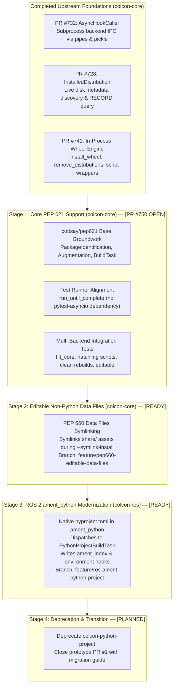

# Modern Python Packaging (PEP 517/518/621/660) in colcon: Architectural Roadmap & Upstream Integration Proposal

This document outlines the architectural roadmap, upstream integration strategy, and current verification status for providing native modern Python packaging standards (PEP 517, PEP 518, PEP 621, and PEP 660) in `colcon-core` and `colcon-ros`.

It connects the merged groundwork in `colcon-core` with open **PR [#750](https://github.com/colcon/colcon-core/pull/750)** and outlines the next self-contained stages to bring full standard packaging to the ROS 2 and colcon ecosystems.

---

## 1. Executive Summary & Architecture Overview

The Python packaging ecosystem has deprecated direct invocations of `setup.py install` and `setup.py develop`. Standard builds are now driven by `pyproject.toml` specifications (`[build-system]` and `[project]`) executed through standardized build backends (Flit, Hatchling, Setuptools, etc.).

Rather than relying on an external prototype extension (`colcon-python-project`), this proposal establishes native, in-process, high-performance packaging across `colcon-core` and `colcon-ros` divided into four sequential stages:



---

## 2. Foundation: Merged Upstream Building Blocks

The core packaging primitives have already been reviewed and merged into `colcon-core`:

| Component / PR | Status | Description |
| :--- | :--- | :--- |
| **[colcon-core#732](https://github.com/colcon/colcon-core/pull/732)** | **Merged** | **`AsyncHookCaller`**: High-performance backend subprocess IPC via OS pipes and pickle serialization. Includes `HookCallerDecoratorExtensionPoint` and TOML parser fallback abstractions. |
| **[colcon-core#728](https://github.com/colcon/colcon-core/pull/728)** | **Merged** | **`InstalledDistribution`**: Live filesystem discovery of installed Python packages, entry points, metadata directories (`.dist-info`), and bytecode cache files (`.pyc`). |
| **[colcon-core#741](https://github.com/colcon/colcon-core/pull/741)** | **Merged** (`v0.21.2` / `v0.21.3`) | **Wheel Engine (`wheel.py`)**:<br/>• `install_wheel`: In-process ZIP extraction, `.data/` directory mapping (e.g. `share/`), CLI entry point script wrapper generation via `distlib.scripts.ScriptMaker`, and PEP 376 `INSTALLER` and `RECORD` writer.<br/>• `remove_distributions`: Clean disk uninstallation of existing distributions prior to rebuilds. |

---

## 3. Stage 1: Core PEP 621 Native Pipeline (PR #750)

* **Pull Request**: [colcon/colcon-core#750](https://github.com/colcon/colcon-core/pull/750) (`Feature/pep621 testing`)
* **Target Base**: `colcon/colcon-core:cottsay/pep621`
* **Head Branch**: [`KmoM88/colcon-core:feature/pep621-upstream-pr`](https://github.com/KmoM88/colcon-core/tree/feature/pep621-upstream-pr) (Commit `4a594c8`)
* **Comparison**: [Compare on GitHub](https://github.com/colcon/colcon-core/compare/cottsay/pep621...KmoM88:colcon-core:feature/pep621-upstream-pr)

### Key Capabilities in Stage 1
1. **Identification (`PEP621PackageIdentification`)**:
   - Inspects `pyproject.toml` for the `[project]` table using `load_and_cache_spec`.
   - Identifies package type as `python.project`.
   - Configured with `PRIORITY = 90` (lower than legacy `setup.cfg`/`setup.py` at `100`), ensuring 100% backward compatibility for existing packages.
2. **Metadata Augmentation (`PEP621PackageAugmentation`)**:
   - Maps `build-system.requires` $\rightarrow$ `build` dependencies.
   - Maps `project.dependencies` $\rightarrow$ `run` dependencies.
   - Maps `project.optional-dependencies.test` $\rightarrow$ `test` dependencies.
3. **Build Task (`PythonProjectBuildTask`)**:
   - Executes `build_wheel` via `AsyncHookCaller`.
   - Installs the wheel into the target `install_base` using `install_wheel`.
   - Emits colcon notification hooks into `.dist-info/RECORD`.
   - Handles editable installations via `build_editable` and writes PEP 610 `direct_url.json` (`{"dir_info": {"editable": true}}`).
4. **Test Suite Harmonization**:
   - Converted async tests to use `colcon-core`'s canonical `from .run_until_complete import run_until_complete`, removing external test runner dependencies.
5. **Real-Backend Integration Tests (`test/test_integration_pep621.py`)**:
   - Automated end-to-end tests exercising `flit_core` and `hatchling`:
     - Minimal pure PEP 621 package build and runtime import.
     - Console script entry points (`[project.scripts]`) with `0o755` permissions in `bin/`.
     - Clean rebuilds verifying that `remove_distributions` deletes old files.
     - Editable installations with `--symlink-install`.
6. **Code Quality**:
   - 100% clean under `flake8` and `scspell3k`.

### Feature Flag Rollout Strategy (`COLCON_FEATURE_FLAGS`)
To facilitate upstream merging with zero risk to existing production workspaces, native PEP 621 building can optionally be gated behind `colcon-core`'s established feature flag mechanism (`colcon_core.feature_flags`):

* **Activation via Environment Variable**:
  ```bash
  export COLCON_FEATURE_FLAGS=pep621_builds
  colcon build
  ```
  *(Multiple flags can be combined using the system path separator, e.g. `COLCON_FEATURE_FLAGS=foo:pep621_builds` on Linux/macOS).*
* **Zero-Regression Extension Guard**:
  In `colcon_core/package_identification/pep621.py`:
  ```python
  from colcon_core.feature_flags import is_feature_flag_set

  class PEP621PackageIdentification(PackageIdentificationExtensionPoint):
      PRIORITY = 90  # Lower priority than legacy setup.py (100)

      def identify(self, desc):
          if not is_feature_flag_set('pep621_builds'):
              return
          # ... proceed with pyproject.toml [project] parsing ...
  ```
* **Graduation Path**:
  Once the maintainers and community validate the implementation across active distributions, `pep621_builds` can simply be registered in `IMPLEMENTED_FLAGS` in `colcon_core/feature_flags.py`. This promotes native PEP 621 discovery to default behavior while gracefully warning users that the flag is no longer required.

---

## 4. Stage 2: PEP 660 & Editable Non-Python Data Files

* **Status**: **Draft PR Opened**
* **Pull Request**: [colcon/colcon-core#751](https://github.com/colcon/colcon-core/pull/751)
* **Repository**: `colcon-core`
* **Branch**: [`KmoM88/colcon-core:feature/pep660-editable-data-files`](https://github.com/KmoM88/colcon-core/tree/feature/pep660-editable-data-files) (Commit `d989ee4`)

### The Problem
Standard Python packaging backends (Flit, Hatchling, Setuptools) only expose Python module files (`.py`) as editable when using PEP 660. Non-Python data assets (such as ROS 2 launch files, URDFs, YAML configuration, and rviz configs located in `share/<package>/`) are normally packaged into `.data/data/share/` and copied statically at build time. Under `--symlink-install`, editing a launch file would require a manual rebuild.

### The Solution
`feature/pep660-editable-data-files` enhances `PythonProjectBuildTask`:
- Detects declared data files in `setup.cfg` (`[options.data_files]`) or `pyproject.toml` (`[tool.setuptools.data-files]` and `[tool.hatch.build.targets.wheel.shared-data]`).
- When `--symlink-install` is active, it calls `colcon_core.task.install()` to create true symbolic links directly from source directories to `install_base/share/...`.
- All created symlinks are tracked and recorded into `.dist-info/RECORD` for clean removal upon package cleanup or rebuild.

---

## 5. Stage 3: ROS 2 `ament_python` Modernization

* **Status**: **Draft PR Opened**
* **Pull Request**: [colcon/colcon-ros#171](https://github.com/colcon/colcon-ros/pull/171)
* **Repository**: `colcon-ros`
* **Branch**: [`KmoM88/colcon-ros:feature/ros-ament-python-project`](https://github.com/KmoM88/colcon-ros/tree/feature/ros-ament-python-project) (Commit `fc03806`)

### The Problem
In ROS 2, packages specifying `<build_type>ament_python</build_type>` in `package.xml` currently require a legacy `setup.py` script. Packages adopting standard `pyproject.toml` without `setup.py` fail build task resolution.

### The Solution
`feature/ros-ament-python-project` updates `AmentPythonBuildTask`:
- Automatically detects if an `ament_python` package declares `pyproject.toml` without a `setup.py`.
- Delegates the compilation and wheel extraction to `PythonProjectBuildTask`.
- Seamlessly generates:
  - ROS 2 `ament_index` resource markers (`share/ament_index/resource_index/packages/<pkg>`).
  - Package metadata placement (`share/<pkg>/package.xml`).
  - Standard colcon `.dsv` environment hooks (`AMENT_PREFIX_PATH`).
- Verified with end-to-end integration tests using `flit_core`.

---

## 6. Stage 4: Ecosystem Transition & Deprecation

* **Repository**: `colcon/colcon-python-project`
* **Status**: **Planned post-merge**

Once native support is merged into `colcon-core` and `colcon-ros`:
1. Provide a deprecation notice in `colcon-python-project` advising users to transition to native `colcon-core` (built into recent releases).
2. Close PR #1 in `colcon-python-project` with reference to the native implementation.
3. Users will no longer require additional extension plugins to build pure PEP 621 or `ament_python` standard packages.

---

## 7. Action Plan & Proposed Staged Review

To keep upstream review friction minimal, we propose the following sequential workflow:

1. **Review & Merge PR #750 (Stage 1)**:
   - Validates that `cottsay/pep621` has 100% test coverage and matches `colcon-core` internal test guidelines.
   - Once merged into `cottsay/pep621`, Scott Logan can merge `cottsay/pep621` into `colcon/colcon-core:master`.
2. **Submit PR for Stage 2 (`feature/pep660-editable-data-files`)**:
   - Rebase cleanly on `master` once Stage 1 lands.
   - Adds data file symlinking for editable installs.
3. **Submit PR for Stage 3 (`colcon-ros`)**:
   - Opens PR against `colcon/colcon-ros:master` enabling native `pyproject.toml` in `ament_python`.
4. **Deprecate Prototype**:
   - Archive and document `colcon-python-project`.

---

## 8. Summary Table of Feature Branches & Deliverables

| Stage | Repository | Feature Branch | Base Branch | Status / PR |
| :--- | :--- | :--- | :--- | :--- |
| **Stage 1** | `colcon-core` | `feature/pep621-upstream-pr` (`4a594c8`) | `cottsay/pep621` | **[colcon-core#750](https://github.com/colcon/colcon-core/pull/750)** (Under Review) |
| **Stage 2** | `colcon-core` | `feature/pep660-editable-data-files` (`d989ee4`) | `master` | **[colcon-core#751](https://github.com/colcon/colcon-core/pull/751)** (Draft PR) |
| **Stage 3** | `colcon-ros` | `feature/ros-ament-python-project` (`fc03806`) | `master` | **[colcon-ros#171](https://github.com/colcon/colcon-ros/pull/171)** (Draft PR) |
| **Stage 4** | `colcon-python-project` | Deprecation Documentation | `master` | **Planned** |

---

* **Published Gist**: [https://gist.github.com/KmoM88/0357abff37b5a32ab801cac7d399d4ed](https://gist.github.com/KmoM88/0357abff37b5a32ab801cac7d399d4ed)  
*Prepared by Federico Rossi ([@KmoM88](https://github.com/KmoM88))*
