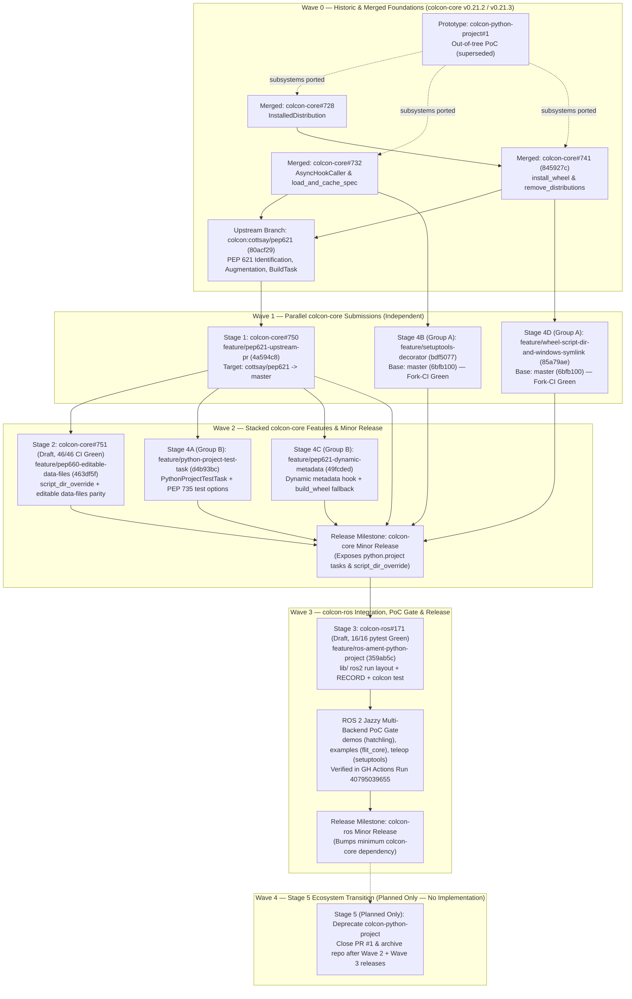

# PR, Branch, Feature & Release Plan: Native Python Packaging (PEP 517/518/621/660)

This directory is the central engineering, pull-request sequencing, and release-planning reference for delivering native modern Python packaging standards (PEP 517, PEP 518, PEP 621, PEP 660, and PEP 735) across [`colcon-core`](https://github.com/colcon/colcon-core) and [`colcon-ros`](https://github.com/colcon/colcon-ros).

Every stage below links directly to its **feature branch**, **comparison diff**, **pull request** (where opened), and **dedicated leaf specification** covering implementation decisions, technical solution, and verification results.

---

## 1. Document Map

| Document | Scope & Role | Status |
| :--- | :--- | :--- |
| **[PR, Branch, Feature & Release Plan (this file)](README.md)** | Master PR dependency DAG, feature-branch index (decisions, solution, validation), and multi-repo upstream release wave plan. | **Active Hub** |
| **[Historic PRs & Prototype Reference](historic_prs_reference.md)** | Reference summary of `colcon-python-project#1`, issue `#736`, merged foundations (`#728`, `#732`, `#741`), and upstream `cottsay/pep621` (`80acf29`). | **Merged / Reference** |
| **[Stage 1: Core PEP 621 Pipeline](stages/stage1_core_pep621.md)** | `colcon/colcon-core#750` (`feature/pep621-upstream-pr` @ `4a594c8`) — async test alignment & multi-backend (`flit_core`, `hatchling`) integration suite. | **Submitted PR #750** |
| **[Stage 2: Editable Data Files & Script Override](stages/stage2_editable_data_files.md)** | `colcon/colcon-core#751` (`feature/pep660-editable-data-files` @ `463df5f`) — `script_dir_override`, backend-scoped `share/` symlinks & deduplicated `RECORD`. | **Draft PR #751 (46/46 CI Green)** |
| **[Stage 3: ROS 2 `ament_python` Support](stages/stage3_colcon_ros_ament_python.md)** | `colcon/colcon-ros#171` (`feature/ros-ament-python-project` @ `359ab5c`) — `pyproject.toml`-only ROS 2 builds, `lib/<pkg>` layout & `colcon test` augmentation. | **Draft PR #171 (16/16 pytest Green)** |
| **[Stage 4 — Group A: Independent `master` Follow-Ups](stages/stage4_group_a_master_followups.md)** | `feature/setuptools-decorator` (`bdf5077`) & `feature/wheel-script-dir-and-windows-symlink` (`85a79ae`) off `colcon-core:master` (`6bfb100`). | **Pushed & Fork-CI Green ([PR #5](https://github.com/KmoM88/colcon-core/pull/5))** |
| **[Stage 4 — Group B: Stacked `pep621` Follow-Ups](stages/stage4_group_b_pep621_followups.md)** | `feature/python-project-test-task` (`d4b93bc`) & `feature/pep621-dynamic-metadata` (`49fcded`) stacked on `feature/pep621-upstream-pr` (`4a594c8`). | **Pushed & Fork-CI Green ([PR #5](https://github.com/KmoM88/colcon-core/pull/5))** |
| **[ROS 2 Jazzy Multi-Backend PoC Validation](stages/poc_ros2_jazzy_validation.md)** | Dockerized & GitHub Actions 6-stage validation across active `ros2/*` packages migrated to pure `pyproject.toml` (`hatchling`, `flit_core`, `setuptools`). | **Implemented & Verified ([Run 40795039655](https://github.com/KmoM88/colcon-roadmap/actions/runs/40795039655))** |
| **[Stage 5: `colcon-python-project` Deprecation Plan](stages/stage5_colcon_python_project_deprecation.md)** | Post-merge deprecation notice, migration pointer, and archival plan for `colcon/colcon-python-project` and prototype PR #1. | **Planned Only (No Implementation)** |

---

## 2. End-to-End PR Dependency & Release Sequencing Graph

---

## 3. Feature Branch Catalog: Implementation Decisions, Solution & Validation

### Historic Foundations (`colcon-core` `v0.21.2` / `v0.21.3` & `cottsay/pep621`)
* **Reference Leaf**: **[historic_prs_reference.md](historic_prs_reference.md)**
* **Upstream Links**: [colcon/colcon-python-project#1](https://github.com/colcon/colcon-python-project/pull/1), [colcon/colcon-core#736](https://github.com/colcon/colcon-core/issues/736), [colcon/colcon-core#728](https://github.com/colcon/colcon-core/pull/728), [colcon/colcon-core#732](https://github.com/colcon/colcon-core/pull/732), [colcon/colcon-core#741](https://github.com/colcon/colcon-core/pull/741) (`845927c`), [`colcon/colcon-core:cottsay/pep621`](https://github.com/colcon/colcon-core/tree/cottsay/pep621) (`80acf29`).
* **Implementation Decisions**: Abandoned the monolithic external override plugin (`colcon-python-project#1`) because overriding the `python` package type broke legacy ROS workspaces; decomposed the architecture into native `colcon-core` primitives (`InstalledDistribution`, `AsyncHookCaller`, `install_wheel` / `remove_distributions`) and a dedicated `python.project` package type.
* **Solution**: Subprocess PEP 517 hook execution via pipes/pickle (`#732`), disk-metadata distribution discovery (`#728`), in-process wheel extraction and uninstallation (`#741`), and initial PEP 621 identification/augmentation/build extensions (`cottsay/pep621`).
* **Validation**: PRs `#728`, `#732`, and `#741` merged and shipped in `colcon-core` `v0.21.2` / `v0.21.3`.

---

### Stage 1: Core PEP 621 Pipeline & Multi-Backend Integration Suite
* **Detail Leaf**: **[stages/stage1_core_pep621.md](stages/stage1_core_pep621.md)**
* **Feature Branch**: [`KmoM88/colcon-core:feature/pep621-upstream-pr`](https://github.com/KmoM88/colcon-core/tree/feature/pep621-upstream-pr) (`4a594c8`) — [Compare vs `cottsay/pep621`](https://github.com/colcon/colcon-core/compare/cottsay/pep621...KmoM88:colcon-core:feature/pep621-upstream-pr)
* **Supporting Branches**: [`KmoM88/colcon-core:cottsay/pep621`](https://github.com/KmoM88/colcon-core/tree/cottsay/pep621) (`816a0d3`), [`KmoM88/colcon-core:feature/pep621-integration-tests`](https://github.com/KmoM88/colcon-core/tree/feature/pep621-integration-tests) (`c40901a`)
* **Upstream PR**: [colcon/colcon-core#750](https://github.com/colcon/colcon-core/pull/750) (Open, targeting `colcon/colcon-core:cottsay/pep621`)
* **Implementation Decisions**:
  1. Preserved upstream commit `80acf29` untouched and targeted `cottsay/pep621` directly to keep the review diff minimal and focused on test readiness.
  2. Replaced `@pytest.mark.asyncio` with `colcon-core`'s native `run_until_complete` helper so bootstrap environments do not require `pytest-asyncio`.
  3. Deferred the `PEP621PackageIdentification.PRIORITY` tie-breaker (`90` -> `80` relative to `colcon-python-setup-py`) into a prepared review note ([../pr/pr_750_priority_comment.md](../pr/pr_750_priority_comment.md)) rather than mixing policy changes into `#750`.
* **Solution**: Harmonized `test/test_task_python_project_build.py` to `run_until_complete` and added `test/test_integration_pep621.py` exercising real `flit_core.buildapi` and `hatchling.build` standard wheel builds, `[project.scripts]` wrappers in `bin/`, idempotent rebuilds via `remove_distributions()`, and PEP 660 `build_editable` builds with PEP 610 `direct_url.json`.
* **Validation**: All unit, multi-backend integration, `flake8`, `scspell3k`, and copyright tests passing with zero warnings.

---

### Stage 2: Backend-Scoped Editable Data Files & `script_dir_override`
* **Detail Leaf**: **[stages/stage2_editable_data_files.md](stages/stage2_editable_data_files.md)**
* **Feature Branch**: [`KmoM88/colcon-core:feature/pep660-editable-data-files`](https://github.com/KmoM88/colcon-core/tree/feature/pep660-editable-data-files) (`463df5f`) — [Compare vs `colcon:master`](https://github.com/colcon/colcon-core/compare/master...KmoM88:colcon-core:feature/pep660-editable-data-files)
* **Upstream PR**: [colcon/colcon-core#751](https://github.com/colcon/colcon-core/pull/751) (Draft, targeting `colcon/colcon-core:master`)
* **Implementation Decisions**:
  1. Scoped editable data-file discovery strictly to the active PEP 517 backend (`setuptools.build_meta*` and `hatchling.*`) so backends without external data-file tables (`flit_core`) never create symlinks in `--symlink-install` that would be missing from standard wheel builds.
  2. Exposed `script_dir_override=None` directly on `PythonProjectBuildTask.build()` so downstream `colcon-ros` tasks can route `[project.scripts]` to `lib/<pkg_name>/` without requiring a legacy `setup.cfg`.
  3. Deduplicated `.dist-info/RECORD` entries by relative path (`record_map`) when replacing wheel `.data/` copies with symbolic links.
* **Solution**: Updated `colcon_core/task/python_project/build.py` (`script_dir_override` parameter, relative `install_base` `$base` expansion fix, `_get_data_files_mapping(pkg, backend_name)` with `setuptools` glob expansion and `hatchling` file/directory `shared-data` mapping, and in-place `RECORD` updates) plus cache-isolated unit and real-backend integration tests (with `setuptools < 70.1` `wheel` guard).
* **Validation**: **46/46 GitHub Actions CI checks green** on [colcon/colcon-core#751](https://github.com/colcon/colcon-core/pull/751) across Ubuntu, macOS, and Windows (Python 3.8–3.14, `stdeb`, `codecov`); `256 passed, 5 skipped` locally.

---

### Stage 3: ROS 2 `ament_python` Native `pyproject.toml` Support
* **Detail Leaf**: **[stages/stage3_colcon_ros_ament_python.md](stages/stage3_colcon_ros_ament_python.md)**
* **Feature Branch**: [`KmoM88/colcon-ros:feature/ros-ament-python-project`](https://github.com/KmoM88/colcon-ros/tree/feature/ros-ament-python-project) (`359ab5c`) — [Compare vs `colcon-ros:master`](https://github.com/colcon/colcon-ros/compare/master...KmoM88:colcon-ros:feature/ros-ament-python-project)
* **Upstream PR**: [colcon/colcon-ros#171](https://github.com/colcon/colcon-ros/pull/171) (Draft, targeting `colcon/colcon-ros:master`)
* **Implementation Decisions**:
  1. Preserved 100% legacy behavior whenever `setup.py` exists; delegated to `PythonProjectBuildTask` only when `<build_type>ament_python</build_type>` has `pyproject.toml` and no `setup.py`.
  2. Passed `script_dir_override=Path('lib') / self.context.pkg.name` so `ros2 run <pkg> <node>` discovers executables in `<install_base>/lib/<pkg>/` without `setup.cfg`.
  3. Moved `ament_index` marker and `package.xml` installation *after* `PythonProjectBuildTask.build()` and recorded them in `.dist-info/RECORD` so `remove_distributions()` does not wipe freshly written files on rebuilds and cleans them up properly on uninstall.
  4. Extended `RosAmentPythonPackageAugmentation` to parse PEP 621 `[project.optional-dependencies]` and PEP 735 `[dependency-groups]` when `setup.py` is absent so `colcon test` (`AmentPythonTestTask`) detects `pytest`.
* **Solution**: Updated `colcon_ros/task/ament_python/build.py` and `colcon_ros/package_augmentation/ros_ament_python.py`, added unit and `flit_core` integration tests in `colcon-ros`, and updated end-to-end mock workspace scenarios (`03` and `04`).
* **Validation**: **16/16 `pytest --cov --cov-branch` checks green** in `colcon-ros` (`flake8`, `scspell3k`, copyright, unit + `flit_core` integration tests) and **4/4 mock workspace scenarios passing** (`scripts/test_mock_packages.py`).

---

### Stage 4 — Group A: Independent `colcon-core:master` Follow-Up Branches (`4B` & `4D`)
* **Detail Leaf**: **[stages/stage4_group_a_master_followups.md](stages/stage4_group_a_master_followups.md)**
* **Feature Branches** *(pushed to `KmoM88/colcon-core`; no upstream PRs opened yet)*:
  - **4B**: [`KmoM88/colcon-core:feature/setuptools-decorator`](https://github.com/KmoM88/colcon-core/tree/feature/setuptools-decorator) (`bdf5077`) — [Fork Compare vs `master`](https://github.com/KmoM88/colcon-core/compare/master...feature/setuptools-decorator)
  - **4D**: [`KmoM88/colcon-core:feature/wheel-script-dir-and-windows-symlink`](https://github.com/KmoM88/colcon-core/tree/feature/wheel-script-dir-and-windows-symlink) (`85a79ae`) — [Fork Compare vs `master`](https://github.com/KmoM88/colcon-core/compare/master...feature/wheel-script-dir-and-windows-symlink)
* **Fork CI Validation PR**: [KmoM88/colcon-core#5](https://github.com/KmoM88/colcon-core/pull/5) (`ci/stage4-all-validation` @ `32dd42a`)
* **Implementation Decisions**:
  1. Branched directly off `colcon-core:master` (`6bfb100`) because both fixes build exclusively on already-merged PRs (`#732`, `#741`, and `colcon_core/task/__init__.py`) and can land upstream independently of `#750` and `#751`.
  2. Used hook-specific `setuptools` option injection (`--global-option` for `get_requires_for_build_*` and `setuptools < 64`; `--build-option` for `build_wheel` on `setuptools >= 64`) after empirically verifying that `_get_build_requires` ignores `--build-option`.
  3. Recreated `script_dir` before cached `ScriptMaker.make_multiple()` calls rather than disabling `functools.lru_cache`, preserving cache performance while eliminating rebuild `FileNotFoundError` after `remove_distributions()`.
  4. Restricted Windows symlink fallback strictly to `sys.platform == 'win32'` and `winerror == 1314` (`ERROR_PRIVILEGE_NOT_HELD`) so genuine I/O errors continue to surface.
* **Solution**: Added `colcon_core/python_project/hook_caller_decorator/setuptools.py` + `setup.cfg` extension-point group registration on Branch 4B (`bdf5077`), and updated `colcon_core/python_project/wheel.py` + `colcon_core/task/__init__.py` on Branch 4D (`85a79ae`).
* **Validation**: `243 passed, 5 skipped` locally on `4B`; `240 passed, 5 skipped` locally on `4D`; **44/44 GitHub Actions matrix jobs passing** on fork PR [KmoM88/colcon-core#5](https://github.com/KmoM88/colcon-core/pull/5) in run [40802478808](https://github.com/KmoM88/colcon-core/actions/runs/40802478808).

---

### Stage 4 — Group B: Stacked `cottsay/pep621` Follow-Up Branches (`4A` & `4C`)
* **Detail Leaf**: **[stages/stage4_group_b_pep621_followups.md](stages/stage4_group_b_pep621_followups.md)**
* **Feature Branches** *(pushed to `KmoM88/colcon-core`; no upstream PRs opened yet)*:
  - **4A**: [`KmoM88/colcon-core:feature/python-project-test-task`](https://github.com/KmoM88/colcon-core/tree/feature/python-project-test-task) (`d4b93bc`) — [Fork Compare vs `feature/pep621-upstream-pr`](https://github.com/KmoM88/colcon-core/compare/feature/pep621-upstream-pr...feature/python-project-test-task)
  - **4C**: [`KmoM88/colcon-core:feature/pep621-dynamic-metadata`](https://github.com/KmoM88/colcon-core/tree/feature/pep621-dynamic-metadata) (`49fcded`) — [Fork Compare vs `feature/pep621-upstream-pr`](https://github.com/KmoM88/colcon-core/compare/feature/pep621-upstream-pr...feature/pep621-dynamic-metadata)
* **Fork CI Validation PR**: [KmoM88/colcon-core#5](https://github.com/KmoM88/colcon-core/pull/5) (`ci/stage4-all-validation` @ `32dd42a`)
* **Implementation Decisions**:
  1. Stacked both branches cleanly on `feature/pep621-upstream-pr` (`4a594c8`) as separate single-concern commits so maintainers can review `colcon test` support (`4A`) and dynamic PEP 517 metadata hooks (`4C`) independently after `#750`.
  2. Overrode `PythonProjectTestTask.add_arguments` as a no-op because `PythonTestTask` already registers `--python-testing`, `--pytest-args`, and `--pytest-with-coverage` globally.
  3. Guarded `load_and_cache_metadata(desc)` behind `set(project.get('dynamic') or ()) & _DYNAMIC_FIELDS` so static `pyproject.toml` discovery incurs zero subprocess overhead, with a warning fallback when build backends are not yet installed and a PEP 517 `build_wheel` fallback when optional `prepare_metadata_for_build_wheel` is unimplemented.
* **Solution**: Added `colcon_core/task/python_project/test.py`, `setup.cfg` `colcon_core.task.test` registration, and static PEP 621 / PEP 735 `[dependency-groups]` augmentation on Branch 4A (`d4b93bc`); wired dynamic metadata augmentation in `colcon_core/package_augmentation/pep621.py` and `build_wheel` metadata fallback in `colcon_core/python_project/metadata.py` on Branch 4C (`49fcded`).
* **Validation**: `256 passed, 5 skipped` locally on `4A`; `257 passed, 5 skipped` locally on `4C`; `272 passed, 5 skipped` locally on combined branch `32dd42a`; **44/44 GitHub Actions matrix jobs passing** on fork PR [KmoM88/colcon-core#5](https://github.com/KmoM88/colcon-core/pull/5) in run [40802478808](https://github.com/KmoM88/colcon-core/actions/runs/40802478808).

---

### End-to-End ROS 2 Jazzy Multi-Backend PoC Validation
* **Detail Leaf**: **[stages/poc_ros2_jazzy_validation.md](stages/poc_ros2_jazzy_validation.md)**
* **Migrated Active `ros2/*` Feature Branches** (`poc/pep621-ament-python`):
  - [`KmoM88/demos:poc/pep621-ament-python`](https://github.com/KmoM88/demos/tree/poc/pep621-ament-python) (`b249c6c`, `hatchling.build` — `demo_nodes_py`)
  - [`KmoM88/examples:poc/pep621-ament-python`](https://github.com/KmoM88/examples/tree/poc/pep621-ament-python) (`8e0155f`, `flit_core.buildapi` — `examples_rclpy_minimal_publisher` & `examples_rclpy_minimal_subscriber`)
  - [`KmoM88/teleop_twist_keyboard:poc/pep621-ament-python`](https://github.com/KmoM88/teleop_twist_keyboard/tree/poc/pep621-ament-python) (`962e0e9`, `setuptools.build_meta` — `teleop_twist_keyboard`)
* **Harness & CI Workflow**: [../../poc/README.md](../../poc/README.md) & [../../.github/workflows/ros2_pep621_poc.yml](../../.github/workflows/ros2_pep621_poc.yml)
* **Implementation Decisions**: Selected exclusively active `ros2/*` Jazzy packages spanning three distinct PEP 517/660 build backends (`hatchling`, `flit_core`, `setuptools.build_meta`), deleted `setup.py` and `setup.cfg` completely, and containerized a deterministic 6-stage verification pipeline runnable both locally via Docker and on demand via GitHub Actions `workflow_dispatch`.
* **Solution**: `ros:jazzy-ros-core` Docker image integrating modernized `colcon-core` and `colcon-ros`, validating pure manifest hygiene, wheel & `RECORD` layout, live `ros2 run` DDS pub/sub and PTY `/cmd_vel` execution, `--symlink-install` live `share/` file edits, and `colcon test`.
* **Validation**: All 3 targets and all 6 stages verified green locally (`./poc/run_poc.sh --target all`) and on GitHub Actions in run [40795039655](https://github.com/KmoM88/colcon-roadmap/actions/runs/40795039655).

---

### Stage 5: `colcon-python-project` Deprecation & Archival (Planned Only — No Implementation)
* **Detail Leaf**: **[stages/stage5_colcon_python_project_deprecation.md](stages/stage5_colcon_python_project_deprecation.md)**
* **Status**: **PLANNED ONLY — NO IMPLEMENTATION EXECUTED**
* **Target Repository**: [`colcon/colcon-python-project`](https://github.com/colcon/colcon-python-project) & [colcon/colcon-python-project#1](https://github.com/colcon/colcon-python-project/pull/1)
* **Plan Summary**: Strictly gated on upstream merges and tagged releases of `colcon-core` (Waves 1–2) and `colcon-ros` (Wave 3). No commits, branches, or pull requests are created for Stage 5 until native support is released upstream, at which point maintainers can close prototype PR #1 with links to the released native packages and archive `colcon/colcon-python-project`.

---

## 4. Upstream PR Submission & Release Wave Plan

To minimize reviewer load on upstream `colcon` maintainers and avoid cross-repository breakage between `colcon-core` and `colcon-ros`, upstream delivery and releases follow four ordered waves:

| Wave | Repository & Milestone | PRs / Branches in Wave | Gating Preconditions & Release Action |
| :--- | :--- | :--- | :--- |
| **Wave 0** *(Completed)* | `colcon-core` `v0.21.2` / `v0.21.3` | `#728`, `#732`, `#741` (`845927c`) | **Released upstream**. Provides `InstalledDistribution`, `AsyncHookCaller`, `install_wheel`, and `remove_distributions`. |
| **Wave 1** *(Active / Ready)* | `colcon-core` (`cottsay/pep621` & `master`) | 1. [colcon/colcon-core#750](https://github.com/colcon/colcon-core/pull/750) (`4a594c8` -> `cottsay/pep621`, then merge `cottsay/pep621` -> `master`) 2. `feature/setuptools-decorator` (`bdf5077` -> `master`) 3. `feature/wheel-script-dir-and-windows-symlink` (`85a79ae` -> `master`, optionally split into `wheel.py` and `task/__init__.py` micro-PRs if preferred) | Zero cross-dependencies among Wave 1 items. Group A branches (`bdf5077`, `85a79ae`) are held on `KmoM88/colcon-core` (already 44/44 fork-CI verified) ready to open against `colcon/colcon-core:master` without cluttering upstream draft queues. |
| **Wave 2** *(Core Release)* | `colcon-core` Minor Release (e.g. `v0.22.0`) | 1. Undraft & rebase [colcon/colcon-core#751](https://github.com/colcon/colcon-core/pull/751) (`463df5f` -> `master`) once `cottsay/pep621` lands on `master` 2. Open `feature/python-project-test-task` (`d4b93bc`) against `master` 3. Rebase & open `feature/pep621-dynamic-metadata` (`49fcded`) against `master` (retaining closure-safe merge of dynamic `Requires-Dist` with static PEP 735 `[dependency-groups]`, already verified in `32dd42a`) | Cut a new `colcon-core` minor release so downstream `colcon-ros` can declare a versioned dependency on `PythonProjectBuildTask(..., script_dir_override=...)` and `PythonProjectTestTask`. |
| **Wave 3** *(ROS 2 Release)* | `colcon-ros` Minor Release | 1. Update `colcon-ros/setup.cfg` `install_requires` minimum `colcon-core` version to the Wave 2 release 2. Undraft & merge [colcon/colcon-ros#171](https://github.com/colcon/colcon-ros/pull/171) (`359ab5c` -> `colcon/colcon-ros:master`) 3. Re-run [`.github/workflows/ros2_pep621_poc.yml`](../../.github/workflows/ros2_pep621_poc.yml) (`target=all`) against released packages | Cut a new `colcon-ros` release delivering native `pyproject.toml`-only `ament_python` builds, `ros2 run` compatibility, `--symlink-install` `share/` parity, and `colcon test` support. |
| **Wave 4** *(Planned Only)* | `colcon-python-project` Archival | [Stage 5 Deprecation Plan](stages/stage5_colcon_python_project_deprecation.md) *(no implementation)* | After Wave 2 and Wave 3 releases ship, publish a deprecation notice in `colcon/colcon-python-project`, close PR #1 referencing the merged native PRs, and archive the prototype repository. |
