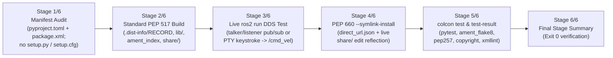

# End-to-End ROS 2 Jazzy Multi-Backend PoC & GitHub Actions Validation

* **Parent Plan**: [PR, Branch, Feature & Release Plan](../README.md)
* **Harness & Runbook**: [poc/README.md](../../../poc/README.md)
* **GitHub Actions Workflow**: [.github/workflows/ros2_pep621_poc.yml](../../../.github/workflows/ros2_pep621_poc.yml)

---

## 1. PoC Repositories, Branches & CI Metadata

| Target | Upstream Active `ros2/*` Repo | Migrated Fork Branch & Commit | PEP 517/660 Backend | Verification Status |
| :--- | :--- | :--- | :--- | :--- |
| **Primary (`demo_nodes_py`)** | [`ros2/demos`](https://github.com/ros2/demos) (`jazzy`) | [`KmoM88/demos:poc/pep621-ament-python`](https://github.com/KmoM88/demos/tree/poc/pep621-ament-python) (`b249c6c`) | `hatchling.build` | **6/6 Stages Green** (Docker + [GH Run 40795039655](https://github.com/KmoM88/colcon-roadmap/actions/runs/40795039655)) |
| **Target 2 (`examples_rclpy_minimal_*`)** | [`ros2/examples`](https://github.com/ros2/examples) (`jazzy`) | [`KmoM88/examples:poc/pep621-ament-python`](https://github.com/KmoM88/examples/tree/poc/pep621-ament-python) (`8e0155f`) | `flit_core.buildapi` | **6/6 Stages Green** (Docker + [GH Run 40795039655](https://github.com/KmoM88/colcon-roadmap/actions/runs/40795039655)) |
| **Target 3 (`teleop_twist_keyboard`)** | [`ros2/teleop_twist_keyboard`](https://github.com/ros2/teleop_twist_keyboard) (`jazzy`) | [`KmoM88/teleop_twist_keyboard:poc/pep621-ament-python`](https://github.com/KmoM88/teleop_twist_keyboard/tree/poc/pep621-ament-python) (`962e0e9`) | `setuptools.build_meta` | **6/6 Stages Green** (Docker + [GH Run 40795039655](https://github.com/KmoM88/colcon-roadmap/actions/runs/40795039655)) |

---

## 2. Context & Objectives

Unit tests and synthetic mock workspaces (`examples/mock_packages/`) validate individual extension points, whereas upstream stakeholders and ROS 2 package maintainers also require proof that **widely used, active `ros2/*` packages** build, run over live DDS middleware via `ros2 run`, honor `--symlink-install` live edits, and pass `colcon test` (`ament_flake8`, `ament_pep257`, `ament_copyright`, `ament_xmllint`) when `setup.py` and `setup.cfg` are completely removed in favor of standard PEP 621 `pyproject.toml`.

---

## 3. Implementation Decisions

1. **Strictly Active `ros2/*` Jazzy Packages Only**:
   - Selected three official, actively maintained `ros2/*` Jazzy repositories (`ros2/demos`, `ros2/examples`, `ros2/teleop_twist_keyboard`) and excluded legacy/deprecated ROS 1 (`ros/*`) repositories completely.
2. **Three Distinct Standard PEP 517/660 Build Backends**:
   - Exercised `hatchling.build` (with `shared-data` non-code YAML assets and 13 console nodes), `flit_core.buildapi` (multi-package workspace with publisher + subscriber nodes), and `setuptools.build_meta` (single-file `py-modules = ["teleop_twist_keyboard"]` layout without `setup.py` or `setup.cfg`).
3. **Deterministic 6-Stage Human-Readable Verification Pipeline**:
   - Designed [poc/container_poc.sh](../../../poc/container_poc.sh) to emit structured `[STAGE 1/6]` through `[STAGE 6/6]` banners and assertions so logs serve directly as reviewable proof-of-concept artifacts both locally and in GitHub Actions job summaries (`$GITHUB_STEP_SUMMARY`).
4. **On-Demand Manual GitHub Actions Execution (`workflow_dispatch`)**:
   - Added [.github/workflows/ros2_pep621_poc.yml](../../../.github/workflows/ros2_pep621_poc.yml) accepting `target` (`demos`, `examples`, `teleop_twist_keyboard`, or `all`), building the `ros:jazzy-ros-core` image with submodules initialized, publishing full stage output to the workflow summary, and uploading raw stage logs as downloadable artifacts.

---

## 4. Technical Solution: 6-Stage Verification Pipeline

* **Container Definition ([poc/Dockerfile](../../../poc/Dockerfile))**:
  - Base image `ros:jazzy-ros-core` (Ubuntu 24.04 Noble, Python 3.12).
  - Installs ROS 2 Python linters/test packages (`ros-jazzy-ament-flake8`, `ros-jazzy-ament-pep257`, `ros-jazzy-ament-copyright`, `ros-jazzy-ament-xmllint`, `ros-jazzy-example-interfaces`, `ros-jazzy-geometry-msgs`, `ros-jazzy-rcl-interfaces`) and PEP 517/660 backends (`python3-hatchling`, `python3-editables`, `python3-flit-core`, `python3-setuptools`, `python3-wheel`), then installs `submodules/kmom88-colcon-core` and `submodules/colcon-ros` with `--no-build-isolation --no-deps`.
* **Local Runner ([poc/run_poc.sh](../../../poc/run_poc.sh))**:
  - Supports `./poc/run_poc.sh` (primary `demos` target) and `./poc/run_poc.sh --target all` (full 3-backend matrix).

---

## 5. Validation & CI Results

* **Local Docker Verification**: `./poc/run_poc.sh --target all` passed all 6 stages across `demos` (`hatchling`), `examples` (`flit_core`), and `teleop_twist_keyboard` (`setuptools.build_meta`).
* **GitHub Actions Manual Workflow Run**: Verified green in run **[40795039655](https://github.com/KmoM88/colcon-roadmap/actions/runs/40795039655)** (`target=all`, conclusion `success`, artifact `ros2-jazzy-pep621-poc-all`).
