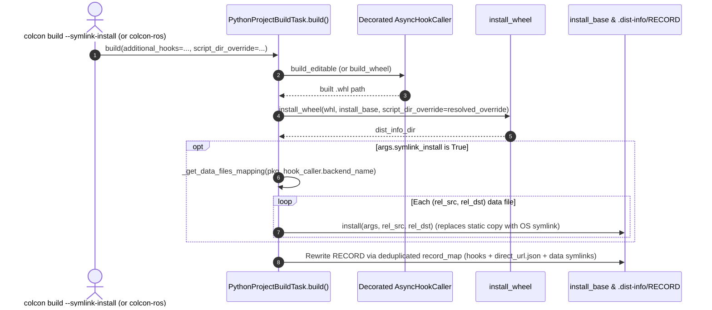

# Stage 2: Backend-Scoped Editable Data Files & `script_dir_override`

* **Parent Plan**: [PR, Branch, Feature & Release Plan](../README.md)
* **Upstream Predecessor**: [Stage 1: Core PEP 621 Pipeline](stage1_core_pep621.md)

---

## 1. Branch & Pull Request Metadata

| Field | Value |
| :--- | :--- |
| **Stage** | Stage 2 (Release Wave 2) |
| **Status** | **Draft PR Verified Upstream — 46/46 GitHub Actions CI Checks Green** |
| **Upstream Pull Request** | [colcon/colcon-core#751](https://github.com/colcon/colcon-core/pull/751) (Draft) |
| **Target Base Branch** | `colcon/colcon-core:master` |
| **Feature Branch** | [`KmoM88/colcon-core:feature/pep660-editable-data-files`](https://github.com/KmoM88/colcon-core/tree/feature/pep660-editable-data-files) (Commit `463df5f`) |
| **GitHub Compare Diff** | [colcon/colcon-core:master...KmoM88:colcon-core:feature/pep660-editable-data-files](https://github.com/colcon/colcon-core/compare/master...KmoM88:colcon-core:feature/pep660-editable-data-files) |
| **PR Description Artifact** | [pr_description_pep660_data_files.md](../../pr/pr_description_pep660_data_files.md) |
| **Pitfalls Remediated** | Pitfall 1 (`script_dir_override` & `$base` fix) & Pitfall 3 (editable data-files parity & `RECORD` deduplication) in [pitfalls_and_remediation_plan.md](../../plans/pitfalls_and_remediation_plan.md) |

---

## 2. Context & Problem Statement

PEP 660 standardizes editable Python module imports (via `.pth` files or import hooks in `build_editable`), but leaves non-code data files (`<dist>.data/data/share/...`, such as ROS 2 launch, config, and parameter files) up to individual build backends:

1. **`setuptools.build_meta.build_editable`**: Omits `[options.data_files]` / `[tool.setuptools.data-files]` from the editable `.whl` archive altogether.
2. **`hatchling.build.build_editable`**: Packs `[tool.hatch.build.targets.wheel.shared-data]` as static copies inside `<dist>.data/data/...`, so editing a launch or YAML file in `src/` under `--symlink-install` has no live effect unless those installed copies are replaced with symbolic links to `src/`.
3. **`flit_core.buildapi`**: Does not support arbitrary external `data_files` tables; unconditionally reading a leftover `setup.cfg` during `--symlink-install` creates phantom symlinks that vanish in standard release builds.
4. **Downstream `ros2 run` Script Placement**: Pure `pyproject.toml` ROS 2 packages have no `setup.cfg` `[install] install_scripts = $base/lib/<pkg>`, yet `PythonProjectBuildTask.build()` provided no programmatic `script_dir_override` parameter (and its existing `$base` expansion doubled relative `install_base` paths).
5. **Duplicate `.dist-info/RECORD` Entries**: Appending symlinked data-file rows onto `.dist-info/RECORD` without removing the static `.data/` rows already written by `install_wheel` produced duplicate path entries in `RECORD`.

---

## 3. Implementation Decisions & Trade-offs

1. **Strict Backend-Scoped Data-File Mapping (`_get_data_files_mapping(pkg, backend_name)`)**:
   - *Decision*: Keyed data-file extraction off `hook_caller.backend_name` rather than scanning every config file in `pkg.path`.
   - *Rationale*: Guarantees 100% file-set parity between `colcon build` and `colcon build --symlink-install`. Only `setuptools.build_meta*` reads `setup.cfg` `[options.data_files]` / `pyproject.toml` `[tool.setuptools.data-files]` (with wildcard glob expansion), and only `hatchling.*` reads `[tool.hatch.build.targets.wheel.shared-data]` (both single-file and recursive directory mappings).
2. **Programmatic `script_dir_override` Parameter + Relative `$base` Fix**:
   - *Decision*: Extended `PythonProjectBuildTask.build(self, *, additional_hooks=None, script_dir_override=None)` and changed `$base` expansion in `setup.cfg` parsing from `_override = Path(args.install_base)` to `_override = Path()` so `install_wheel` always receives a relative path under `install_base`.
   - *Rationale*: Lets `colcon-ros` (`AmentPythonBuildTask`) pass `script_dir_override=Path('lib') / pkg.name` directly while still honoring explicit `setup.cfg` overrides if a package provides one.
3. **In-Place Dictionary Deduplication for `.dist-info/RECORD`**:
   - *Decision*: Parsed existing `RECORD` rows into an insertion-ordered `record_map[rel_posix_path] = (hash_str, size_str)` before inserting symlink/hook/direct-url updates.
   - *Rationale*: Replaces static `.data/` digests with empty-hash symlink entries (`path,,`) in place, keeping `RECORD` PEP 376 compliant and idempotent across repeated builds.
4. **Cross-Distribution `setuptools < 70.1` `wheel` Guard & Cache Isolation in Tests**:
   - *Decision*: Guarded real `setuptools.build_meta` integration tests with `if Version(st.__version__) < Version('70.1.0'): pytest.importorskip('wheel')` and added an `autouse=True` fixture clearing `_ENTRY_POINTS_CACHE` and `_extension_instances`.
   - *Rationale*: Ubuntu 22.04/24.04 and Debian `stdeb` runners ship `setuptools < 70.1` where `bdist_wheel` lives in the external `wheel` package, and `test_extension_point.py` mutates `_ENTRY_POINTS_CACHE` earlier in full-suite runs.

---

## 4. Technical Solution

### Modified Files (`submodules/kmom88-colcon-core`)
* **`colcon_core/task/python_project/build.py`**:
  - Added `script_dir_override=None` to `PythonProjectBuildTask.build()`, fixed `$base` prefix stripping to `Path()`, implemented `_get_data_files_mapping(pkg, backend_name)` (with `glob` expansion for `setuptools` and recursive directory walk for `hatchling` `shared-data`), and deduplicated `RECORD` updates via `record_map`.
* **`test/test_task_python_project_build.py`**:
  - Added `test_get_data_files_mapping_by_backend` (verifying `setuptools` globs, `hatchling` files/directories, and `flit_core` isolation) and `test_build_task_script_override_and_record_update`.
* **`test/test_integration_pep621.py`**:
  - Added `isolate_extension_cache_and_event_queue` (`autouse=True`), `test_integration_symlink_install_data_files` (`hatchling` standard copy -> `--symlink-install` live symlink + zero `RECORD` duplicates), and `test_integration_setuptools_data_files_and_script_override` (`setuptools.build_meta` globbed data files + `lib/st_data_pkg` script override).

---

## 5. Validation & Verification Results

* **Upstream GitHub Actions CI ([colcon/colcon-core#751](https://github.com/colcon/colcon-core/pull/751))**: **46/46 checks passing** across Ubuntu, macOS, and Windows (Python 3.8–3.14, `stdeb`, `bootstrap`, `codecov/patch`, `codecov/project`).
* **Local Full Suite**: **`256 passed, 5 skipped`** (`0` `flake8`, `scspell3k`, or copyright issues).

---

## 6. Upstream Merge & Release Readiness

1. Kept as a **Draft PR** on `colcon/colcon-core` until [Stage 1 (`#750` / `cottsay/pep621`)](stage1_core_pep621.md) merges into `colcon/colcon-core:master`.
2. Once `cottsay/pep621` merges into `master` (Wave 1), rebase `feature/pep660-editable-data-files` onto `master` (dropping the ancestor `cottsay/pep621` commits so `#751` shows only Stage 2's focused diff), mark Ready for Review, and merge into the Wave 2 `colcon-core` minor release.
