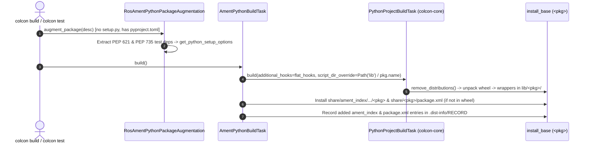

# Stage 3: ROS 2 `ament_python` Native `pyproject.toml` Support

* **Parent Plan**: [PR, Branch, Feature & Release Plan](../README.md)
* **Core Dependency**: [Stage 2: Editable Data Files & `script_dir_override`](stage2_editable_data_files.md)
* **End-to-End Showcase**: [ROS 2 Jazzy Multi-Backend PoC Validation](poc_ros2_jazzy_validation.md)

---

## 1. Branch & Pull Request Metadata

| Field | Value |
| :--- | :--- |
| **Stage** | Stage 3 (Release Wave 3) |
| **Status** | **Draft PR Verified — 16/16 `pytest --cov --cov-branch` Checks Green** |
| **Upstream Pull Request** | [colcon/colcon-ros#171](https://github.com/colcon/colcon-ros/pull/171) (Draft) |
| **Target Base Branch** | `colcon/colcon-ros:master` |
| **Feature Branch** | [`KmoM88/colcon-ros:feature/ros-ament-python-project`](https://github.com/colcon-ros/colcon-ros/compare/master...KmoM88:colcon-ros:feature/ros-ament-python-project) ([Tree](https://github.com/KmoM88/colcon-ros/tree/feature/ros-ament-python-project), Commit `359ab5c`) |
| **PR Description Artifact** | [pr_description_colcon_ros.md](../../pr/pr_description_colcon_ros.md) |
| **Pitfalls Remediated** | Pitfall 1 (`ros2 run` `lib/<pkg>` layout), Pitfall 2 (`colcon test` for `ros.ament_python`), Pitfall 5/6 (dual-manifest `<build_depend>` & post-wheel `RECORD` tracking) in [pitfalls_and_remediation_plan.md](../../plans/pitfalls_and_remediation_plan.md) |

---

## 2. Context & Problem Statement

In ROS 2, `RosPackageIdentification` identifies any package containing `package.xml` with `<build_type>ament_python</build_type>` as `ros.ament_python` (`PRIORITY = 150`, running ahead of `colcon-core`'s Python identifiers). Prior to Stage 3, `colcon-ros` assumed every `ros.ament_python` package had a `setup.py`:

1. **`colcon build` Failure Without `setup.py`**: `AmentPythonBuildTask` delegated unconditionally to `PythonBuildTask` (`setup.py`), failing on modernized ROS 2 Python packages that contain only `package.xml` and `pyproject.toml`.
2. **`ros2 run` Executable Discovery Failure**: `ros2 run <pkg> <node>` searches `<install_base>/lib/<pkg>/`, whereas PEP 517 wheels unpack `[project.scripts]` into `<install_base>/bin/` unless overridden.
3. **Rebuild Deletion of `ament_index` & `package.xml`**: `install_wheel` runs `remove_distributions()` at the start of every build. Installing `share/ament_index/resource_index/packages/<pkg>` and `share/<pkg>/package.xml` *before* `PythonProjectBuildTask.build()` either left them untracked in `.dist-info/RECORD` or caused `remove_distributions()` to delete them on subsequent rebuilds.
4. **Nested Hook List Bug**: Wrapping `additional_hooks` in an extra list broke `create_environment_scripts`, omitting `ament_prefix_path` shell/DSV hooks.
5. **`colcon test` Skipping `pytest`**: `RosAmentPythonPackageAugmentation` exited early when `setup.py` was absent, leaving `desc.metadata['get_python_setup_options']` unset so `AmentPythonTestTask` / `PytestPythonTestingStep` never matched `pytest`.

---

## 3. Implementation Decisions & Trade-offs

1. **Zero-Regression Dispatch Gate (`not setup_py.is_file() and pyproject_toml.is_file()`)**:
   - *Decision*: Kept the existing `PythonBuildTask` path untouched whenever `setup.py` is present, routing to `PythonProjectBuildTask` strictly when `setup.py` is absent and `pyproject.toml` exists.
   - *Rationale*: Guarantees 100% backward compatibility across existing ROS 2 distributions while enabling opt-in pure `pyproject.toml` migration package by package.
2. **Automatic `script_dir_override=Path('lib') / self.context.pkg.name`**:
   - *Decision*: Passed `script_dir_override=Path('lib') / self.context.pkg.name` and flat `additional_hooks=additional_hooks` directly to `PythonProjectBuildTask.build()`.
   - *Rationale*: Eliminates boilerplate `setup.cfg` `[install] install_scripts` files from pure `pyproject.toml` ROS 2 packages while keeping `ros2 run` and `ros2 pkg executables` working identically across Linux, macOS, and Windows.
3. **Post-Wheel `ament_index` & `package.xml` Installation with `.dist-info/RECORD` Registration**:
   - *Decision*: Moved marker and `package.xml` installation *after* `await extension.build(...)`, guarded against overwriting files already supplied by the wheel's `.data/` payload, and appended newly created relative paths into `.dist-info/RECORD`.
   - *Rationale*: Ensures `remove_distributions()` cleanly uninstalls and reinstalls both files across arbitrary rebuild cycles without orphan files or missing ROS resource markers.
4. **Static `pyproject.toml` Test Dependency Extraction in `RosAmentPythonPackageAugmentation`**:
   - *Decision*: Parsed `[project.dependencies]`, `[project.optional-dependencies]` (`test`, `tests`, `testing`), and cycle-safe PEP 735 `[dependency-groups]` (`include-group` support) via `load_and_cache_spec`, merging with `setup.cfg` `[options]` if present, to populate `get_python_setup_options`.
   - *Rationale*: Enables `colcon test` (`pytest`, `ament_flake8`, `ament_pep257`, `ament_copyright`, `ament_xmllint`) with zero subprocess overhead during package discovery.
5. **Dual-Manifest `<build_depend>` Convention for `rosdep`**:
   - *Decision*: Documented that ROS 2 `pyproject.toml` packages declare their PEP 518 build backend in `package.xml` (e.g., `<build_depend>python3-hatchling</build_depend>`, `<build_depend>python3-flit-core</build_depend>`, or `<build_depend>python3-setuptools</build_depend>` + `<build_depend>python3-wheel</build_depend>` on distros with `setuptools < 70.1`).
   - *Rationale*: Because `colcon` runs non-isolated builds against the system/workspace environment and `rosdep` reads `package.xml`, declaring backend `<build_depend>` tags keeps ROS buildfarm and `rosdep install` workflows deterministic.

---

## 4. Technical Solution

### Modified & Added Files (`submodules/colcon-ros`)
* **`colcon_ros/task/ament_python/build.py`**: Delegated `pyproject.toml`-only `ament_python` builds to `PythonProjectBuildTask` with `script_dir_override=Path('lib') / self.context.pkg.name`, flat `additional_hooks`, and post-wheel `RECORD`-tracked `ament_index` and `package.xml` installation.
* **`colcon_ros/package_augmentation/ros_ament_python.py`**: Added static PEP 621 and PEP 735 `[dependency-groups]` extraction to populate `get_python_setup_options` and `desc.dependencies` when `setup.py` is absent.
* **`test/test_ament_python_pep621.py` [NEW]**: Unit tests for `AmentPythonBuildTask` delegation, `RosAmentPythonPackageAugmentation` PEP 621 / PEP 735 test dependency resolution, and a real `flit_core` end-to-end build + idempotent rebuild integration test verifying `lib/<pkg>/` scripts, `package.dsv` / `package.sh` `ament_prefix_path` hooks, `ament_index`, `package.xml`, and `.dist-info/RECORD`.

---

## 5. Validation & Verification Results

* **`colcon-ros` Test & Coverage Suite**: **`16 passed`** under `pytest --cov --cov-branch` (`test_flake8`, `test_spell_check`, `test_copyright_license`, unit tests, and `flit_core` integration test).
* **Base Repository Mock Workspace ([scripts/test_mock_packages.py](../../../scripts/test_mock_packages.py))**: **`4/4` scenarios passing**, including `04_ros2_ament_pyproject` (`lib/ros_pyproject_pkg/sample-node`, repeated rebuilds, `ament_index` + `package.xml` in `RECORD`, and `pytest` detection).
* **ROS 2 Jazzy Multi-Backend Docker & GitHub Actions PoC**: Verified across `ros2/demos` (`hatchling`), `ros2/examples` (`flit_core`), and `ros2/teleop_twist_keyboard` (`setuptools.build_meta`) in GitHub Actions run [40795039655](https://github.com/KmoM88/colcon-roadmap/actions/runs/40795039655) (see [poc_ros2_jazzy_validation.md](poc_ros2_jazzy_validation.md)).

---

## 6. Upstream Merge & Release Readiness

1. Held as **Draft PR** [colcon/colcon-ros#171](https://github.com/colcon/colcon-ros/pull/171) until `colcon-core` ships its Wave 2 minor release containing [Stage 1 (`#750`)](stage1_core_pep621.md) and [Stage 2 (`#751`)](stage2_editable_data_files.md) (`PythonProjectBuildTask(..., script_dir_override=...)`).
2. In Wave 3, update `colcon-ros/setup.cfg` (`colcon-core>=<wave2_version>`), undraft `#171` so `colcon-ros` CI resolves the released `colcon-core` from PyPI/apt, merge, and tag the `colcon-ros` minor release.
